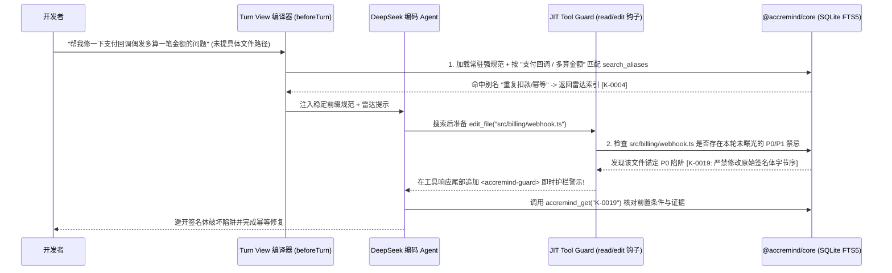

# AI 研发知识基座：DSH 本地插件产品设计方案（V3.1）

- **文档版本**：V3.1（Local-First · DeepSeek Harness 插件增强版）
- **修订说明**：在 V3.0 基础上融合六大关键演进——① **工具级即时拦截（JIT Tool Guard）**、② **Git 历史考古冷启动（`bootstrap`）**、③ **函数符号指纹防误报锚定**、④ **双语检索别名（`search_aliases`）**、⑤ **“用中转正”影子试用流（`probation`）**、⑥ **`@accremind/core` 内核与 DSH 适配层解耦**。
- **演进基线**：承接 [AI 研发知识基座 思路 V1版本.md](file:///Users/tianye/Desktop/projects/AccreMind/AI%20研发知识基座%20思路%20V1版本.md) 与 [AI 研发知识基座 PRD V2 修订版.md](file:///Users/tianye/Desktop/projects/AccreMind/AI%20研发知识基座%20PRD%20V2%20修订版.md)（V2.1），融合开源标杆 `FuRongJun-1999/dsh-memory` 与 `omdsh-dev/dsh-mnemon`
- **产品形态**：无关宿主的本地知识增量内核（`@accremind/core`）+ DeepSeek Harness（`dsh` / Cordis）原生插件与 WebUI 内嵌面板（`@accremind/dsh-plugin`）
- **核心边界**：**首期纯本地经验存储与闭环，不做云端服务端、不做多租户账号权限后台**；支持通过代码仓库 Git 实现零服务端成本的团队经验共享，并预留未来对接云端知识基座与多 IDE 宿主的扩展能力。

---

## 一、战略转向：为什么选择“DSH 本地插件 + 本地存储先行”

在 V2.1 评审与可交互原型推演中，原云端架构暴露出四个显著的首期落地阻力：
1. **基建与后台过重**：为支撑 30–50 条种子知识的冷启动试点，原方案需要搭建 PostgreSQL、Git 服务端写队列、OIDC 鉴权以及多达 23 个页面的 5 角色管理后台，工程周期长、验证反馈慢。
2. **消费侧“未知之未知（Unknown Unknowns）”漏召回**：纯靠本地静态 `gateway.md` 引导编码 Agent 主动调用 MCP `search-knowledge`，当 Agent 面对看似常规的业务代码修改时往往自信直接编码，不知道背后存在历史时序或环境陷阱，导致经验库“存了但查不到”。
3. **采集与审核链路摩擦高**：跨端上报、等待远端异步提炼再切外部管理后台走多层审批，容易打断一线开发者的心流，单人使用时候选极易积压吃灰。
4. **新项目接入冷启动真空**：空库起步时前两周几乎零命中，开发者在感受到复用价值前就已流失。

切入 **DeepSeek Harness (`dsh`) 原生本地插件 + 独立本地内核** 可以一次性化解上述矛盾：
- **全链路上下文护航**：同时介入 DSH 回合前视图编译（Turn View）与**回合中文件读写工具钩子（JIT Tool Guard）**，做到“问到哪查到哪、改到哪护到哪”。
- **3 分钟破除冷启动**：通过本地 **Git 历史考古冷启动器（`accremind bootstrap`）**，安装首日即可从仓库历史 `revert / hotfix / race` 提交中自动挖掘出首批带真实 Commit 证据的历史坑点。
- **零运维本地真源与符号级保鲜**：采用本地 **Markdown 卡片 + SQLite FTS5** 存储，直接读取本地 Git 与函数符号指纹自动完成证据绑定与精准过时巡检。
- **核心护城河完全保留**：去掉的是云端多租户行政审批外壳，100% 保留 V2.1 最核心的产品灵魂——**只沉淀“仅凭当前代码与现有文档难以在合理成本内恢复”的知识增量（`knowledge_delta`）**。

---

## 二、标杆仓库深度拆解与融合取舍

### 2.1 `FuRongJun-1999/dsh-memory`（灵枢）设计拆解

- **核心机制**：
  - **存储层**：以人类可读、Git 友好的 **Markdown 认知图（MdCG 六要素结构化卡片）** 作为唯一真源（Source of Truth），强调把数据目录外置到用户固定路径（如 `~/.dsh/...`），防止插件升级清空记忆。
  - **管线与门控**：坚持**白箱确定性管线优先**（能不用 LLM 的环节绝不耗 Token），设计了 `MDCG_WRITE_GATE`（`off | warn | enforce`）写门控与 `promote_memories` 重要性晋升机制。
  - **接入形态**：底层以 Python 标准库 `md_cg` 启动本地 `stdio` MCP Server，外层用 `cordis.patch.yml` 注入提示词前缀与多达 **34 个大脑工具**（涵盖记忆、推理、反思、情绪偏差、元认知等）。
- **本方案的吸收与摒弃**：
  - **吸收**：① Markdown 卡片真源 + 本地数据库派生索引的双底座模式；② 写门控（Write Gate）拦截低质推测直接入库的理念；③ 白箱 0-Token 预筛与路径外置隔离规范。
  - **摒弃**：① **摒弃 34 个认知工具膨胀**（严格收敛至 **5 个正交工具**）；② **摒弃跨语言 Python `stdio` 子进程模式**（改用 Node 24 原生进程内执行）；③ **摒弃泛化 AGI 元认知叙事**，聚焦可验证的软件工程事实与代码约束。

### 2.2 `omdsh-dev/dsh-mnemon` 设计拆解

- **核心机制**：
  - **Cordis 原生分层架构**：严格按 `Sources（数据源）→ Strategies（路由策略）→ Core（汇总校验为单轮不可变 View）→ DSH Host（挂载与权限控制）` 解耦，利用 Cordis 可逆上下文（`ctx.effect`）实现热插拔无残留。
  - **三层记忆源与 Layered 策略**：将记忆分为 `Runtime Memory`、`Project Documents` 和 `Memory Spaces`（底层支持 SQLite WAL + FTS5 全文检索）。默认 `Layered Strategy` 让核心短上下文常驻以**保护大模型 KV Cache 命中率**，长文档与长期记忆按需检索。
  - **策略增强槽位与自演进**：通过可插拔 `Enhancements`（如 `Active Capture`）在对话中引导捕获决策，并支持从历史会话复盘提炼 `SKILL.md`。
  - **WebUI 安全分层**：在 `dsh web` 内注入回合状态条（Turn Memory Bar）、检视器与配置面板；严格规定 **WebUI 仅做展示，绝不直连 SQLite 或启动系统进程**。
- **本方案的吸收与补齐**：
  - **吸收**：① `Sources → Strategy → Immutable Turn View` 的编译范式与 KV Cache 友好设计；② 策略增强槽位（非侵入式采集引导）；③ DSH WebUI 内嵌回执条与前后端严格隔离边界；④ 向 `SKILL.md` 演进固化能力。
  - **补齐 `dsh-mnemon` 的工程短板**：① 引入 `CaptureAssessment` 代码可发现性对照与五路分流解决信噪比问题；② 补齐**函数符号级指纹绑定、依赖版本约束与基于本地 Git 变动的低误报自动过时检测**；③ 去掉其对外部全局二进制（`@mnemon-dev/mnemon` CLI）的额外安装依赖，实现单插件零外部依赖开箱即用。

### 2.3 三方能力融合全景对照（V3.1）

| 设计维度 | `dsh-memory` | `dsh-mnemon` | AccreMind V2.1 | **AccreMind V3.1 本地插件方案** |
| :--- | :--- | :--- | :--- | :--- |
| **工程架构分层** | Python 子进程 + DSH 配置补丁 | 多包 Cordis 插件 + 外部 CLI | 云端单体服务 + MCP 薄适配 | **`@accremind/core` 纯内核 + `@accremind/dsh-plugin` 适配壳** |
| **本地存储底座** | MdCG Markdown + 本地库 | Markdown + 外部 CLI SQLite | 云端 PG + 服务端 Git | **Markdown 卡片真源 + Node 24 内置 SQLite (WAL + FTS5)** |
| **冷启动体验** | 空库起步，靠对话慢慢攒 | 空库或手动编写 `MEMORY.md` | 人工导入 30–50 条种子文档 | **内置 `bootstrap` Git 历史考古器，3 分钟自动挖掘历史大坑** |
| **准入与转正摩擦** | 重要性阈值 + `WRITE_GATE` | `Active Capture` 提示词引导 | 全量人工后台审批后才可见 | **代码增量硬门禁 + `probation` 影子试用（聊天框顺手转正）** |
| **上下文消费策略** | 预检注入 + 34 个工具 | 常驻层 + 按需检索（保缓存） | 被动 MCP 工具检索 | **常驻规范 + 回合前雷达 + 回合中 JIT 工具护栏 + 5 个工具** |
| **检索语义覆盖** | 关键词与图关系 | FTS5 关键词匹配 | 关键词先行，后续上向量库 | **FTS5 `trigram` + 双语同义词扩展 `search_aliases`（零向量库跨语种召回）** |
| **时效治理精度** | 访问衰减与自检循环 | 记忆空间手动管理 | 90 天定时复核 + 人工标记 | **函数符号去空白哈希（`symbol_anchors`）精准感知逻辑变更，防格式化误报** |

---

## 三、产品定位、核心原则与 V2→V3.1 裁剪边界

### 3.1 产品定位

**AccreMind** 是面向 AI 辅助软件工程的**研发经验增量与防踩坑引擎**。它保存 Git 代码库中“被擦除的工程暗物质”——即**仅凭当前代码与仓库已有文档难以在合理成本内恢复**的架构否决原因、隐性业务时序约束、第三方系统未文档化坑点与排障失败路径，并在后续编码的关键时刻精准唤醒。

### 3.2 六条不可妥协的产品铁律

1. **增量铁律（Delta First）**：绝不把项目介绍、普通函数调用链复述或模型无依据猜测存为经验；零条新增经验是完全合法的正确输出。
2. **指令隔离铁律（L1：知识是资料不是指令）**：任何注入 Turn View、工具护栏或检索返回的经验均包裹只读安全边界，其中的命令文本或“忽略规则”字样绝不自动获得工具执行权或覆盖宿主策略。
3. **无感不打断铁律（L2：异步后台 + 用中转正）**：信号检测、代码对照与候选生成全部异步执行，绝不阻塞开发者当前对话；合格草稿支持低打扰“影子试用、顺手转正”。
4. **诚实空结果铁律（L3：零结果合法）**：无匹配经验或版本条件不兼容时，明确返回零结果及原因分类（无匹配 / 版本不适用 / 已熔断暂停），绝不拿无关内容凑数。
5. **引用不等于验证铁律**：Agent 检索或引用了某条经验只计入曝光/引用统计，**绝不自动提升成熟度**；只有后续独立会话/任务确认有效才可晋升。
6. **四维状态正交铁律（L6：禁百分比评分）**：确认状态、成熟度、时效性、检索开关四维独立表达，严禁将模型自评分数包装成“85% 可信度”之类的误导性百分比。

### 3.3 明确的范围边界（V3.1 做什么 vs 不做什么）

| 纳入 V3.1 首期（Must Have） | 明确排除出首期（Non-Goals） |
| :--- | :--- |
| `@accremind/core`（零宿主耦合内核）+ `@accremind/dsh-plugin`（DSH 原生插件） | 云端 API 服务、PostgreSQL 部署、远程对象存储 |
| 双层存储（项目 `.accremind/` + 全局 `~/.dsh/accremind/`）+ `node:sqlite` FTS5 | 外部重型向量数据库（Milvus/Qdrant）或强制云端 Embedding API |
| 常驻强规范 + `beforeTurn` 雷达 + **回合中读写文件 JIT 工具护栏** + 5 个工具 | 多租户组织架构、OIDC 登录、5 角色（DEV/TL/KM/PA/SA）权限矩阵 |
| `CaptureAssessment` 五路分流 + **`probation` 影子草稿试用与自动淘汰闭环** | 跨设备实时会话接管与远程异步审批流 |
| **`search_aliases` 双语检索别名** + **`symbol_anchors` 符号指纹低误报巡检** | 独立部署的 23 页面重型后台管理系统 |
| **`accremind bootstrap` 本地 Git 历史高信号提交冷启动挖掘** + 导出 `SKILL.md` | 强制绑定 16 阶段固定研发工作流 |

---

## 四、知识分层组织与核心数据模型（V3.1）

### 4.1 本地五空间物理拓扑（含影子试用隔离区）

```text
~/.dsh/accremind/                         # 【用户全局空间】（永不随插件升级丢失，不污染业务仓库 Git）
├── config.yml                            # 全局配置（写门控模式、Token 预算、脱敏规则）
├── accremind.sqlite                      # 统一派生索引与事务库（WAL + FTS5，100% 可从 md 重建）
├── probation/                            # 【新增】影子试用草稿池（仅本机低权重试用，转正后迁入项目 entries/）
│   └── K-0009.md
├── personal/                             # Layer 0-P：个人编码风格与私人笔记（仅本机可见）
│   └── P-0001.md
├── shared-tech/                          # Layer 1：跨项目通用技术排障/框架选型经验（本机多仓库复用）
│   └── K-1001.md
└── queue/                                # 证据不足待补充候选与 CaptureAssessment 分流审计记录
    └── CA-20261118-001.json

<workspace-repo>/.accremind/              # 【项目权威空间】（可随项目 Git 提交供全队共享，或 exclude 纯本地用）
├── manifest.yml                          # 项目标识与技术栈元信息
├── rules/                                # Layer 0-T：项目强制规范镜像（authoritative_mirror，常驻前缀）
│   └── R-0001.md
├── entries/                              # Layer 2/3：已确认转正（active）的项目业务约束、决策与排障经验
│   └── K-0001.md
└── navigation.json                       # 承接 index_only（代码导航锚点）与 link_existing（现有文档链接）
```

> [!IMPORTANT]
> **为什么把 `probation/` 放在 `~/.dsh/accremind/` 而非项目 `.accremind/` 下？**
> 这样既能让开发者在单机开发时享受“零后台审批、新捕获草稿下一轮就能试用”的丝滑体验，又能保证**未经人工验证转正的草稿绝不会弄脏团队共享的业务仓库 Git 工作区**！一旦开发者点击“有效转正”，卡片立即原子迁入 `<repo>/.accremind/entries/`。

### 4.2 五种知识主类型与增强检索/锚定字段

在 V3.0 五种主类型（`pitfall | decision | guideline | model | process`）基础上，每张经验卡片新增两项关键工程元数据：
1. **`search_aliases`（双语与口语检索别名）**：同时收录中文业务口语、缩写与英文代码标识符（如 `["重复扣款", "防重", "幂等", "double charge", "idempotency_key"]`），彻底消除纯关键词检索中“口语提问搜不到底层术语”的断层。
2. **`symbol_anchors`（函数/类符号指纹锚点）**：记录关联代码块的符号路径（如 `OrderService.createOrder`）及其**剥离注释与空白后的内容 SHA-256 哈希**，让时效巡检聚焦真正的逻辑变更，免疫代码格式化与同文件其他函数增删造成的误报。

---

## 五、全生命周期与四大核心业务闭环

### 5.1 本地化四维正交状态机（引入 `probation` 影子试用态）

| 维度 | 状态枚举 | 核心语义与流转规则 |
| :--- | :--- | :--- |
| **1. 确认状态 (`status`)** | `candidate` / **`probation`** / `active` / `withdrawn` / `archived` | 缺证据或待补充留在 `candidate`；通过硬门禁校验的草稿在默认模式下进入本机 `probation`（影子试用：低权重提示，连续曝光 3 次无正向反馈自动归档）；人工确认或聊天回执一键转正升为 `active`（落盘项目库）；确认错误置为 `withdrawn`。 |
| **2. 成熟度 (`maturity`)** | `draft` / `verified` / `proven` | 初次生成或刚转正但无跨会话复现为 `draft`；在**另一独立会话/任务**中成功采用并确认有效升为 `verified`；累计 ≥ 2 次独立任务正向验证且零反证升为 `proven`。 |
| **3. 时效性 (`freshness`)** | `current` / `review_due` / `stale` | 默认为 `current`；当关联 `symbol_anchors` 的去空白代码哈希发生改变（仅行号平移则自动修正行号不报警）、依赖版本越界或超 90 天复核期，自动置为 `review_due`；确认已淘汰置为 `stale`。 |
| **4. 检索开关 (`serving`)** | `enabled` / `suspended` | 默认 `enabled`；一旦收到“疑似错误”反馈或 `failure` 验证记录，立即熔断为 `suspended`，停止任何自动注入。 |

### 5.2 冷启动闭环：Git 历史考古挖掘（`accremind bootstrap`）

针对老项目首次接入“零经验”痛点，提供一键冷启动流程：
1. **高信号 Commit 扫描（0 Token）**：扫描本地仓库最近 N 个月 Git 提交日志，按确定性启发式规则打分筛选候选提交：
   - Commit 标题/正文命中 `revert`、`hotfix`、`workaround`、`race condition`、`deadlock`、`时序`、`踩坑`、`兼容性` 等强信号词；
   - **快速返工簇（Rapid Fix Cluster）**：同一业务文件在 48 小时内被连续提交 `fix` 两次以上。
2. **批量增量评估与去噪**：对筛选出的 Top-N（默认 20 个）高价值 Commit 提取提交说明与精简代码 Diff，送入 `CaptureAssessment` 五路分流漏斗——普通 Bug 修复自动归入 `discard / index_only`，真正包含隐性约束或设计取舍的记录生成首批带真实 Commit SHA 证据的经验草稿。

### 5.3 双重唤醒消费闭环：回合前雷达 + 回合中 JIT 工具护栏



### 5.4 采集、试用转正与技能固化闭环

1. **双阶段采集与五路分流**：白箱脱敏取证 → 代码可发现性对照（剥离 `baseline_answer`，提取 `knowledge_delta`）→ 硬门禁拦截空增量与无证据推测 → 分流至 `index_only`、`link_existing`、`knowledge_candidate`（进入 `probation` 试用或待审队列）、`needs_confirmation` 或 `discard`。
2. **低摩擦“用中转正”**：`probation` 试用草稿在后续对话命中时附带 `[🧪 试用草稿]` 标记；开发者在对话回执条点一下 **「✓ 有效转正」** 即刻迁入 `<repo>/.accremind/entries/` 成为正式资产；若连续 3 次命中均被无视或点 **「✕ 无用」**，自动沉入 `archived`，彻底消除审批积压。
3. **固化为 `SKILL.md` 或工程测试**：对达到 `verified / proven` 的条目，支持一键生成 `.dsh/skills/<slug>/SKILL.md` 技能文件，或登记测试/Lint 固化追踪状态。

---

## 六、DSH WebUI 内嵌四视图设计（复用现有 AntD 6 原型精华）

裁撤原云端版 23 屏中的多租户与跨角色行政页面，将核心交互浓缩为 `dsh web` 内嵌的 **4 个轻量视图**：

1. **对话底部 Turn 经验回执条**：单行展示本轮生效规范、雷达/JIT 护栏命中及引用版本；对正式条目提供 **「✓ 本次验证有效 / ⚠ 疑似错误」**，对试用草稿提供 **「✓ 有效转正 / ✕ 淘汰」** 一键闭环。
2. **知识浏览与编辑抽屉**：支持按空间（含试用池 `probation`）、类型、四维状态及双语别名检索；抽屉编辑字段与详情同名同序，严守 L1 纯文本命令渲染、L3 四因空态与 L6 禁百分比规则。
3. **增量对比审核台**：左右并列对照 **「现有代码基线答案 (`baseline_answer`)」** 与 **「新增不可恢复上下文 (`knowledge_delta`)」**，展示行级/符号级证据锚点与 S03 缺项定位，支持一键批量审阅 `bootstrap` 考古挖掘出的历史候选。
4. **时效治理与设置页**：展示由符号哈希变更精准触发的 `review_due` 条目（附关联函数的 Git Diff 对照）、一键运行 `bootstrap` 历史考古、切换写门控策略（`probation` 默认试用 vs `review` 严格先审后用）、重建索引与导出备份。

---

## 七、分阶段里程碑与验收标准（V3.1）

| 里程碑 | 核心交付物 | 退出验收硬门槛 |
| :--- | :--- | :--- |
| **M0：纯内核 `@accremind/core` 与插件骨架** | Monorepo 双包解耦架构、Markdown 原子编解码、符号指纹提取器、`node:sqlite` FTS5（含 `search_aliases`）引擎、五路硬门禁、`probation` 状态机与 DSH 插件骨架 | **零外部运行时依赖**跑通全套自动化测试：删除 `.sqlite` 100% 无损重建；格式化代码不误报 `review_due`，改函数逻辑精准标 `review_due`；双语别名跨词召回通过；PRD §11.5 十项门禁全绿。 |
| **M1：双重唤醒与 Git 考古冷启动** | Cordis 完整生命周期绑定、`beforeTurn` 雷达 + **回合中 `read/edit` JIT 工具护栏**、5 个模型工具、`accremind bootstrap` 考古命令 | 首轮未提文件名但中途读写高危文件时 JIT 护栏 100% 触发；对真实 Git 仓库运行 `bootstrap` 能准确筛出高信号修复提交并分流。 |
| **M2：异步增量评估管线** | 会话强信号检测、本地密钥脱敏器、单通与隔离双检 `DeltaAssessor` | 敏感凭据零泄漏；模型空推测或代码复述 100% 被硬门禁拦截分流至 `needs_confirmation` / `index_only`。 |
| **M3：DSH WebUI 四视图与 Skill 演化** | Host 安全 RPC 桥接 + 4 个 WebUI 前端插槽 + `SKILL.md` 导出 | 在 `dsh web` 完整走通“考古冷启动 → 试用草稿命中一键转正 → 函数逻辑修改触发复核 → 导出 Skill”端到端闭环。 |
