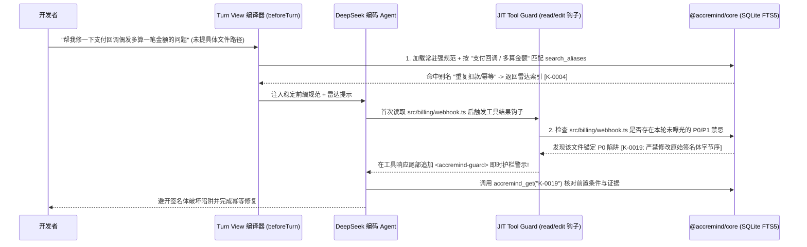

# AI 研发知识基座：DSH 本地插件产品设计方案（V3.2）

- **文档版本**　V3.2 产品设计稿。工作台右上角另行显示实际安装的插件版本。
- **修订范围**　沿用 V3.1 的本地工作台、增量审核、影子试用和符号复核。V3.2 规定完整经验如何保存、既有文档如何接入、改代码时如何复用，以及新证据怎样修订已有经验。R1–R3 均为待交付范围，验收见 §七。
- **演进依据**　承接 [V1 产品思路](<AI 研发知识基座 思路 V1版本.md>)、[V2.1 PRD](<AI 研发知识基座 PRD V2 修订版.md>) 与 V3.1 插件方案。实现契约见[配套技术方案](<AI 研发知识基座 DSH本地插件技术实现方案 V3.md>)。外部案例来自 `optimos-intco-frontend` 仓库的 `.agents/skills/compound-engineering/`，下文涉及旧库的路径均相对该目录。
- **产品形态**：无关宿主的本地知识增量内核（`@accremind/core`）+ DeepSeek Harness（`dsh` / Cordis）原生插件与 WebUI 内嵌面板（`@accremind/dsh-plugin`）
- **核心边界**：**首期纯本地经验存储与闭环，不做云端服务端、不做多租户账号权限后台**；支持通过代码仓库 Git 实现零服务端成本的团队经验共享，并预留未来对接云端知识基座与多 IDE 宿主的扩展能力。

---

## 一、战略转向：为什么选择“DSH 本地插件 + 本地存储先行”

在 V2.1 评审与可交互原型推演中，原云端架构暴露出四个显著的首期落地阻力：
1. **基建与后台过重**：为支撑 30–50 条种子知识的冷启动试点，原方案需要搭建 PostgreSQL、Git 服务端写队列、OIDC 鉴权以及多达 23 个页面的 5 角色管理后台，工程周期长、验证反馈慢。
2. **消费侧“未知之未知（Unknown Unknowns）”漏召回**：纯靠本地静态 `gateway.md` 引导编码 Agent 主动调用 MCP `search-knowledge`，当 Agent 面对看似常规的业务代码修改时往往自信直接编码，不知道背后存在历史时序或环境陷阱，导致经验库“存了但查不到”。
3. **采集与审核链路摩擦高**：跨端上报、等待远端异步提炼再切外部管理后台走多层审批，容易打断一线开发者的心流，单人使用时候选极易积压吃灰。
4. **新项目接入冷启动真空**：空库起步时前两周几乎零命中，开发者在感受到复用价值前就已流失。

切入 **DeepSeek Harness (`dsh`) 原生本地插件 + 独立本地内核** 可以一次性化解上述矛盾：
- **按任务唤醒经验**　回合前根据提问和已知文件检索，回合中可在 DSH 工具结果中追加新发现的文件提示。当前钩子发生在工具执行之后，直接写文件的首次提示时点见 §5.3。
- **接入已有项目**　现有 Git 考古可筛选高信号提交，有可用模型时按选择提炼。V3.2 增加本地经验文档预览，用户分别决定哪些原文值得保留、哪些只需建立导航。
- **零运维本地真源与符号级保鲜**：采用本地 **Markdown 卡片 + SQLite FTS5** 存储，直接读取本地 Git 与函数符号指纹自动完成证据绑定与精准过时巡检。
- **正式经验准入**　沿用 V2.1 的核心要求，沉淀**仅凭当前代码与现有文档难以在合理成本内恢复的知识增量（`knowledge_delta`）**。可直接恢复的内容保留准确的代码或文档入口。

---

## 二、标杆仓库深度拆解与融合取舍

### 2.1 `FuRongJun-1999/dsh-memory`（灵枢）设计拆解

- **核心机制**：
  - **存储层**：以人类可读、Git 友好的 **Markdown 认知图（MdCG 六要素结构化卡片）** 作为唯一真源（Source of Truth），强调把数据目录外置到用户固定路径（如 `~/.dsh/...`），防止插件升级清空记忆。
  - **管线与门控**：坚持**白箱确定性管线优先**（能不用 LLM 的环节绝不耗 Token），设计了 `MDCG_WRITE_GATE`（`off | warn | enforce`）写门控与 `promote_memories` 重要性晋升机制。
  - **接入形态**：底层以 Python 标准库 `md_cg` 启动本地 `stdio` MCP Server，外层用 `cordis.patch.yml` 注入提示词前缀与多达 **34 个大脑工具**（涵盖记忆、推理、反思、情绪偏差、元认知等）。
- **本方案的吸收与摒弃**：
  - **吸收**：① Markdown 卡片真源 + 本地数据库派生索引的双底座模式；② 写门控（Write Gate）拦截低质推测直接入库的理念；③ 白箱 0-Token 预筛与路径外置隔离规范。
  - **摒弃**：① **摒弃 34 个认知工具膨胀**（严格收敛至 **5 个正交工具**）；② **摒弃跨语言 Python `stdio` 子进程模式**（改用 Node 24 原生进程内执行）；③ **摒弃泛化 AGI 元认知叙事**，聚焦可验证的软件工程事实与代码约束。

### 2.2 `omdsh-dev/dsh-mnemon` 设计拆解

- **核心机制**：
  - **Cordis 原生分层架构**：严格按 `Sources（数据源）→ Strategies（路由策略）→ Core（汇总校验为单轮不可变 View）→ DSH Host（挂载与权限控制）` 解耦，利用 Cordis 可逆上下文（`ctx.effect`）实现热插拔无残留。
  - **三层记忆源与 Layered 策略**：将记忆分为 `Runtime Memory`、`Project Documents` 和 `Memory Spaces`（底层支持 SQLite WAL + FTS5 全文检索）。默认 `Layered Strategy` 让核心短上下文常驻以**保护大模型 KV Cache 命中率**，长文档与长期记忆按需检索。
  - **策略增强槽位与自演进**：通过可插拔 `Enhancements`（如 `Active Capture`）在对话中引导捕获决策，并支持从历史会话复盘提炼 `SKILL.md`。
  - **WebUI 安全分层**：在 `dsh web` 内注入回合状态条（Turn Memory Bar）、检视器与配置面板；严格规定 **WebUI 仅做展示，绝不直连 SQLite 或启动系统进程**。
- **本方案的吸收与补齐**：
  - **吸收**：① `Sources → Strategy → Immutable Turn View` 的编译范式与 KV Cache 友好设计；② 策略增强槽位（非侵入式采集引导）；③ DSH WebUI 内嵌回执条与前后端严格隔离边界；④ 向 `SKILL.md` 演进固化能力。
  - **补齐 `dsh-mnemon` 的工程短板**：① 引入 `CaptureAssessment` 代码可发现性对照与五路分流解决信噪比问题；② 补齐**函数符号级指纹绑定、依赖版本约束与基于本地 Git 变动的低误报自动过时检测**；③ 去掉其对外部全局二进制（`@mnemon-dev/mnemon` CLI）的额外安装依赖，实现单插件零外部依赖开箱即用。

### 2.3 三方能力融合全景对照（V3.1）

| 设计维度 | `dsh-memory` | `dsh-mnemon` | AccreMind V2.1 | **AccreMind V3.1 本地插件方案** |
| :--- | :--- | :--- | :--- | :--- |
| **工程架构分层** | Python 子进程 + DSH 配置补丁 | 多包 Cordis 插件 + 外部 CLI | 云端单体服务 + MCP 薄适配 | **`@accremind/core` 纯内核 + `@accremind/dsh-plugin` 适配壳** |
| **本地存储底座** | MdCG Markdown + 本地库 | Markdown + 外部 CLI SQLite | 云端 PG + 服务端 Git | **Markdown 卡片真源 + Node 24 内置 SQLite (WAL + FTS5)** |
| **冷启动体验** | 空库起步，靠对话慢慢攒 | 空库或手动编写 `MEMORY.md` | 人工导入 30–50 条种子文档 | **内置 `bootstrap` Git 历史考古器，3 分钟自动挖掘历史大坑** |
| **准入与转正摩擦** | 重要性阈值 + `WRITE_GATE` | `Active Capture` 提示词引导 | 全量人工后台审批后才可见 | **代码增量硬门禁 + `probation` 影子试用（聊天框顺手转正）** |
| **上下文消费策略** | 预检注入 + 34 个工具 | 常驻层 + 按需检索（保缓存） | 被动 MCP 工具检索 | **常驻规范 + 回合前雷达 + 回合中 JIT 工具护栏 + 5 个工具** |
| **检索语义覆盖** | 关键词与图关系 | FTS5 关键词匹配 | 关键词先行，后续上向量库 | **FTS5 `trigram` + 双语同义词扩展 `search_aliases`（零向量库跨语种召回）** |
| **时效治理精度** | 访问衰减与自检循环 | 记忆空间手动管理 | 90 天定时复核 + 人工标记 | **函数符号去空白哈希（`symbol_anchors`）精准感知逻辑变更，防格式化误报** |

---

## 三、产品定位、核心原则与交付范围

### 3.1 产品定位

**AccreMind** 帮助开发者在改代码前找到适用的经验，在改完后保存可验证的新发现。业务领域知识记录规则、术语、时序和适用边界，项目知识记录具体系统的约束、取舍和排障过程。两者均可关联权威原文、代码与测试。能从权威文档直接回答的问题提供定位；正式经验保留额外的结论、理由、边界和验证证据。

### 3.2 六条不可妥协的产品铁律

1. **增量铁律（Delta First）**：绝不把项目介绍、普通函数调用链复述或模型无依据猜测存为经验；零条新增经验是完全合法的正确输出。
2. **指令隔离铁律（L1：知识是资料不是指令）**：任何注入 Turn View、工具护栏或检索返回的经验均包裹只读安全边界，其中的命令文本或“忽略规则”字样绝不自动获得工具执行权或覆盖宿主策略。
3. **无感不打断铁律（L2：异步后台 + 用中转正）**：信号检测、代码对照与候选生成全部异步执行，绝不阻塞开发者当前对话；合格草稿支持低打扰“影子试用、顺手转正”。
4. **诚实空结果铁律（L3：零结果合法）**：无匹配经验或版本条件不兼容时，明确返回零结果及原因分类（无匹配 / 版本不适用 / 已熔断暂停），绝不拿无关内容凑数。
5. **引用不等于验证铁律**：Agent 检索或引用了某条经验只计入曝光/引用统计，**绝不自动提升成熟度**；只有后续独立会话/任务确认有效才可晋升。
6. **四维状态正交铁律（L6：禁百分比评分）**：确认状态、成熟度、时效性、检索开关四维独立表达，严禁将模型自评分数包装成“85% 可信度”之类的误导性百分比。

### 3.3 本地插件基础与本版增量

| V3.1 基础范围 | 首期排除项 |
| :--- | :--- |
| `@accremind/core`（零宿主耦合内核）+ `@accremind/dsh-plugin`（DSH 原生插件） | 云端 API 服务、PostgreSQL 部署、远程对象存储 |
| 双层存储（项目 `.accremind/` + 全局 `~/.dsh/accremind/`）+ `node:sqlite` FTS5 | 外部重型向量数据库（Milvus/Qdrant）或强制云端 Embedding API |
| 常驻强规范 + `beforeTurn` 雷达 + **回合中读写文件 JIT 工具护栏** + 5 个工具 | 多租户组织架构、OIDC 登录、5 角色（DEV/TL/KM/PA/SA）权限矩阵 |
| `CaptureAssessment` 五路分流 + **`probation` 影子草稿试用与自动淘汰闭环** | 跨设备实时会话接管与远程异步审批流 |
| **`search_aliases` 双语检索别名** + **`symbol_anchors` 符号指纹低误报巡检** | 独立部署的 23 页面重型后台管理系统 |
| **`accremind bootstrap` 本地 Git 历史高信号提交冷启动挖掘** + 导出 `SKILL.md` | 强制绑定 16 阶段固定研发工作流 |

**工作区已有基础。** 知识库支持五种归属、五种主类型与四维状态筛选，候选可补证并决定去向，Git 提交可先扫描后提炼。回合回执、锚点差异复核、正文修订和单条 Skill 导出已有入口。现有“总结”按已保存结论和增量浏览当前结果。已有的代码基线比较、条目修订号和导出动作，各自只覆盖下文闭环的一部分。

**V3.2 待交付。** R1 保证多节正文、示例、例外与证据在录入、读取/复制原文、修改及重建后完整保留；R2 支持旧库试读、按节增量接入与按需引用；R3 支持既有条目比较、条件冲突裁决、历史快照、验证更正与衍生 Skill 同步。归属与物理空间继续独立，领域和项目经验均受当前仓库约束。

---

## 四、知识组织、正文与证据

### 4.1 本地五空间物理拓扑（含影子试用隔离区）

```text
~/.dsh/accremind/                         # 【用户全局空间】（永不随插件升级丢失，不污染业务仓库 Git）
├── accremind.sqlite                      # 卡片/检索索引与候选、验证、使用等运行记录
├── probation/<workspace-id>/             # 当前仓库的本机试用草稿；转正后迁入项目 entries/
│   └── K-0009.md
├── personal/                             # Layer 0-P：个人编码风格与私人笔记（仅本机可见）
│   └── P-0001.md
├── shared-tech/                          # Layer 1：跨项目通用技术排障/框架选型经验（本机多仓库复用）
│   └── K-1001.md
└── queue/<workspace-id>/                 # 本地异步采集任务文件

<workspace-repo>/.accremind/              # 【项目权威空间】（可随项目 Git 提交供全队共享，或 exclude 纯本地用）
├── rules/                                # Layer 0-T：项目强制规范镜像（authoritative_mirror，常驻前缀）
│   └── R-0001.md
├── entries/                              # 当前仓库的 domain / project 条目
│   └── K-0001.md
└── navigation.json                       # 承接 index_only（代码导航锚点）与 link_existing（现有文档链接）
```

> [!IMPORTANT]
> **为什么把 `probation/` 放在 `~/.dsh/accremind/` 而非项目 `.accremind/` 下？**
> 这样既能让开发者在单机开发时享受“零后台审批、新捕获草稿下一轮就能试用”的丝滑体验，又能保证**未经人工验证转正的草稿绝不会弄脏团队共享的业务仓库 Git 工作区**！一旦开发者点击“有效转正”，卡片立即原子迁入 `<repo>/.accremind/entries/`。

### 4.2 检索与锚定基础

在 V3.0 五种主类型（`pitfall | decision | guideline | model | process`）基础上，每张经验卡片新增两项关键工程元数据：
1. **`search_aliases`（双语与口语检索别名）**：同时收录中文业务口语、缩写与英文代码标识符（如 `["重复扣款", "防重", "幂等", "double charge", "idempotency_key"]`），彻底消除纯关键词检索中“口语提问搜不到底层术语”的断层。
2. **`symbol_anchors`（函数/类符号指纹锚点）**：记录关联代码块的符号路径（如 `OrderService.createOrder`）及其**剥离注释与空白后的内容 SHA-256 哈希**，让时效巡检聚焦真正的逻辑变更，免疫代码格式化与同文件其他函数增删造成的误报。

### 4.3 知识规格与列表口径（R1）

| 维度 | 编辑与展示规则 |
| --- | --- |
| 归属与存储 | 每条一个归属。领域知识保存业务实体、规则和约束，项目知识保存当前项目的实现约定；另有个人、团队规范、通用技术。领域/项目可在当前仓库内显式改选，原记录缺少新分类时沿用原归属。团队、个人或共享的迁移另行确认可见边界。 |
| 主类型与主题 | 每条一个主类型，见 §4.4。主题用于集合“表单、表格、支付回调”等相关条目；标签是多个受控入口词，检索别名承接同义词、缩写和代码标识。导入时保留旧 `domain=form` 作为来源主题，人工选业务归属；保留旧 `type=fix/pattern/ref` 原值供对照。主题、标签、类型与归属可组合查询。 |
| 摘要与原文 | 卡片与总结使用已保存的结论和知识增量，必须带改变结论的前提或例外。详情展开完整节、原文片段和来源位置。知识库“总结”是同一组结果的摘要阅读方式；跨条目的需求总结需要单独的需求、结果与 commit 来源。 |
| 日期与版本 | 并列创建时间、正文更新日期和当前修订最近独立验证。编辑文案只改正文日期。导入的 `last_updated`、`validated`、`validated_at` 及原版本在来源卡片中展示，当前修订可以同时显示“尚无独立验证”。下次复核日单列。已测版本记录实际运行的依赖精确版本、环境与日期，兼容范围记录有依据的适用约束。 |
| 来源、证据与标识 | 条目拥有稳定 ID；修订有版本；可独立引用的子节有稳定锚点。记录来源文件和标题路径、可取得的来源修订（Git SHA 或内容摘要）、涵盖的原文段落。证据按结论记录来源定位、方法、观察结果、覆盖与未覆盖项。保留原始 Markdown、代码语言/缩进、列表、表格与标题层级。敏感片段在预览阶段明确标出并可局部排除。 |

浏览时先按归属和类型定位，再按主题、标签或状态缩小范围。标签优先选择已有词，新词确认后进入词表，别名可关联标准词。检索索引和计数从已保存条目派生。范围按钮计数遵循当前其它筛选，视图切换沿用查询和排序；统计中的“全部”与“可自动检索”分别标明口径。旧卡未登记主题、历史版本或已测环境时原样显示缺项。

### 4.4 五种正文与渐进阅读（R1）

共用短字段为标题、核心结论、代码外增量、适用条件、例外、来源及验证情况。录入时先选类型，展开其正文提示；已有旧卡可直接阅读和编辑，缺少的扩展段按需补全。

| 类型 | 类型专属正文提示 | 可复核的产物举例 |
| --- | --- | --- |
| 排障陷阱 `pitfall` | 症状与触发环境 → 最小复现 → 根因、失败尝试 → 修复与预防 → 已验证的范围 | 修复前失败和修复后通过的同一回归，或可复现的组件片段 |
| 架构决策 `decision` | 当时约束与候选方案 → 选定方案与取舍 → 放弃项及原因 → 重开决策的条件 | 原决议、实验对照、关键 commit |
| 规范 `guideline` | 适用对象 → 应遵守的要求与缘由 → 正反例、例外与权威来源 → 检查方式 | 已存在的 lint、契约或人工核对依据 |
| 领域模型 `model` | 术语、实体和关系 → 不变量/状态变化 → 业务例子、反例与适用业务边界 | 已确认规则、业务事件样例、合同或需求章节 |
| 操作流程 `process` | 触发条件与输入 → 有序步骤、分支与失败恢复 → 输出、结束条件和验证 | 实际运行记录、交接检查项或操作结果 |

一个条目可有多个同级或嵌套场景。独立场景保存自己的适用环境、证据与验证时间，保留父条目 ID。代码类结论优先给最小片段或可定位的测试，决策与业务规则可直接引用权威原文。列表露出结论、关键边界与验证状态；点开场景后，按需展开根因、完整代码、失败路径、证据和原文。折叠和摘要均保留回到原段落的入口，普通读写或索引重建须保全未编辑的节。

---

## 五、从接入、复用到修订

### 5.1 本地化四维正交状态机（引入 `probation` 影子试用态）

| 维度 | 状态枚举 | 核心语义与流转规则 |
| :--- | :--- | :--- |
| **1. 确认状态 (`status`)** | `candidate` / **`probation`** / `active` / `withdrawn` / `archived` | 待补证留在候选队列；合格草稿按工作区写入策略进入本机试用或人工审核。试用达曝光上限提示处理，真实回合允许在当次回执反馈后再执行归档策略。批准正式使用写入 `active`；撤回与归档有各自原因。 |
| **2. 成熟度 (`maturity`)** | `draft` / `verified` / `proven` | 初次生成或刚转正但无跨会话复现为 `draft`；在**另一独立会话/任务**中成功采用并确认有效升为 `verified`；累计 ≥ 2 次独立任务正向验证且零反证升为 `proven`。 |
| **3. 时效性 (`freshness`)** | `current` / `review_due` / `stale` | 默认为 `current`；当关联 `symbol_anchors` 的去空白代码哈希发生改变（仅行号平移则自动修正行号不报警）、依赖版本越界或超 90 天复核期，自动置为 `review_due`；确认已淘汰置为 `stale`。 |
| **4. 检索开关 (`serving`)** | `enabled` / `suspended` | 默认 `enabled`；一旦收到“疑似错误”反馈或 `failure` 验证记录，立即熔断为 `suspended`，停止任何自动注入。 |

四维状态属于条目修订。R3 对可独立复用的场景登记验证范围，单一场景的新证据不能自动证明其余场景。标记失效后要提供重评依据进入待复核；核对当前证据后才能恢复时效。若检索已暂停，解决暂停原因、明确恢复检索是单独的动作。

### 5.2 冷启动闭环：Git 历史考古挖掘（`accremind bootstrap`）

针对老项目首次接入“零经验”痛点，提供一键冷启动流程：
1. **高信号 Commit 扫描（0 Token）**：扫描本地仓库最近 N 个月 Git 提交日志，按确定性启发式规则打分筛选候选提交：
   - Commit 标题/正文命中 `revert`、`hotfix`、`workaround`、`race condition`、`deadlock`、`时序`、`踩坑`、`兼容性` 等强信号词；
   - **快速返工簇（Rapid Fix Cluster）**：同一业务文件在 48 小时内被连续提交 `fix` 两次以上。
2. **批量增量评估与去噪**：对筛选出的 Top-N（默认 20 个）高价值 Commit 提取提交说明与精简代码 Diff，送入 `CaptureAssessment` 五路分流漏斗——普通 Bug 修复自动归入 `discard / index_only`，真正包含隐性约束或设计取舍的记录生成首批带真实 Commit SHA 证据的经验草稿。

#### 5.2.1 已有经验库接入（R2）

在“治理与设置 → 接入已有经验库”选择当前工作区内目录或文件，先只读预览，可从知识库空态进入。识别入口目录、索引、模板与正文；对正文按 Markdown 标题解析场景，代码围栏里的 `#` 保留为代码。预览列出文件、父/子标题、原文、可识别的元数据、缺项、疑似重复、来源边界与预计去向。用户可调整选择、归属和分流，核对可见范围后再提交。已有经验库不因接入被改写。

| 来源判断 | 审核动作及结果 |
| --- | --- |
| 权威文档已有完整答案／代码可直接还原 | “链接原文章节”／“仅作代码导航”，显示源文件、标题或符号，不增加正式经验条目数。索引和模板可辅助解析。 |
| 原文有额外决策、失败路径或边界且有证据 | 选择保留的节，预览原文与拟存正文，生成候选交审核；源库自报 `validated` 和版本作为来源记录，当前工作区成熟度按自身验证规则计算。 |
| 缺证据、来源不可访问、解析不完整 | 标示具体文件、节、缺项和重试入口；用户可补定位、暂缓或明确跳过。无模型时仍能预览、选节、建导航和人工补录。 |
| 重复接入或上游变更 | 同来源同节同内容再接入只显示“已接入”。变更显示旧/新段落供选择，重命名或拆节可重绑；已消失的来源标记待复核。批次报告逐节列出成功、跳过和失败，重试仅处理未完成项。 |

例如旧库 `references/experiences/form.md` 先记 iPad Safari 的触摸失效，后面用四级标题补充 Modal 滚动容器裁剪。两个场景都把下拉层挂到 body，各自的现象、根因与已测版本不同。导入后用“点击无反应”和“弹窗选项被截断”应分别定位对应子节；第二节的验证日期只归属于第二节。长文可按节送评估，保留整节原文入口；若有未读部分，应显示范围并续读，避免遗漏末尾的证据或例外。

### 5.3 双重唤醒消费闭环：回合前雷达 + 回合中 JIT 工具护栏



**改前经验摘要（R2）。** 真实回合以问题、目标文件/符号、报错、工作区依赖检索。先给少量命中的标题、ID@修订、命中原因、关键条件/排除项与证据入口；完整原文和代码由 Agent 或开发者按需读取。未知环境标“请核对”，已失效、撤回或暂停项从普通结果中排除。有匹配但超预算时给展开入口；无适用结果说明原因并继续开发。若条件与结论无法同时放入预算，只显示标题和查看入口。已知路径在改前检索，首次经工具结果才发现的路径显示实际提示时点，分别验收“先读后写”和“直接首次写入”。

**可追溯复用（R2–R3）。** R2 的改前摘要能打开来源和场景，模拟保持只读。R3 回执区分真实提示、展开正文、明确引用或采用、独立验证。记录来源 ID 或条目 ID、修订、场景与本轮触发原因；从回执可打开当时看到的正文及当前状态。来源失效、权限变化或条目撤回时按当前权限展示可用历史信息。问及具体场景时返回该场景的结论、适用条件与证据。

### 5.4 采集、试用转正与技能固化闭环

1. **双阶段采集与五路分流**：白箱脱敏取证 → 代码可发现性对照（剥离 `baseline_answer`，提取 `knowledge_delta`）→ 硬门禁拦截空增量与无证据推测 → 分流至 `index_only`、`link_existing`、`knowledge_candidate`（进入 `probation` 试用或待审队列）、`needs_confirmation` 或 `discard`。
2. **试用回执**　命中试用条目时展示“试用草稿”，允许转正、淘汰或暂不处理。记录此次决定、条目修订与工作区。仅曝光不增加独立验证次数。
3. **固化为 `SKILL.md` 或工程测试**：对达到 `verified / proven` 的条目，支持一键生成 `.dsh/skills/<slug>/SKILL.md` 技能文件，或登记测试/Lint 固化追踪状态。

**改后验证与可选沉淀（R2）。** 真实回合结束后可记录“已解决／部分解决／未解决／尚未验证”，附运行环境、测试或人工观察、实际结果与未覆盖项；“跳过沉淀”独立于结果，不要求填写理由。无代码外增量可直接结束或建导航。出现失败后成功、被否决方案、新业务约束等信号时，回执提供“保存为候选／稍后／跳过”，可标注希望补充的已有条目，实际修订取决于 §5.5 的审核。后台采集遵循工作区设置；显式跳过的这次内容不再生成候选。R3 支持更正误选，保留原反馈和更正缘由，统计取有效结果。旧库 `references/experiences/form.md` 记录了用户把“未解决”更正为误选，七个用例通过仍只算该任务的一次验证。

### 5.5 候选与已有条目比较（R3）

审核先展示两组依据。第一组对照代码可发现的基线与本次新增事实，保留现有五路分流。第二组找出相近的已有条目/场景，并列原结论、适用范围、版本和来源。可用现象、根因、解法、涉及组件和预防方式发现相似项；最后由人根据实体、版本、上下文、结论方向和证据独立性决定。原条目、目标子节、版本与修改摘要必须在确认前可见。

| 判断 | 用户动作 | 保存后的结果 |
| --- | --- | --- |
| 相同来源事件或完全重复 | 跳过重复 | 记录来源已处理，不增加经验数或独立验证数。 |
| 同结论同条件，新材料支持原结论 | 给已有结论补证 | 在目标条目/子节补来源和覆盖项；同一试验的多个断言归为一次任务。给当前候选补缺字段仍可单独“补候选”。 |
| 主题相关、场景或根因不同 | 追加独立场景，或新建并关联 | 为场景保留独立定位、条件、证据与已测版本。仅主题相近即可保留两条。 |
| 通用规则仅在某一条件失效 | 添加例外／缩小适用范围 | 通用规则保留，命中例外时明确提示。旧库 `references/experiences/css.md` 中事件表要求标签单行，允许换行页面仍可用原布局；8px 和 24px 只属于该页。 |
| 同一上下文的旧示例有误，或已确认由新版替代 | 更正旧条目／建立替代关系 | 展示段落或代码前后差异、理由与验证。保留历史定位并指向现行修订。旧库 `references/experiences/table.md` 的 `column.title` 通用插值曾导致 VNode 渲染错误，修正后的选择列/排序列回归属于新写法。 |
| 实体、版本和条件相同，结论相反且依据尚未裁定 | 标记冲突并转治理 | 双方证据并存，记录影响条目和是否暂停检索。裁定时可选局部例外、保留一方、合并或两方撤回；须填写可复核的理由、作用范围及检索处置。 |

### 5.6 修订、验证与衍生物（R3）

详情编辑显示原修订与未保存差异，保存时检查目标修订。润色保留原验证；改变结论、条件、例外、业务归属或示例行为属于实质修订，受影响结论回到待验证。不同场景保留原来的验证记录与版本引用；新修订须能说明哪些证据仍可沿用。并发修改提示重读并比较，避免覆盖他人修订。原 ID、旧修订和子节可从受权历史入口追溯；合并或替代记录原、新两端关系。

验证明确“主张、环境与版本、方法、实际结果、未覆盖项、来源与任务”。`references/experiences/table.md` 的列偏好记录含 50 项回归与 26 项检查，真实 SSR 验证了列宽，保存 API 使用 mock；查询“是否验证真实后端落库”应返回“待验证”。编辑正文不自动刷新实际验证时间、时效或检索开关。

导出前可预览标题与对应修订、适用条件、排除项、已测版本与兼容范围、必要步骤/示例、验证与来源。满足正式启用、当前适用且已独立验证的条目才可新导出。源修订发生变化，在该条详情和治理队列显示“导出版本落后”，可查看差异后重新生成。源条目撤回或暂停时，随插件托管且内容与生成记录一致的文件可停用并保留恢复入口；用户手改的文件展示差异，标明宿主是否仍会发现，等待用户决定。失败可重试。

---

## 六、工作台菜单、阅读方式与操作位置

工作台沿用横向顶部菜单 **知识库｜候选审核｜回合回执｜治理与设置**。顶部左侧显示工作区，右侧保留搜索、主题、“＋录入经验”和实际插件版本。窄屏收起次要操作，保持当前菜单与版本可辨识。演示空间有持续提示，真实项目与演示的筛选和队列分别保存。

| 顶部菜单 | 目前的工作台入口 | V3.2 增加的信息与动作 |
| --- | --- | --- |
| 知识库 | 归属按钮与计数、组合筛选、卡片／表格／总结、打开详情和录入 | 按 §6.1 查经验、来源和历史。详情顶部为结论、适用条件与状态，下方展开复现、示例、证据和原文。编辑从当前节进入，底部查看差异、保存或取消。 |
| 候选审核 | 待审／已处理、代码基线与增量、证据补录、代码和文档索引 | 新增“与已有条目对照”，先定位旧修订/子节，再选择 §5.5 的处理方式。处理结果保留「打开试用条目」「查看来源」或「继续补证」，指向实际去向。不同结论与冲突逐条裁决。 |
| 回合回执 | 真实回合的规则、雷达和文件提醒，及相应的反馈操作；独立的只读命中预览 | 改前摘要链接原文/场景，改后登记运行结果、证据和未覆盖项；“是否保存经验”可独立跳过。真实回执可查当时提示、打开或采用的修订和后续更正。 |
| 治理与设置 | 时效扫描、查看 Git 差异、锚点复核、考古提炼、写入与模型设置、重建检索索引 | 按 §6.2 处理待办并回查决定；接入旧库预览、策略及手动扫描从“设置”进入。 |

知识库空态可录入、接入现有经验、扫描 Git 或切换示例。检索无命中可清除筛选或查看版本/检索状态原因；禁止查看的来源仅展示可公开的定位信息。列表、抽屉及已保存过滤条件切换视图时保留，键盘关闭抽屉后焦点返回触发项。

### 6.1 全库浏览与整理

**从哪里找。** 顶部四菜单沿用现有布局。“知识库”内第一行水平切换 **经验条目｜来源导航｜历史记录**，默认打开“经验条目”。R2 交付经验和导航的浏览、筛选、主题阅读，以及归档／撤回条目的历史入口。R3 补齐修订级历史、批量整理和关联治理。

| 页签 | 收录范围与计数 | 怎样找到目标 |
| --- | --- | --- |
| 经验条目 | 当前可见的五种归属下，所有已确认（`active`）与试用（`probation`）条目的现行修订，每个知识 ID 计一次。包含检索暂停、待复核和已失效项，并在结果旁显示状态及原因。 | 按关键词、ID、归属、主题、类型或状态筛选。只想看可用于本轮的内容，点“可自动检索”快筛，沿用当前工作区的检索准入判定。 |
| 来源导航 | 已保存的权威文档章节、代码文件／符号。按导航记录计数，分别显示“文档链接／代码定位”，失联时标明状态。 | 按标题、源文件路径、章节或符号搜索。打开显示定位、来源修订及关联经验；整合来自候选审核的导航记录入口，候选决策仍在“候选审核”处理。 |
| 历史记录 | 分为“归档／撤回条目”和“旧修订”。前者按知识 ID，后者按 ID@修订分别计数。候选待审与候选处理历史统一从顶部“候选审核”进入。 | 用原 ID、ID@修订、标题或替代关系找回历史；显示归档／撤回原因、日期和现行版本入口。正文按当前权限与撤回策略展示。 |

**怎样浏览一组经验（R2）。** 从上到下依次是页签、归属按钮（全部／领域知识／项目知识／通用技术／团队规范／个人知识）、关键词搜索与筛选、当前结果数，以及卡片／表格／总结切换。结果默认按主主题分组，可切换为平铺。主题组显示条数，可折叠；旧条目缺主题时进入“未归类”。快筛提供“试用中、待复核、已暂停、未归类”；类型、版本与四维状态收进更细的筛选。选中条件可单项移除或清空。切换页签沿用可以共用的关键词，保留各页签自己的筛选和位置。

结果总数按所属空间和条目 ID 去重，归属按钮按其余有效筛选计算数量。每条最多一个主主题，主题组与“未归类”数量合计等于当前结果数；多标签计数可以重叠。来源导航、历史与候选分别计数。页头全局搜索按可见的经验、来源与历史展示结果分组，一点进入对应页签；候选在审核台查询。分页／逐页加载可遍历全部结果；切换卡片、表格或总结保留筛选、排序及正在看的条目，返回原视图或关闭详情恢复滚动位置。

例如，选“项目知识 → 表格 → 列偏好”。卡片看“云端仅覆盖显隐、冻结、顺序与列宽”；表格对照适用页面、已测版本与复核状态；总结按主题聚合当前结果，逐条列出结论、例外、覆盖／待验证项和来源。多条结论相左时列明各自条件。点任一项打开相同 ID@修订的详情，按 **结论与条件 → 复现／示例代码 → 证据与版本** 阅读，能看见真实 SSR 已验证列宽、mock API 未验证实际落库，并能回到原文场景。

**怎样批量整理（R3）。** 在表格显式勾选本页条目，显示已选数量，可批量补充／调整主题、标签。预览逐条列出标题、ID@修订、修改前后值和不可处理原因，再确认范围。提交前重查可见范围与当前修订；已变化的项提示重读，逐条报告成功、跳过和失败，重试仅处理未完成项。影响归属、结论、适用范围、验证状态的修改进入逐条修订或治理；切换查询清空勾选，避免波及隐藏结果。

**查不到时。** 首次进入空库提供录入、接入已有经验、Git 扫描；有数据但筛选为零时展示生效条件与清除入口。全部经验均在历史时提供“查看历史记录”；只有权威文档链接时提供“查看来源导航”；有待审候选时链接其唯一审核队列。以上提示只使用当前工作区可见数量。“未归类”有记录时可直接查看和整理。

### 6.2 治理待办与处理过程（R2–R3）

“治理与设置”打开后默认进入 **治理待办**。R2 先提供待办分组和设置入口，已有复核动作可以从待办进入。R3 补全 **已处理**、按原因提交决定和操作时间线，回执提交的反证可直接跳到治理待办。候选审核负责决定新材料的去向，回合回执记录实际任务结果，知识库负责浏览和修订。设置收纳写入策略、模型、接入旧库、Git 考古与重建索引。

#### 先找到要处理的问题

待办顶部有 **全部待办｜反证与冲突｜时效待复核｜来源与文件异常｜Skill 待同步**，另有“等待补证”筛选。当前阶段仅展示已接入的原因组。先显示需要立即处理的反证和冲突，再显示即将影响复用的时效、文件与导出问题。同优先级先显示等待更久的事项，可切换最近变化排序。页头标明最近检查时间，用户可以主动「检查变更」。

| 列表规则 | 用户看到的结果 |
| --- | --- |
| 一条经验一行 | 同一条经验同时被反证暂停与标为待复核时，行上并列显示两个原因。总数按待办对象去重，各原因分组数可交叉。来源失联和无法解析的文件可按自身定位列一行；有源条目的 Skill 问题并入该条目。 |
| 每行给出下一步 | 显示标题与修订、触发原因、影响（例如“已停止自动检索”）、最近证据时间和一个主操作，如「处理反证」「核对变更」。整行可展开其他原因和证据；详情里的「查看治理」回到同一行。 |
| 等待与已结案 | 需要补证的项目并入“等待补证”，说明缺哪项、已掌握的证据、复查时间（如已选）。提交新证据可以继续处理。已确认失效且无其他待办原因的条目进入已处理，仍可在知识库查到，并可从详情重新发起评估。 |

#### 原因、证据和动作放在一起

点击待办行，在详情中选择具体原因。先看“为什么出现”与“现在有什么影响”，再看当时版本、当前差异、验证记录及反证。提交前说明本次会改变什么，以及处理后还需完成什么。完成一项即回写结果，保留同条目未完成的原因，有剩余原因时直接显示下一步。

| 所选原因 | 处理路径 |
| --- | --- |
| **新反证或结论冲突** | 查看反例发生的环境和影响范围，对照当时修订及另一条结论。可补证、收窄条件、修订或撤回；不同场景可保留关联。申请恢复检索时展示仍未通过的时效检查或未裁决的反证，并链接对应处理入口；条件满足后显式提交恢复依据。 |
| **时效待复核** | 比较验证时的代码、当前代码、依赖变化或到期依据。可确认本版仍适用、修订后验证，或标为失效。确认仍适用只结束该次时效任务；暂停和反证处理保持各自的状态。 |
| **来源或文件异常** | 展示旧路径、版本与错误，操作为重新定位来源、查看 Git 冲突或重跑扫描。来源刷新后核对实际定位。内容受影响时再发起知识复核，并保留原证据引用。 |
| **Skill 待同步** | 比较源条目修订与导出版本，标明文件当前能否被宿主发现。按 §5.6 更新、停用或处理人工修改的差异。失败留在原待办，显示真实状态和重试入口。 |

“已处理”按时间呈现对象、处理原因、当时修订、操作、依据及结果，可筛选并跳回原条目。治理允许批量重新扫描和整理分类；恢复、撤回、冲突裁决分别核对各自证据。失败保留录入草稿和选择，依据变化时先查看最新差异，再重新提交。

**用旧库「表格列设置」验收。** 一条用户偏好合并经验因共享 hook 改动待复核，同时收到真实后端仍恢复默认冻结的反证。治理顶部显示一条待办，详情有两项原因。核对代码确认时效后，反证仍可继续处理，知识库仍显示“检索已暂停”。核实反证并完成适用修订和复验后，显式恢复检索；两个决定都能从已处理和条目时间线回查。

---

## 七、里程碑与产品验收

### 7.1 V3.1 已有基础及回归边界

| 基础里程碑 | 保留的能力与回归检查 |
| --- | --- |
| M0 本地内核与存储 | Markdown 卡片和检索索引可由本地文件重新扫描。候选判定、验证记录、使用回执等含 SQLite 事务数据，完整恢复需要其持久化副本；“重建检索索引”的结果只报告已同步卡片、异常和冲突。 |
| M1 回合唤醒与 Git 考古 | 核对真实回合前检索和文件工具返回后提示的时间，预览不计曝光；在本地 Git 仓库测试选定提交提炼及无可用模型的明确反馈。 |
| M2 增量评估与分流 | 含凭据的样本经脱敏，代码直接可还原、权威原文已覆盖、缺证与无增量的输入分别到达对应去向；无根据的推测不得进入试用。 |
| M3 工作台与单次导出 | 保留顶部四菜单、实际版本、三种阅读方式和当前筛选。已有条目经独立验证后可在当前适用且启用时导出 Skill；模拟结果与真实反馈分开。 |

### 7.2 V3.2 待交付的三个阶段

各阶段用正常工作台和宿主工具入口验收；下列实例对应[配套技术方案 §5.2](<AI 研发知识基座 DSH本地插件技术实现方案 V3.md>) 的工程用例。示例来源均可定位到旧库中的具体标题，以原始文件作为保真对照。

| 顺序与目标 | 用户可操作的交付物 | 产品退出条件 |
| --- | --- | --- |
| **R1 正文保真** | 五类型录入与编辑，完整 Markdown 原文、代码、验证和例外可复制/阅读；归属、主题、标签及三日期可分别理解。 | 使用 `references/experiences/table.md` 的列偏好条目，逐项核对七条规则、完整代码块、SSR 与 mock API 边界；编辑标题、调整状态、保存并重建索引，未编辑的节和尾段均保全。旧格式卡片也可打开和修改。 |
| **R2 旧库接入与按需复用** | 预览指定旧库、按节分流、分主题浏览全库与来源导航、按需展开证据、改前摘要和改后可选采集。 | iPad 点击失效与 Modal 裁剪可分别命中；客户评分末尾 10% 回到权威说明；未归类的旧卡也能发现。同一筛选在卡片、表格与总结得到相同条目及计数。重复接入复用原处理结果，跳过沉淀后后台任务停止提交。 |
| **R3 版本化治理与验证** | 治理待办与已处理、历史检索、批量整理、候选与旧条目对照、逐项验证及导出物同步。 | 列偏好从 r1 修订到 r2 后可从旧回执看 r1；局部例外各自匹配，未测真实落库保持待验证。同时存在反证与时效变化时只显示一条待办，处理一个原因后另一个仍可继续处理；确认仍适用、恢复检索及导出同步分别记录结果。 |
