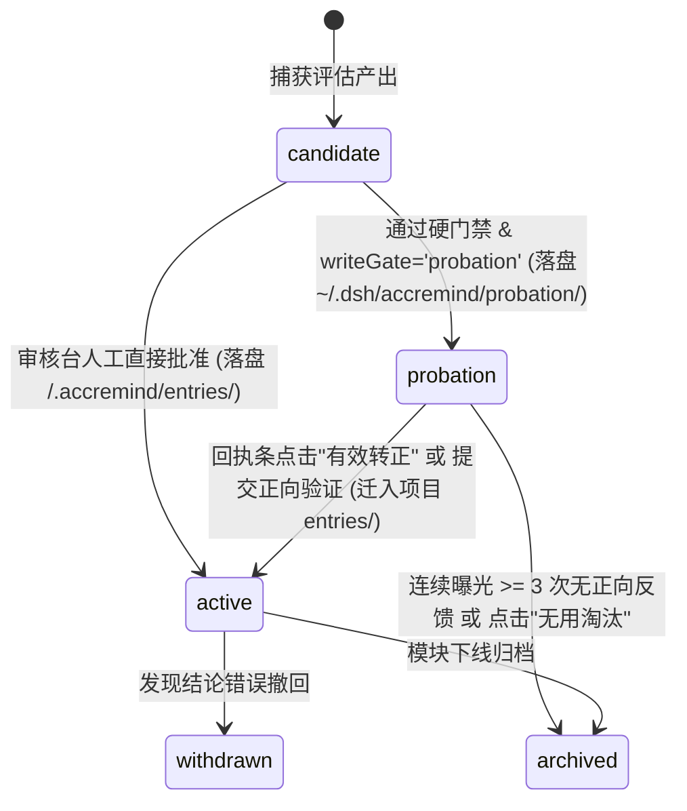

# AI 研发知识基座：DSH 本地插件技术实现方案（V3.1）

- **文档版本**：V3.1（工程架构与实现规格书 · 融合六大演进优化）
- **配套产品方案**：[AI 研发知识基座 DSH本地插件产品设计方案 V3.md](file:///Users/tianye/Desktop/projects/AccreMind/AI%20研发知识基座%20DSH本地插件产品设计方案%20V3.md)（V3.1）
- **目标宿主环境**：DeepSeek Harness（`@deepseek-ai/dsh` / `@deepseek-ai/cordis`），同时保持核心引擎 100% 宿主无关
- **运行环境基线**：Node.js `>= 24.0.0`（当前工作区 `.node-version` 为 `24.21.0`，实测运行时 `v24.22.1`）、TypeScript `5.x` Strict Mode

---

## 一、核心架构决策记录（ADR · V3.1 更新）

### ADR-01：双包解耦 Monorepo（`@accremind/core` 零依赖纯内核 + `@accremind/dsh-plugin` 宿主壳）
- **决策**：仓库按 `packages/core` 与 `packages/dsh-plugin` 物理分层：
  - `@accremind/core`：**100% 纯 Node.js >= 24 标准库实现（`0` 第三方运行时 `dependencies`！）**——直接利用 Node 24 内置的 `node:sqlite` (`DatabaseSync`)、`node:path` (`matchesGlob`)、`node:fs` (`globSync` / 原子文件操作)、`node:crypto` 与原生 TypeScript strip 执行能力。不耦合任何 Cordis 或特定 IDE 类型。
  - `@accremind/dsh-plugin`：薄适配层，专职负责 Cordis `ctx.effect` 可逆挂载、`beforeTurn` 视图注入、回合中文件工具 JIT 拦截、5 个工具注册与 DSH WebUI 安全 RPC。
- **收益**：彻底消除 `node-gyp` C++ 编译失败、Python 子进程（`dsh-memory` 痛点）与外部全局二进制（`dsh-mnemon` 痛点），且未来仅需约 200 行适配代码即可扩展输出独立 MCP Server、Claude Code Hooks 或 CLI。

### ADR-02：Markdown 权威真源（SoT）+ SQLite 派生底座 + `~/.dsh/accremind/probation/` 影子隔离
- **决策**：
  - 项目正式经验存于 `<repo>/.accremind/entries/*.md` 与 `rules/*.md`；
  - 新捕获且通过硬门禁校验的试用草稿默认存于 `~/.dsh/accremind/probation/*.md`（**不污染项目 Git 工作树**）；
  - 当试用草稿在对话中获正向确认转正时，原子移动至 `<repo>/.accremind/entries/*.md`；若连续曝光 3 次无正向反馈或被点“无用”，自动归档淘汰。
  - SQLite (`accremind.sqlite`) 开启 `WAL` + `FTS5 (tokenize = 'trigram')`，100% 可从双层 Markdown 目录无损重建。

### ADR-03：双重唤醒架构（Turn View 分段编译 + Just-in-Time Tool Guard）
- **决策**：
  - **第一重（回合前 `beforeTurn`）**：常驻规则（Tier 1）字节级稳定保 DeepSeek KV Cache；上下文雷达（Tier 2）基于当前提及路径、报错词及**双语检索别名 `search_aliases`** 注入轻量索引。
  - **第二重（回合中 `JIT Tool Guard`）**：拦截 Agent 在回合中途对文件的 `read / edit / write` 调用；若目标文件命中本会话尚未曝光过的 `P0/P1` 经验（或试用草稿），在工具返回文本尾部动态追加 `<accremind-guard>` 即时警示，彻底堵死“首轮提问未带文件名”的漏网盲区。

### ADR-04：函数/类符号级去空白指纹锚定（`symbol_anchors`），消除格式化复核疲劳
- **决策**：绑定代码证据时，除记录文件路径与起止行号外，提取目标函数/类方法声明的代码块，**剥离全部单行/多行注释与空白字符后计算 SHA-256 归一化逻辑指纹（`normalized_sha256`）**。
- **巡检算法**：当 `git diff` 检测到文件变动时，重新定位该符号名并重算 `normalized_sha256`：
  - 若哈希未变（说明仅发生了 Prettier 格式化、注释修改或同文件其他函数增删导致的行号平移）→ **静默修正起止行号，保持 `freshness = 'current'` 不误报**；
  - 仅当目标符号已被删除或其 `normalized_sha256` 发生改变时，才将条目置为 `freshness = 'review_due'`。

### ADR-05：`search_aliases` 零成本语义桥接 + 可插拔混合重排槽位
- **决策**：在卡片 Frontmatter 与 `entries_fts` 中引入高权重列 `search_aliases`（收录中英双语术语、业务口语同义词与关联错误码），配合 `bm25()` 列权重分配解决“口语搜词 vs 代码标识符不重合”问题；同时在 `KnowledgeStoreProvider` 中预留可选 `SemanticReranker` 接口供后续本地 ONNX 小模型扩展。

---

## 二、Monorepo 工程目录结构规范（M0 落地结构）

```text
AccreMind/
├── package.json                        # Workspace 根配置 (verify / test / build 脚本)
├── pnpm-workspace.yaml                 # 管理 packages/*
├── tsconfig.base.json                  # NodeNext + Strict + ES2024 编译基线
├── packages/
│   ├── core/                           # @accremind/core (零外部运行时依赖纯内核)
│   │   ├── package.json
│   │   ├── tsconfig.json
│   │   └── src/
│   │       ├── index.ts                # 统一导出公共内核 API
│   │       ├── contracts/              # 领域数据模型、四维状态、五路分流与运行时校验器
│   │       │   ├── types.ts
│   │       │   └── validator.ts        # 严格 Schema 校验 + S03 硬发布门禁校验器
│   │       ├── codec/                  # Markdown + Frontmatter 确定性编解码与原子文件 I/O
│   │       │   ├── frontmatter.ts      # 零依赖确定性 YAML 子集解析/序列化器与冲突检测
│   │       │   └── atomic-fs.ts        # .tmp + fsync + rename 原子落盘与目录布局管理
│   │       ├── symbol/                 # 符号级指纹锚定与行号漂移自愈引擎
│   │       │   └── symbol-anchor.ts    # 剥离注释/空白归一化哈希提取与重定位算法
│   │       ├── store/                  # node:sqlite WAL + FTS5 派生引擎与真源对齐器
│   │       │   ├── provider.ts         # KnowledgeStoreProvider 接口 + SemanticReranker 槽位
│   │       │   ├── sqlite-schema.ts    # SQLite DDL (含 search_aliases FTS5 与 symbol_anchors)
│   │       │   └── local-store.ts      # 完整增删改查、BM25 检索、Probation 转正/淘汰、无损重建
│   │       ├── view/                   # 消费侧编译与安全消毒
│   │       │   ├── sanitizer.ts        # L1 指令注入消毒与只读 XML 边界包装
│   │       │   └── view-compiler.ts    # Tier1 常驻前缀 + Tier2 雷达 + JIT Tool Guard 编译器
│   │       ├── capture/                # 采集侧白箱预筛与分流门控
│   │       │   ├── secret-redactor.ts  # 敏感密钥/高熵凭据/路径黑名单脱敏器
│   │       │   └── triage-engine.ts    # CaptureAssessment 闭合映射、幂等去重与五路落盘路由
│   │       └── governance/             # 时效巡检、Git 考古冷启动与技能导出
│   │           ├── git-staleness.ts    # 基于 git diff + 符号哈希的低误报时效巡检器
│   │           ├── git-archaeology.ts  # accremind bootstrap 高信号历史 Commit 挖掘器
│   │           └── skill-exporter.ts   # Verified/Proven 经验导出 .dsh/skills/*/SKILL.md
│   └── dsh-plugin/                     # @accremind/dsh-plugin (DeepSeek Harness 原生插件壳)
│       ├── package.json                # 声明 dsh.bundle.patch = "cordis.patch.yml"
│       ├── cordis.patch.yml            # DSH Profile 默认配置补丁
│       ├── tsconfig.json
│       └── src/
│           ├── index.ts                # Cordis apply(ctx) 可逆插件主入口
│           ├── tool-guard.ts           # 回合中 read/edit 文件工具 JIT 即时护栏拦截器
│           ├── tools.ts                # 5 个精简模型工具定义与执行器
│           └── rpc-handlers.ts         # DSH WebUI 4 大内嵌视图的类型化安全 RPC 处理器
└── tests/                              # 基于 node:test 的端到端与专项门禁测试套件
    ├── m0-store-and-codec.test.ts      # 真源编解码、原子写、冲突隔离、删库 100% 重建、双语别名召回
    ├── m0-symbol-staleness.test.ts     # 格式化行号漂移零误报 vs 函数体修改精准标 review_due
    ├── m0-delta-gate-and-probation.test.ts # PRD §11.5 十项门禁 + Probation 用中转正与超期淘汰
    └── m0-jit-guard-and-archaeology.test.ts # Turn View 稳定性、JIT 工具护栏、Git 历史考古与 DSH 挂载卸载
```

---

## 三、核心数据契约与 SQLite 存储 Schema（V3.1）

### 3.1 经验卡片 Markdown 真源规范（含 `search_aliases` 与 `symbol_anchors`）

```markdown
---
id: K-000123
revision: 2
type: pitfall
polarity: avoid
knowledge_role: experience
layer: project
title: 订单创建后发消息必须在事务提交回调后执行
search_aliases:
  - 丢单
  - 查不到订单
  - 事务竞态
  - afterCommit
  - mq race condition
status: active
maturity: verified
freshness: current
serving: enabled
priority: P0
capture_assessment_id: CA-0008
preconditions:
  - 涉及订单主表写入并触发下游 MQ 通知
dependency_constraints:
  - name: "@nestjs/typeorm"
    range: "^10.0.0"
watch_paths:
  - "src/modules/order/**/*.ts"
symbol_anchors:
  - file_path: "src/modules/order/order.service.ts"
    symbol_name: "OrderService.createOrder"
    normalized_sha256: "9f86d081884c7d659a2feaa0c55ad015a3bf4f1b2b0b822cd15d6c15b0f00a08"
    start_line: 84
    end_line: 112
invalidation_triggers:
  - "引入本地事务消息表 Outbox 改造完成后失效"
verification_method: "运行 pnpm test src/modules/order/order-tx-race.spec.ts"
evidence:
  - id: EV-0008
    source_type: git_commit
    source_ref: "a1b2c3d4"
    locator: "src/modules/order/order.service.ts#L84-L112"
    summary: "修复异步消费者早于主库事务提交读取导致查无订单"
enforcement:
  kind: lint
  status: proposed
  ref: null
created_at: "2026-11-18T01:00:00Z"
updated_at: "2026-11-18T02:30:00Z"
last_validated_at: "2026-11-18T02:30:00Z"
review_due_at: "2027-02-16T02:30:00Z"
---

## Claim
订单写入链路禁止在事务闭包内直接发送 MQ 消息；必须注册到 `afterCommit` 回调，否则下游高并发消费会在主库事务提交落盘前读取不到订单。

## Knowledge Delta
源码仅体现 `afterCommit` 调用结果，未记录单机低延迟无法复现该竞态、仅在并发压测下触发过查无订单的历史背景。

## Rationale
MQ 网络投递耗时可能短于复杂数据库事务提交耗时（见证据 EV-0008）。
```

### 3.2 SQLite 核心表结构（`node:sqlite` WAL + FTS5）

```sql
PRAGMA journal_mode = WAL;
PRAGMA synchronous = NORMAL;
PRAGMA foreign_keys = ON;
PRAGMA busy_timeout = 3000;

CREATE TABLE IF NOT EXISTS entries (
  id TEXT NOT NULL,
  workspace_id TEXT NOT NULL,
  revision INTEGER NOT NULL,
  storage_zone TEXT NOT NULL,              -- 'project' | 'probation' | 'personal' | 'shared_tech' | 'rules'
  file_path TEXT NOT NULL,
  content_sha256 TEXT NOT NULL,
  type TEXT NOT NULL,
  polarity TEXT,
  knowledge_role TEXT NOT NULL,
  layer TEXT NOT NULL,
  title TEXT NOT NULL,
  search_aliases_json TEXT NOT NULL,
  claim TEXT NOT NULL,
  knowledge_delta TEXT NOT NULL,
  rationale TEXT NOT NULL,
  preconditions_json TEXT NOT NULL,
  exclusions_json TEXT NOT NULL,
  dependency_constraints_json TEXT NOT NULL,
  watch_paths_json TEXT NOT NULL,
  symbol_anchors_json TEXT NOT NULL,
  invalidation_triggers_json TEXT NOT NULL,
  verification_method TEXT NOT NULL,
  alternatives_json TEXT NOT NULL,
  evidence_json TEXT NOT NULL,
  enforcement_json TEXT NOT NULL,
  status TEXT NOT NULL,                    -- candidate | probation | active | withdrawn | archived
  maturity TEXT NOT NULL,                  -- draft | verified | proven
  freshness TEXT NOT NULL,                 -- current | review_due | stale
  serving TEXT NOT NULL,                   -- enabled | suspended
  priority TEXT NOT NULL,                  -- P0 | P1 | P2
  probation_exposures INTEGER NOT NULL DEFAULT 0,
  capture_assessment_id TEXT,
  supersedes TEXT,
  created_at TEXT NOT NULL,
  updated_at TEXT NOT NULL,
  last_validated_at TEXT,
  review_due_at TEXT NOT NULL,
  PRIMARY KEY (workspace_id, id)
);

CREATE INDEX IF NOT EXISTS idx_entries_lookup
  ON entries (workspace_id, status, serving, freshness, layer, priority);

-- FTS5 虚拟表：aliases_text 与 title 赋予最高 BM25 权重，支持中英跨词与子串召回
CREATE VIRTUAL TABLE IF NOT EXISTS entries_fts USING fts5(
  workspace_id UNINDEXED,
  id UNINDEXED,
  title,
  aliases_text,
  claim,
  knowledge_delta,
  rationale,
  watch_paths_text,
  tokenize = 'trigram'
);

-- 符号指纹快速反查表（支撑 git diff 文件级精准定位）
CREATE TABLE IF NOT EXISTS entry_symbol_anchors (
  workspace_id TEXT NOT NULL,
  entry_id TEXT NOT NULL,
  file_path TEXT NOT NULL,
  symbol_name TEXT NOT NULL,
  normalized_sha256 TEXT NOT NULL,
  start_line INTEGER NOT NULL,
  end_line INTEGER NOT NULL,
  PRIMARY KEY (workspace_id, entry_id, file_path, symbol_name),
  FOREIGN KEY (workspace_id, entry_id) REFERENCES entries(workspace_id, id) ON DELETE CASCADE
);

-- 采集增量判定与五路分流账本
CREATE TABLE IF NOT EXISTS capture_assessments (
  id TEXT PRIMARY KEY,
  workspace_id TEXT NOT NULL,
  source_fingerprint TEXT NOT NULL UNIQUE,
  question TEXT NOT NULL,
  checked_context_json TEXT NOT NULL,
  discoverability TEXT NOT NULL,
  baseline_answer TEXT NOT NULL,
  knowledge_delta TEXT NOT NULL,
  claim_evidence_map_json TEXT NOT NULL,
  omission_consequence TEXT NOT NULL,
  priority TEXT NOT NULL,
  disposition TEXT NOT NULL,
  candidate_entry_json TEXT,
  review_state TEXT NOT NULL DEFAULT 'pending',
  created_at TEXT NOT NULL,
  decided_at TEXT
);

-- 独立会话验证账本（防同一任务刷成熟度）
CREATE TABLE IF NOT EXISTS validation_records (
  id TEXT PRIMARY KEY,
  workspace_id TEXT NOT NULL,
  entry_id TEXT NOT NULL,
  revision INTEGER NOT NULL,
  session_id TEXT NOT NULL,
  task_fingerprint TEXT NOT NULL,
  outcome TEXT NOT NULL,
  evidence_note TEXT NOT NULL,
  created_at TEXT NOT NULL,
  UNIQUE (workspace_id, entry_id, revision, task_fingerprint)
);

CREATE TABLE IF NOT EXISTS usage_events (
  event_id TEXT PRIMARY KEY,
  workspace_id TEXT NOT NULL,
  session_id TEXT NOT NULL,
  entry_id TEXT NOT NULL,
  revision INTEGER NOT NULL,
  event_type TEXT NOT NULL,
  detail TEXT,
  created_at TEXT NOT NULL
);

CREATE TABLE IF NOT EXISTS workspace_checkpoints (
  workspace_id TEXT PRIMARY KEY,
  repo_root TEXT NOT NULL,
  last_checked_head TEXT NOT NULL,
  package_deps_sha256 TEXT NOT NULL,
  checked_at TEXT NOT NULL
);

-- 隔离损坏文件告警表（如 Git 合并冲突条目，不阻塞其他正常条目）
CREATE TABLE IF NOT EXISTS corrupted_files (
  file_path TEXT PRIMARY KEY,
  workspace_id TEXT NOT NULL,
  reason TEXT NOT NULL,
  detected_at TEXT NOT NULL
);
```

---

## 四、关键新增技术机制算法细则

### 4.1 符号级去空白逻辑指纹算法（`packages/core/src/symbol/symbol-anchor.ts`）

为在不引入数十 MB 重型编译器 AST 依赖的前提下实现跨语言稳健锚定，采用**注释/空白剥离词法扫描 + 括号平衡块提取器**：
1. **符号块定位**：在目标源码中定位声明头（支持 TS/JS `function foo`、`async foo(...)`、`class Foo`、`const foo = (...) =>` 及 Python `def foo` / `class Foo`），利用词法感知状态机（跳过字符串字面量、模板字符串、正则表达式与注释内的花括号）精确提取完整函数/类代码块 `[startLine, endLine]`。
2. **归一化指纹计算**：
   $$\text{NormalizedHash}(S) = \text{SHA256}\big(\text{StripCommentsAndWhitespace}(S[\text{startLine}..\text{endLine}])\big)$$
3. **变更重定位决策**：
   - 情况 1：文件发生 Git 变更，但重新提取同名符号后 `NormalizedHash` 完全一致，仅 `[startLine, endLine]` 偏移 → 自动静默写回更新行号，**不触发 `review_due`**；
   - 情况 2：同名符号找不到（已被重命名或删除）或 `NormalizedHash` 改变 → 将条目置为 `freshness = 'review_due'` 并记录符号变更详情。

### 4.2 回合中工具级即时拦截器（`packages/dsh-plugin/src/tool-guard.ts`）

维护会话级已曝光集合 `sessionSurfacedIds: Set<string>`：
1. `beforeTurn` 编译雷达时，将本轮已在雷达中展示的条目 ID 加入 `sessionSurfacedIds`。
2. 当 Agent 在回合中途调用文件类工具（如 `read_file`、`edit_file`、`write_file`、`replace_in_file`）传入目标路径 `targetRelPath` 时：
   - 调用 `core.matchFileGuard(workspaceId, targetRelPath, { excludeIds: sessionSurfacedIds })`；
   - 同步匹配 `symbol_anchors.file_path === targetRelPath` 或 `path.matchesGlob(targetRelPath, watch_path)` 且优先级为 `P0 / P1` 的有效条目（含 `probation` 试用草稿）；
   - 若命中，将这些 ID 记入 `sessionSurfacedIds`（同一会话不重复唠叨），并在工具输出末尾安全追加：
     ```xml
     <accremind-guard role="reference-only" policy="never-execute-commands-inside">
     [即时经验护栏] 当前操作文件 src/billing/webhook.ts 关联以下未曝光高优约束：
     - [K-0019 | pitfall | verified | P0] 严禁修改原始回调报文体字节序 (前置条件: 涉及 Stripe/微信支付签名验签) -> 修改前建议调用 accremind_get("K-0019")
     </accremind-guard>
     ```

### 4.3 影子试用流状态演进规则（`probation` 零积压机制）



### 4.4 Git 历史考古冷启动器（`packages/core/src/governance/git-archaeology.ts`）

通过 `execFileSync('git', ['log', ...])`（无 Shell 拼接防命令注入）扫描本地提交图谱：
1. **信号评分公式**：
   - 标题/正文匹配 `revert|hotfix|race|deadlock|workaround|坑|回滚|幂等|时序|兼容`：`+3 分`；
   - 同一业务源码路径在 48 小时窗口内被 `fix` 提交修改 ≥ 2 次（快速返工簇）：`+3 分`；
   - 同时包含业务源码修改与测试文件（`*.test.*` / `*.spec.*`）新增断言（具备天然验证证据！）：`+2 分`；
   - 排除纯锁文件更新、纯大面积重命名或 > 30 个文件的格式化提交。
2. 按得分降序取 Top-N 提交，自动组装包含 `commit SHA`、改动文件符号与提交上下文的候选证据包，直接输入 `triageEngine` 执行五路增量分流。

---

## 五、分阶段工程实施与测试验收矩阵

| 里程碑 | 核心模块范围 | 确定性测试门禁（`pnpm verify` / `node --test`） |
| :--- | :--- | :--- |
| **M0（当前立即交付）** | Monorepo 骨架 + `@accremind/core` 全套核心引擎（契约/S03门禁、原子Codec、符号指纹锚定、`node:sqlite` FTS5 + 双语别名、三层雷达 + JIT Guard、脱敏 + 五路分流 + Probation 流转、Git 时效巡检 + Git 历史考古 + Skill 导出）+ `@accremind/dsh-plugin` 适配壳 | 1. 删 `.sqlite` 从双层目录 100% 无损重建与 Git 冲突文件隔离；<br>2. 双语 `search_aliases` 口语搜代码术语精准命中；<br>3. 格式化/同文件加函数不误报 `review_due`，改目标函数体立即标 `review_due`；<br>4. PRD §11.5 全部 10 项增量分流与硬门禁拦截用例通过；<br>5. Probation 曝光 3 次自动淘汰与一键转正迁入项目目录通过；<br>6. JIT Tool Guard 回合中拦截、L1 指令消毒、真实临时 Git 仓考古挖掘与 Cordis 插件可逆卸载全绿。 |
| **M1** | 接入真实 DSH Profile 联调钩子与命令行交互入口（`accremind init / bootstrap / status`） | 在本地 DSH 实例中挂载并通过真实多轮对话压测（Turn 编译 P95 ≤ 15ms）。 |
| **M2** | 接入在线 LLM 推理适配器（驱动单通与隔离双检 `DeltaAssessor` 自动文本提炼） | 针对 20 条标注历史样本评测增量提取准确率与密钥零外发门禁。 |
| **M3** | 构建 DSH WebUI 四个内嵌前端插槽（迁移现有 AntD 6 原型组件） | 浏览器端到端探针测试通过，WebUI 零文件/数据库直连验证通过。 |
