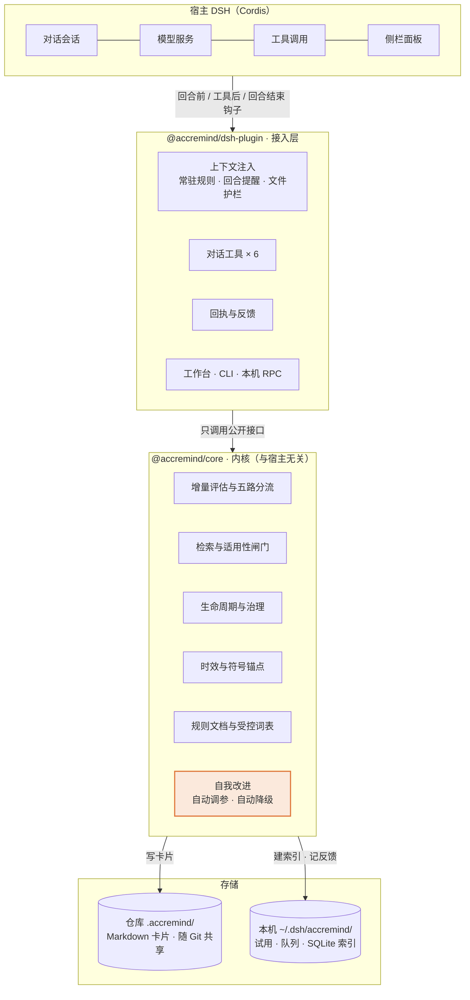
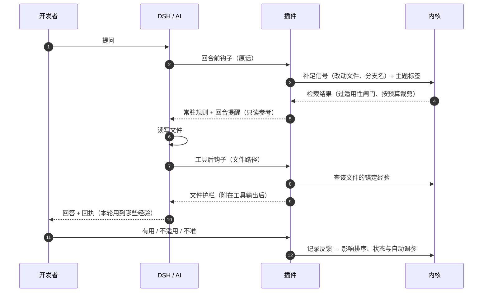
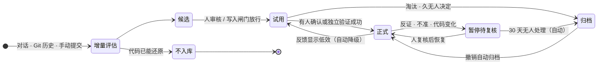
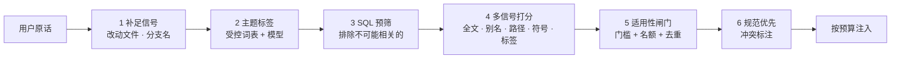
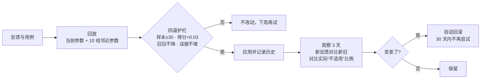

# AccreMind 架构与设计理念

> 让团队花过代价的工程经验，在下一次改动前出现在 AI 和开发者手边。

本文面向第一次接触项目的同事，讲清楚四件事：**它为什么存在、遵循哪些原则、由哪些部分组成、往哪里走**。命令与安装见 [README](../README.md)，详细的产品与技术方案见本目录下的 V3 设计文档。

- [愿景](#愿景)
- [要解决的问题](#要解决的问题)
- [核心思想：七条原则](#核心思想七条原则)
- [总体架构](#总体架构)
- [一次对话里发生了什么](#一次对话里发生了什么)
- [一条经验的一生](#一条经验的一生)
- [五层知识与跨仓库](#五层知识与跨仓库)
- [检索流水线](#检索流水线)
- [规则文档集与受控词表](#规则文档集与受控词表)
- [自我改进](#自我改进)
- [存储布局](#存储布局)
- [模块地图](#模块地图)
- [扩展点](#扩展点)
- [路线图](#路线图)

---

## 愿景

**让团队花过代价的经验，不再随人员流动、上下文滚动和记忆衰减而消失，而是成为每一次 AI 辅助开发的默认前提。**

| 阶段 | 目标 |
| --- | --- |
| 个人 | 我在 DSH 里和 AI 一起写代码时，它记得我上周踩过的坑 |
| 团队 | 同事踩过的坑、团队定下的规范，随 Git 提交共享，所有人的 AI 都知道 |
| 组织 | 同一业务领域的多个仓库互相借鉴；经验能自己判断适用范围、自己淘汰过时内容 |

## 要解决的问题

代码只记录最终选择，文档只留下结论。团队真正花过代价的知识——"为什么不那样做"、"那样做踩过什么坑"——通常只存在于某个人的记忆、一段聊天记录或一次事故复盘里。

AI 辅助开发放大了这个问题：

- **AI 没有团队记忆**：每次会话从零开始，上周刚解决的问题这周会再犯一次。
- **AI 很自信**：它会给出"教科书正确"的方案，恰好撞上团队已经否决过的那条路。
- **人的记忆会衰减和流动**：知道"这个接口重试会重复扣款"的人可能已经换了项目。

AccreMind 只收这一类知识：**代码与现有文档还原不出来的增量**（`knowledge_delta`）。

## 核心思想：七条原则

| # | 原则 | 在实现里意味着什么 |
| --- | --- | --- |
| 1 | **只收增量** | 增量评估先只看代码和文档生成基线，再判断经验多告诉了什么；五路分流（仅索引 / 关联已有 / 入库候选 / 待确认 / 丢弃）；空增量、未证实猜测、本机绝对路径被硬门禁拦下 |
| 2 | **本地优先，Markdown 是事实来源** | 每条经验是可读、可评审的 Markdown 卡片；SQLite 只是随时可重建的索引；没有后台服务和外部向量库 |
| 3 | **是参考，不是命令** | 注入内容包在只读标签里、经过清洗、标注"参考材料"，不覆盖宿主规则，没有执行权 |
| 4 | **证据和时效先于结论** | 经验必须带证据定位，并锚定到文件与函数符号；代码一变就进入待复核，格式化或改注释不误报 |
| 5 | **AI 提议，人来裁决** | 新经验先试用、有人确认才转正；规则文档和词表只能由 AI 提议、人确认；对团队规范的例外必须带批准人和到期日 |
| 6 | **克制地占用注意力** | 每层注入都有 token 预算；常驻部分字节级稳定以保住 KV 缓存；不确定相关的宁可不提 |
| 7 | **自我改进，但每一步可见、可撤销** | 检索参数自动调整并自动回滚；低效经验自动降级；知识内容本身从不自动改写 |

## 总体架构

三个包，单向依赖：插件依赖内核，内核不依赖任何宿主。内核只用 Node.js 24 标准库（内置 `node:sqlite`），没有第三方运行时依赖。



第三个包 `@accremind/webui`（React + Vite）构建成单个 HTML 文件，内联进插件，由插件的本机服务提供。

**这样分层的好处**：换一个宿主（其他 IDE 插件、服务端）只需要重写接入层；索引损坏或升级时从 Markdown 卡片重建即可，不会丢知识。

### 三层注入与预算

| 时刻 | 层 | 默认预算 | 给什么 |
| --- | --- | --- | --- |
| 每轮对话开头 | 常驻规则 | 500 tokens | 团队硬约束和项目概况，字节稳定以保住 KV 缓存 |
| 每轮按提问检索 | 回合提醒 | 300 tokens | 相关经验的编号和一句摘要、相关文档章节 |
| 读写相关文件时 | 文件护栏 | 240 / 1500 tokens | 该文件上的高风险经验；需要时展开全文 |

## 一次对话里发生了什么



## 一条经验的一生

所有状态变化都由同一张生命周期表（`governance/lifecycle.ts`）定义，不管是人点按钮、AI 登记反馈还是后台巡检触发，规则都一样。



带"自动"的步骤都会出现在工作台「需要你处理」里，可一键撤销。

## 五层知识与跨仓库

| 层 | 存放位置 | 谁能看到 |
| --- | --- | --- |
| 团队规范 `team_rule` | 仓库 `.accremind/rules/` | 整个团队，每轮常驻且优先 |
| 业务领域 `domain` | 仓库内，或本机共享区 | 同一业务领域的所有仓库 |
| 通用技术 `shared_tech` | 本机 `~/.dsh/accremind/` | 技术栈匹配的仓库（语言、依赖、版本范围） |
| 项目 `project` | 仓库 `.accremind/entries/` | 本仓库；其他仓库只在显式要求时作参考 |
| 个人 `personal` | 本机，归属于用户 | 只有本人，跨仓库 |

跨仓库不"串味"靠三件事：

1. **稳定的仓库身份**：`.accremind/repo.json` → Git `origin` → 路径哈希。
2. **适用性闸门**：本仓库 / 同领域 / 同技术栈 / 本人 / 跨仓库参考，各有相关性门槛和名额。
3. **分作用域的反馈**：共享经验在某仓库被标"不适用"只在该仓库停止提醒；多个仓库都这样、或任一仓库报告反例，才全局暂停。

用户身份默认是"本机用户"（同一人在不同仓库用不同 Git 邮箱也算一个人），宿主可以通过 `store.setUserIdentity()` 接入登录用户。

## 检索流水线



- 全文索引使用 FTS5 trigram，中文无需分词。
- 模型打标签只在会话首轮和换话题时同步进行，1.5 秒超时退回词表匹配；同一话题复用并在后台刷新。
- 压测（30 个仓库、一万条经验）：单次检索 p95 约 60–90 ms，文件护栏 p95 约 1.5 ms。

## 规则文档集与受控词表

经验是零散踩出来的；业务规则和规范往往已经写在文档里。

- **四类文档**：业务领域 `domain`、业务规则 `business_rules`、项目规范 `project_norms`、项目基本业务属性 `project_profile`，放在 `.accremind/docs/<类别>/*.md`，随 Git 评审。
- **按章节索引**：相关章节随回合提醒给 AI；项目概况常驻；领域和业务规则文档提供给同领域的其他仓库。
- **逐步完善**：AI 通过 `accremind_propose_doc_change` 提议修改，人确认后写入（基于章节哈希检测并发冲突）；导入、确认的修改、直接编辑文件，都逐节记入 `changes.ndjson` 和 `CHANGELOG.md`。
- **受控词表**：`.accremind/vocabulary.json` + 文档标签 + 业务领域 + 依赖名。模型可以提议新词，人确认后才进入词表。

## 自我改进

只自动做两件低风险的事，知识内容本身从不自动改写。

### 自动调参



得分 = 召回率 − 被否定条目的出现率 − ½ × 无关问题的噪声率。记录在 `~/.dsh/accremind/tuning-history.jsonl`，`accremind eval rollback` 可随时手动撤销。

### 低效经验自动降级

| 步骤 | 条件 |
| --- | --- |
| 降为试用 | 当前版本被 ≥ 2 个会话标"不适用"，占提醒会话 ≥ 25%，且无任何确认 |
| 降为试用 | 30 天内在 ≥ 40 个会话中提醒过，从未被打开、引用或确认 |
| 自动归档 | 因"不适用"暂停后 30 天无人处理（试用期满无人决定的等 60 天） |

团队规范、当前版本有过确认或反例的、跨仓库共享的经验不做自动处理。撤销后该版本不再被自动降级。两项都可以通过插件配置 `autoEvolve: { tune: false, demote: false }` 关闭。

## 存储布局

```
<仓库>/.accremind/                 # 随 Git 提交、评审、共享
├── entries/                       # 正式经验卡片（Markdown）
├── rules/                         # 团队规范（常驻）
├── docs/<类别>/*.md               # 规则文档集 + changes.ndjson + CHANGELOG.md
├── vocabulary.json                # 受控词表
├── eval/cases.jsonl               # 手写评测用例（可选）
└── repo.json                      # 仓库身份与业务领域

~/.dsh/accremind/                  # 本机，不进 Git
├── probation/                     # 试用稿
├── queue/                         # 自动捕获与评估队列
├── index/global.sqlite            # 本机所有仓库共享的派生索引（可重建）
├── workspaces/<仓库>/index.sqlite # 每个仓库的状态：审核、回执、使用与反馈
├── personal/ · shared-tech/ · domain/
├── registry/repos.json            # 本机仓库注册表
├── users/local.json               # 本机用户身份
└── tuning.json · tuning-history.jsonl
```

## 模块地图

| 目录 | 职责 | 关键文件 |
| --- | --- | --- |
| `core/src/capture/` | 信号检测、增量评估、五路分流、自动捕获、首轮信号 | `delta-assessor.ts` `triage-engine.ts` `workspace-signals.ts` |
| `core/src/retrieval/` | 适用性闸门、主题标签、离线评测、自动调参、跨仓库反馈 | `applicability.ts` `query-tagger.ts` `evaluation.ts` `auto-tuning.ts` |
| `core/src/governance/` | 生命周期表、审核、时效巡检、Git 考古、自动降级、技能导出 | `lifecycle.ts` `git-staleness.ts` `auto-demotion.ts` |
| `core/src/store/` | Markdown + SQLite 存储、索引、迁移、活动日志 | `local-store.ts` `sqlite-schema.ts` |
| `core/src/view/` | 三层注入编译与内容清洗 | `view-compiler.ts` `sanitizer.ts` |
| `core/src/docs/` | 规则文档集、受控词表 | `doc-library.ts` `vocabulary.ts` |
| `core/src/identity/` | 本机用户与登录用户身份 | `user-identity.ts` |
| `core/src/symbol/` `evidence/` `ledger/` `registry/` | 符号锚点、证据快照、验证台账、仓库注册表 | — |
| `dsh-plugin/src/` | DSH 钩子、对话工具、RPC、CLI、工作台服务 | `index.ts` `tools.ts` `rpc-handlers.ts` `cli.ts` |
| `webui/src/` | 工作台界面（总览、知识库、审核、规则文档、治理、回执） | `features/*` |

## 扩展点

| 想做的事 | 从哪里接入 |
| --- | --- |
| 接入新的宿主（IDE、服务端） | 参照 `dsh-plugin` 写一个接入层，只调用 `@accremind/core` 的公开接口 |
| 接入登录用户 | `store.setUserIdentity({ provider, id, emails })` |
| 换模型服务 | 实现 `LlmInferenceAdapter`，或配置 `ACCREMIND_LLM_*` 环境变量 |
| 调整检索参数 | `~/.dsh/accremind/tuning.json`，或让自动调参完成 |
| 补充评测用例 | `.accremind/eval/cases.jsonl` |

## 路线图

| 阶段 | 状态 | 内容 | 进入下一阶段的门槛 |
| --- | --- | --- | --- |
| 现在 · 个人与小团队 | 已具备 | 本地经验库与三层注入、试用期与人工治理、五层知识与跨仓库检索、规则文档集与主题标签、自动调参与自动降级 | 试点数据证明提醒有用 |
| 下一步 · 团队试点（建议） | 规划中 | 在 1–2 个仓库落地、团队共享验证台账、接入登录用户身份、工作台展示调参与降级、有帮助率等效果指标 | 多个团队提出共享需求 |
| 之后 · 组织级（建议） | 设想 | 可选的团队同步服务、接入更多 IDE 与宿主、跨团队领域知识共享、经验沉淀为可复用技能、新人入职知识导览 | — |

不论走到哪一步，三条不变：**Markdown 是事实来源、本地优先、人做裁决。**
