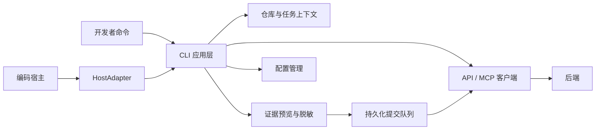
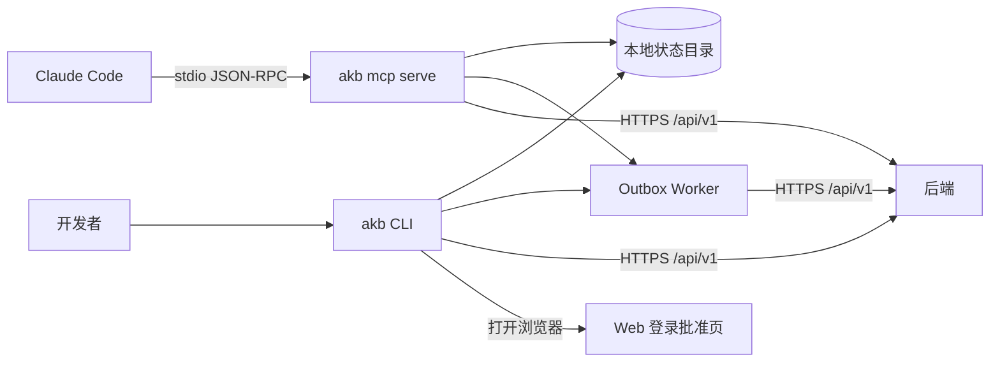
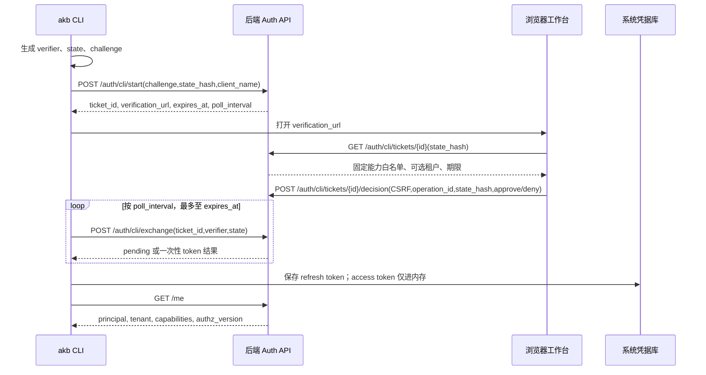

# AI 研发知识基座：工具端架构设计

- 版本：2.1（阶段 A 契约修订）；日期：2026-09-12。
- 依据：[AI 研发知识基座 PRD V2.1](<../../AI 研发知识基座 PRD V2 修订版.md>)。
- 状态：实施设计建议。本文规定模块、契约和验收边界，不表示系统已实现或评测已通过。
- 文档协作：[工具端架构](<../../docs/architecture/01-工具端架构设计.md>) · [前端架构](<../../docs/architecture/02-前端架构设计.md>) · [后端架构](<../../docs/architecture/03-后端架构设计.md>) · [开发任务与验收计划](<../../docs/architecture/04-开发任务与验收计划.md>)。
- 规则优先级：PRD V2.1 为产品依据；跨端契约以随附 OpenAPI/JSON Schema 和《后端架构》B10—B20 的详细规则为实现基线；B1—B9 为概要导航。发现冲突须先修正契约与文档，不能自行选择较宽松规则。
- 共同底线：优先保存有证据的知识增量；搜不到不等于存在隐性知识；引用不等于验证；零条产出有效；权限、发布校验和成熟度判定由后端执行。

- 实现附件：[OpenAPI 3.1](<../../docs/architecture/contracts/openapi.json>) · [JSON Schema](<../../docs/architecture/contracts/schemas.json>) · [MCP 工具定义](<../../docs/architecture/contracts/mcp-tools.json>) · [领域 SQL](<../../docs/architecture/data/001_initial_schema.sql>) · [身份 SQL](<../../docs/architecture/data/002_identity_schema.sql>) · [验证记录](<../../docs/architecture/verification/2026-09-11-design-validation.md>)。

## T1. 定位与范围

工具端是开发者与编码助手接入知识服务的入口，包括 CLI、首个宿主适配器和轻量配置。首版使用本地 MCP stdio 桥接，协议进程属于工具端；权威能力与授权均在后端 API。后端远程 /mcp 作为后续协议适配入口，不是 MVP 部署依赖。桥接不能复制发布与授权规则。

MVP：安装登录、仓库绑定、受控配置加载、知识检索、显式证据提交、提交进度、引用/应用事件、验证提交、反馈与更正通知、可靠重试。

后置：全量会话自动采集、跨宿主漫游、个人云同步、完整工作流引擎、远程接管、自动执行 Skills。默认首个宿主为 Claude Code，CLI 为通用入口；T9—T13 定义接入实现，宿主安装版本须在验收报告记录，不假定已完成兼容测试。

## T2. 内部模块



| 模块 | 输入与输出 | 边界 |
| --- | --- | --- |
| HostAdapter | 宿主能力 → 注册配置、显式选区和上下文 | 不假设能读取任意历史会话；不支持时回退手动选择文件 |
| RepoContext | cwd、remote、commit → 待核验仓库上下文 | remote 和本地路径不是访问凭据 |
| AuthClient | 组织登录 → 有范围会话/令牌 | 使用系统凭据存储，不写项目文件 |
| ConfigManager | 服务端版本 → 受控配置文件 | 校验范围、宿主兼容性；原子替换，保留用户自定义区 |
| EvidenceCollector | 选定会话/文件/PR → 最小证据包 | 仅采集明确选择内容；排除个人配置和密钥 |
| Outbox | 提交包 → 重试/送达/失败状态 | 加密或系统受保护存储；上报前再次核验身份与范围 |
| KnowledgeClient | 查询意图/环境 → 结构化结果 | 保留条件、来源、版本；失败不转成无知识 |
| UsageReporter | 实际引用/应用/验证证据 → 事件 | 不把检索自动当作引用，不自行认可验证 |

建议目录为 apps/tool（命令入口）、adapters（宿主实现）、auth、context、config、capture、outbox、knowledge、telemetry；共享 schema 来自 packages/contracts。目录为建议，实施时由 D00 统一。

## T3. HostAdapter 接口与接入流程

建议适配器能力：detectHost、getCapabilities、readProjectContext、installManagedConfig、selectEvidence、renderStatus。可选能力为 registerExplicitCaptureAction；自动事件 Hook 属于后续扩展。

每项能力返回 supported/unsupported/failed 与可操作原因。宿主不支持受控工具注册时不得写入猜测的配置路径；给出已验证的手动接入步骤。若后续使用本地桥接，桥接要遵循统一 schema、保留 request_id，不能静默替换身份或绕过服务端预算。

首次接入：

1. 检查宿主版本、网络与登录前提，说明将创建的配置文件。
2. 通过组织认证完成登录；不得索取或打印长期密码。
3. 获取 remote/commit，POST /repo-bindings 由后端核验并返回 repo_id。多业务域要求用户选择有权上下文。
4. 获取配置并验证兼容范围，原子安装受控部分。首次安装与认证是明确步骤，不宣传零配置。
5. 运行只读连通性诊断，确认任务创建、工具可发现性及授权查询；退出登录可删除本地凭据与临时缓存。

## T4. CLI 与宿主动作设计

命令前缀暂定 `akb`，属于本项目设计，尚未注册或安装。

| 动作 | 命令建议 | 对应后端操作 |
| --- | --- | --- |
| 登录/诊断 | akb login / doctor | 身份系统、GET /me |
| 绑定仓库 | akb repo bind | POST /repo-bindings |
| 拉取配置 | akb config sync | get-config |
| 开始任务 | akb task start | POST /tasks |
| 查询/展开 | akb search / get | search-knowledge / get-knowledge |
| 提交证据 | akb capture --file 或宿主“提交选定内容” | ingest-knowledge |
| 查看进度 | akb contribution status | get-contribution |
| 上报引用/应用 | akb usage record | record-usage，仅 cited/applied |
| 提交验证 | akb validation submit | submit-validation |
| 反馈错误 | akb feedback | submit-feedback |
| 队列管理 | akb queue list / retry / remove | 本地队列与原幂等请求 |
| 更正提示 | akb notifications | 通知 API |

所有命令支持人类可读输出和结构化 JSON；错误退出码区分登录、无权限、参数、冲突、服务失败。结构化字段遵循后端契约，不让调用方解析自然语言判断是否已发布。

查询与提交命令不得拥有候选 publish、验证 approve、成员授权或全库导出能力。管理动作在前端发起，由后端执行权限检查。

## T5. 证据采集与可靠上报

### T5.1 采集数据契约

提交字段：idempotency_key、repo_id、source_event_ids、task/PR/commit、evidence、可选候选草稿。source_event_ids 保留宿主来源、session 与稳定事件标识；客户端生成 event_id 后重试不改变。actor_id 由后端认证确定。

每份证据标记来源版本、定位、摘要、内容哈希与采集范围；不以本地临时路径作为唯一来源。未提交的变更可以带 base_commit、dirty=true 和 diff_hash，不能假装它已存在于某个 commit。后端接收后返回稳定证据 ID；原始文件仍按保留策略处理。

预览展示实际发送片段、文件范围、删改/脱敏提示和最终大小，不展示“自动脱敏所以一定安全”的承诺。包上限 256KB，超限要求用户拆分或明确裁剪；关键前置条件不能静默截断。会话中出现个人偏好指令或敏感数据也需要排除，不能仅按文件目录判断。

### T5.2 采集动作顺序

显式选择 → 范围检查 → 本地敏感检查 → 用户预览 → 持久化最小包 → 后台发送 → 保存接收结果 → 后续读取处理状态。

一个显式命令或已批准的工作流动作可以作为提交授权，不需要在重试时反复确认同一个未变的包。用户修改包后生成新幂等键；同键不同内容由后端拒绝。

本地可附问题、上下文和候选草稿，但不得伪造已经执行的代码可发现性检查。基线不存在则交后端形成 inconclusive。个人“分享到团队”是单独显式入口，也走同样的预览、授权和审核链路。

### T5.3 本地队列

状态：prepared / sending / accepted / failed / expired / removed。accepted 仅表示后端接收，不能显示“知识已沉淀成功”。后续显示服务端逐条分流结果，例如“1 条待审核、2 条转链接、0 条已发布”。

队列保存幂等键、内容哈希、创建时间、身份/租户、尝试数、下次重试时间和 contribution_id。超时重发同键；指数退避加随机抖动最多 5 次，之后可手动重试。默认最长保留 7 天，到期清理给出状态提示；用户可删除未发送内容。后端已接收内容的删除必须走服务端删除请求，不把本地删除误报为全链路删除。

## T6. 消费行为与上下文管理

- 文件定位和函数定义优先使用代码工具/导航；决策原因、外部限制、例外和失败经验查询知识服务。
- 请求包含 task_id、repo_id、commit、已知依赖版本及中立的任务意图。未知字段显式缺省，禁止猜测版本。
- 预算默认每任务 3 次自动知识读取、每次至多 5 条和 4000 tokens，由后端执行。客户端显示剩余额度，详情展开也消耗预算，不新建任务绕限额。
- 结果保留知识 ID/revision、条件、增量、原因、例外、来源及验证方法。只有标题相似不足以判断可用。
- draft 明确未完成验证；条件缺失或代码与规则冲突时提示补充或反馈，不能一律选择代码或一律选择旧知识。
- 查询超时为失败；no_applicable_knowledge 为有效零结果；两者分别展示。不得向用户声称查询失败等于不存在规范。
- 知识正文中的命令不是授权，不能因检索内容而自动安装、上传或执行。

建议产物引用格式：`{knowledge_id, revision, task_id, used_in, event_type}`。客户端仅在产物确有引用或明确采用时发送 cited/applied；验证必须另附方法、环境、预期与实际结果，不能根据构建成功自动填 success。

## T7. 配置、缓存和故障边界

允许持久保存受控配置、必要团队规则和未发送队列；不克隆团队全量知识。普通结果仅会话内临时使用，重新应用前通过读取接口检查当前权限与状态。用户过去的终端输出无法追回，更正通知说明受影响 ID/revision。

配置包括版本、兼容宿主范围、内容哈希及服务端发布身份。先写临时文件、校验后替换，失败保留最近有效版本；已知撤销版本不能回退。开发者自定义区不被覆盖。配置中的 secret 使用凭据引用，不能明文写入知识网关。

查询默认 3 秒超时，不阻塞普通编码；强制规范有效性未知时标记校验未完成。宿主或系统崩溃后提交队列可恢复；不依赖“会话结束”才能确保上报。日志只写状态、ID、耗时和去敏错误。

## T8. 工具端验收

| 用例 | 必须达到 |
| --- | --- |
| 首次接入 | 在前提就绪后记录是否能于 10 分钟内登录、绑定并检索 |
| 不支持的宿主版本 | 明确拒绝自动写入，保留已有配置 |
| 个人文件或敏感片段 | 不进入默认上报，预览与服务端包一致 |
| 网络超时与进程重启 | 同一个包只形成一次服务端逻辑提交 |
| 已接收但未审核 | 显示 accepted/待审核，不显示已发布 |
| 五路分流且零候选 | 正确显示导航/链接/待确认/丢弃统计，无失败误报 |
| 引用/验证分离 | 查询不冒充引用，引用不冒充成功验证 |
| 超限/超时/越权 | 状态准确，预算和权限不靠本地绕过 |
| 撤回与配置回滚 | 新读取不返回撤回正文；不回退至已知撤销配置 |

测试优先覆盖真实首个宿主、断网/重启、配置变更与权限收回；Mock 用于契约开发，不能替代宿主验收。概要验收见本节，进程、认证与默认宿主的详细验收见 T14；任务见 T01—T07、Q01—Q03。

## T9. 工具端进程模型

MVP 由三个逻辑进程组成，但只发布一个 `akb` 安装包。CLI 是短生命周期命令；MCP Bridge 是宿主启动的长生命周期 stdio 子进程；Outbox Worker 默认嵌入 MCP Bridge，在没有宿主运行时也可由 `akb queue flush` 临时启动。首版不常驻安装系统守护进程。



| 进程 | 生命周期 | 可以做什么 | 退出条件 |
| --- | --- | --- | --- |
| `akb <command>` | 单次命令 | 登录、绑定、查询、采集、队列管理和诊断 | 命令完成或有界超时 |
| `akb mcp serve` | 由宿主按会话启动 | 暴露 8 个 MCP 工具、复用认证、处理后台队列 | stdin EOF、SIGTERM 或协议致命错误 |
| Outbox Worker | Bridge 内或 `queue flush` 内 | 领取本地提交、发送、保存回执、退避重试 | 队列清空、父进程退出或达到时间预算 |

进程之间不能共享内存作为权威状态。登录票据、令牌元数据、配置版本、队列和 contribution_id 必须持久化。多个 Bridge/CLI 可以同时运行，因此本地数据库写入必须支持并发事务；同一 outbox 条目只允许一个领取者。

### T9.1 启动、握手与关闭

MCP Bridge 启动顺序：解析固定的非敏感配置 → 打开本地状态库并执行向前兼容迁移 → 读取凭据句柄 → 注册工具 schema → 完成 MCP initialize → 异步检查后端身份与配置。初始化期间不主动把网络诊断输出到 stdout；stdout 仅用于 JSON-RPC，日志写 stderr 且不包含 token、query 或证据正文。

宿主调用工具时若尚未登录，Bridge 返回结构化 `UNAUTHENTICATED` 及执行 `akb login` 的提示；不能从 MCP 工具内隐式打开浏览器。配置不兼容时只禁用受影响工具，并在 capabilities 中说明原因。后端暂时不可用时查询返回明确失败，本地已准备的提交仍可入队。

收到 SIGTERM 后停止接受新的本地提交，等待最多 5 秒完成当前 SQLite 事务；网络请求可取消，处于 sending 的条目恢复为 prepared 并保留原 idempotency_key。stdin EOF 等价于正常关闭。崩溃恢复时，超过 60 秒的本地发送租约可由新进程回收。

### T9.2 进程并发与单实例边界

不对整个工具设置全局单实例锁。采用“条目级租约＋配置文件原子锁”：

- Outbox 领取执行一个短事务，将 `prepared/failed` 条目条件更新为 `sending`，写 `lease_owner`、`lease_until` 和 generation；发送结束仍需匹配 generation 才能落结果。
- 每个进程随机生成 process_id，不把 PID 单独作为租约身份。PID 会复用，不能证明旧进程仍然存活。
- 配置同步以 repo_id 为锁粒度。等待锁最多 2 秒，超时读取最近验证版本；只有下载、hash、宿主兼容检查全部通过后才原子替换。
- 登录刷新以 session_id 为锁粒度。等待刷新结果的进程重读凭据库，避免多个刷新请求导致 refresh token 轮换互相撤销。
- `queue remove` 只能删除未被服务端 accepted 的本地载荷；sending 状态先标记 cancel_requested，发送完成后根据真实回执决定本地删除或展示云端删除入口。

## T10. 本地目录、SQLite 与权限

本地状态目录通过平台标准目录解析，示例为 `$XDG_STATE_HOME/accremind`；不得假定 `~/.ai-team` 一定存在。配置目录与状态目录分开。路径由平台适配器返回，并通过 `akb doctor --json` 展示去敏后的实际位置。

```text
state/
├── state.db                 # 队列、配置元数据、任务和通知游标
├── evidence/                # 等待发送的加密/受保护最小证据包
├── locks/                   # 配置替换锁；不含凭据
└── logs/                    # 仅 ID、状态与错误码，滚动保留
config/
├── client.json              # endpoint、tenant alias、宿主选择；无 token
└── managed/{repo-id}/       # 已验证团队配置快照及 manifest
```

长期 token 优先存操作系统凭据库，SQLite 只存 credential_handle、session_id、过期时间和主体摘要。若平台无凭据库，MVP 应拒绝持久 refresh token，允许当前进程短会话，不能降级成明文 JSON。

建议本地表：

| 表 | 关键字段与约束 |
| --- | --- |
| `auth_sessions` | session_id、principal_id、tenant_id、credential_handle、access_expires_at、authz_version；不得存明文 token |
| `repo_bindings` | normalized_root、canonical_remote、repo_id、domain_id、last_verified_commit、revision |
| `task_sessions` | host_session_id＋repo_id 唯一、server_task_id、expires_at、budget 快照 |
| `outbox` | local_id、idempotency_key、payload_hash、encrypted_path、state、attempts、lease/generation、contribution_id |
| `config_manifests` | repo_id、config_id/revision、sha256、status、installed_paths、last_verified_at |
| `notification_cursor` | principal_id、last_cursor、last_checked_at |

SQLite 使用 WAL、foreign_keys=ON、busy_timeout=2000ms。迁移放在安装包内并记录 schema_version；迁移失败时进入只读诊断模式，不删除旧库。证据文件先写随机临时文件、fsync 后 rename，再在事务中引用；清理孤立临时文件时只处理已知目录和超过 24 小时的文件。

## T11. CLI 认证详细流程

认证采用后端 B12 定义的浏览器票据流程，不复用 MCP stdout 传 token。具体接口以 [OpenAPI](<../../docs/architecture/contracts/openapi.json>) 的 `/auth/cli/*`、`/auth/refresh` 和 `/auth/logout` 为准。



认证状态机：

```text
signed_out
  -> ticket_requested
  -> awaiting_browser_approval
  -> exchanging
  -> authenticated
authenticated -> refreshing -> authenticated
authenticated/refreshing -> reauthentication_required
任意未完成状态 -> denied | expired | cancelled -> signed_out
authenticated -> logout_pending -> signed_out
```

实现规则：

- verifier 至少 32 字节安全随机数，只保存在当前登录进程；start 请求只发 challenge。state 同时绑定浏览器批准页与 CLI 轮询，服务端存 hash。
- CLI 尊重 poll_interval，遇 429 使用 Retry-After；start 网络错误可退避但不得超过票据期限。exchange 只有明确 pending 响应后继续轮询；任何可能已消费票据的未知结果都重新登录，不能把重发视为安全 token 恢复。Ctrl-C 结束本地等待，不将未消费票据视为登录成功。
- exchange 返回 approved 后票据只能消费一次。access token 只在内存中缓存；refresh token 保存系统凭据库并每次轮换，保存 session_id/family 绝对期限。刷新响应丢失必须 reauthentication_required，不重试旧 refresh；服务端重用检测撤销整个会话族，不支持宽限重放。
- API 请求在收到一次 401 且 access token 已过期/可刷新时，争用刷新锁并最多刷新一次；第二次 401 清除会话，返回 `reauthentication_required`，禁止无限重试。
- 403 表示当前身份无权，不能通过刷新或切换客户端 repo 参数重试。`authz_version` 变化时清除任务、知识结果及配置能力缓存，重新执行 GET /me。
- 多租户身份不自动挑选最近租户。批准页只显示服务端 eligible_tenants，approve 必须明确选择一个，deny 不带 tenant_id；token 固定一个 tenant_id。浏览器 URL fragment 只携带 ticket_id/state_hash，原始 state/verifier 不进入浏览器、配置或日志。
- logout 先请求服务端撤销，再删除本地凭据；服务端不可达时标记 logout_pending 并立即停止使用本地 token，后续补发撤销。不得为了补发保留可继续读出的明文 refresh token。

### T11.1 凭据与网络安全

仅接受 HTTPS endpoint；开发例外只允许显式的 loopback HTTP。禁用任意环境变量覆盖生产 endpoint，endpoint 变更需要重新登录并清空服务端内容缓存。TLS 校验失败不能提供“忽略证书”常规开关。

令牌不进入命令参数、shell 历史、环境变量、项目配置、崩溃报告或 MCP 返回内容。请求 Authorization header 仅由 HTTP 客户端拦截器从凭据句柄填充。日志对 Authorization、Cookie、refresh_token、证据正文以及 verification URL 中的一次性参数做固定字段级清理。

## T12. MCP Bridge 适配与工具调用生命周期

MVP 注册后端契约中的 8 个工具。桥接启动时读取 `mcp-tools.json`，再将调用映射至统一 HTTP 客户端；不得手工维护第二套输入 schema。

```text
MCP tools/call
  -> JSON Schema 输入校验
  -> 解析 cwd/repo/task 上下文
  -> 确认认证与 capability
  -> 生成或复用 operation_id/event_id
  -> HTTPS 调后端
  -> 按 output schema 校验
  -> 转为 MCP content + structuredContent
  -> 仅对 ingest 写入本地回执/队列状态
```

`search-knowledge` 和 `get-knowledge` 不在 Bridge 中缓存正文跨会话复用。相同宿主会话使用一个 server task_id；宿主 session 不可获得时，以 Bridge 启动实例为 client_session_id，但不得在一次模型任务中反复重启制造预算。

超时策略：search/get 3 秒；贡献接收 10 秒；状态查询 5 秒。MCP 调用取消时取消尚未落后端的请求；如果后端可能已经接受写操作，使用相同 idempotency_key 查询结果，不能报告“已取消所以未提交”。HTTP 响应通过契约校验失败视为 `PROTOCOL_MISMATCH`，记录版本并停止自动重试写请求。

Bridge 对工具结果的文字说明只能来自固定模板；业务判断使用 structuredContent。`accepted` 显示“已接收，正在处理”，`completed` 仍显示 route_counts/published_ids，不能将包终态解释成全部发布。

## T13. 配置安装与 Claude Code 默认适配

默认适配 Claude Code 的项目级 MCP 配置，安装动作须先读取当前文件并解析为结构化数据，只更新由 manifest 记录的 `accremind` 条目。未知字段和其他 MCP server 原样保留；文件格式损坏时拒绝覆盖并输出修复位置。

受控安装流程：

1. `doctor` 验证宿主命令与版本，记录实际版本。
2. `config sync` 下载 ConfigBody 和 sha256，验证 host/min_host_version、规则引用和 endpoint。
3. 生成临时配置，运行本地 schema 校验；保存旧文件 hash 和仅一次本地备份。
4. 比较目标文件当前 hash，若读取后被其他进程修改，返回 CONFIG_CONFLICT 并重试整个读改写，最多一次。
5. 原子 rename 生效，写 config_manifest；随后启动一个本地 Bridge initialize 自检。
6. 自检失败时恢复刚才的旧文件，但若旧配置已被服务端 revoked，只移除本次 managed 条目并报告需要人工修复，不恢复已撤销内容。

Gateway 文本和 mandatory_rules 是服务端内容，安装前显示来源版本并按受控区域写入；不得合并到个人规则文件。规则内容的权限在下载时由后端校验，本地文件应使用用户只读权限，但本地可读并不代表绝对防泄漏。

## T14. 工具端新增验收清单

除 T8 外，必须验证：两个 Bridge 同时领取一个 outbox 条目；发送租约过期后的旧进程迟到；刷新 token 轮换竞争；登录被拒/过期/取消；第二次 401 退出；403 不刷新；endpoint 变化清缓存；stdout 无诊断污染；宿主配置并发修改；配置自检失败回滚；MCP 写调用取消后以同幂等键确认真实结果。

任务映射更新为 T01—T07、Q01—Q03。T06 实现进程、本地存储与认证，T07 实现 MCP Bridge 和默认宿主配置安装。
