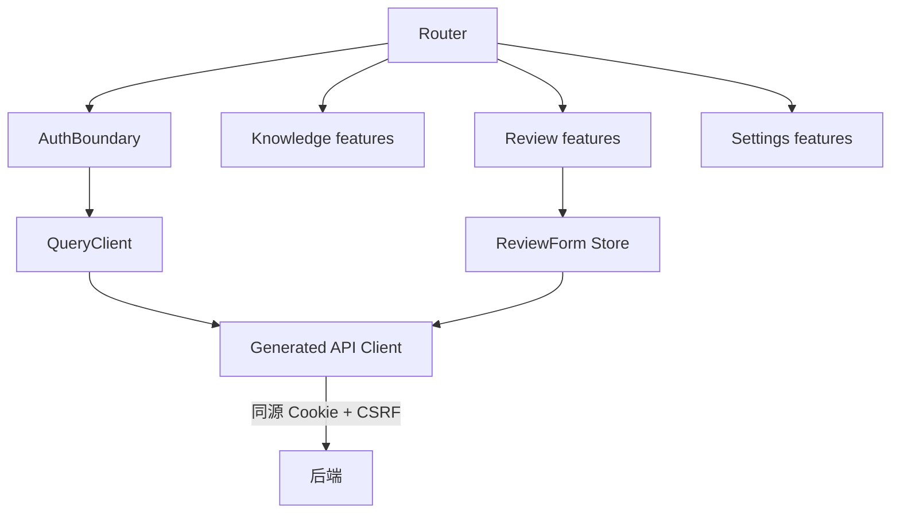
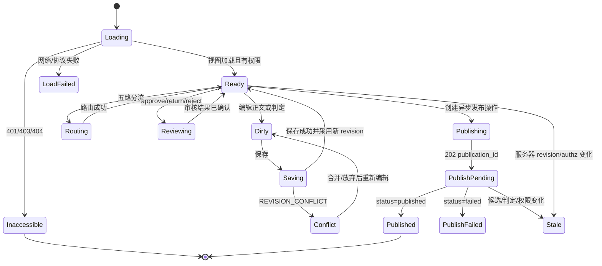

# AI 研发知识基座：前端架构设计

- 版本：2.1（阶段 A 契约修订）；日期：2026-09-12。
- 依据：[AI 研发知识基座 PRD V2.1](<../../AI 研发知识基座 PRD V2 修订版.md>)。
- 状态：实施设计建议。本文规定模块、契约和验收边界，不表示系统已实现或评测已通过。
- 文档协作：[工具端架构](<../../docs/architecture/01-工具端架构设计.md>) · [前端架构](<../../docs/architecture/02-前端架构设计.md>) · [后端架构](<../../docs/architecture/03-后端架构设计.md>) · [开发任务与验收计划](<../../docs/architecture/04-开发任务与验收计划.md>)。
- 规则优先级：PRD V2.1 为产品依据；跨端契约以随附 OpenAPI/JSON Schema 和《后端架构》B10—B20 的详细规则为实现基线；B1—B9 为概要导航。发现冲突须先修正契约与文档，不能自行选择较宽松规则。
- 共同底线：优先保存有证据的知识增量；搜不到不等于存在隐性知识；引用不等于验证；零条产出有效；权限、发布校验和成熟度判定由后端执行。

- 实现附件：[OpenAPI 3.1](<../../docs/architecture/contracts/openapi.json>) · [JSON Schema](<../../docs/architecture/contracts/schemas.json>) · [MCP 工具定义](<../../docs/architecture/contracts/mcp-tools.json>) · [领域 SQL](<../../docs/architecture/data/001_initial_schema.sql>) · [身份 SQL](<../../docs/architecture/data/002_identity_schema.sql>) · [验证记录](<../../docs/architecture/verification/2026-09-11-design-validation.md>)。

## F1. 定位与范围

前端是团队知识的审核与治理工作台。最重要的产品界面是“现有材料与新增信息的对照审核”，而不是知识总量大屏。

MVP 包含知识浏览、人工导入、贡献追踪、增量判定与审核、正文修订、验证确认、冲突处理、撤回/归档、授权配置、治理任务和指标查看。自定义工作流设计器、实时协作文档编辑、个人云同步和远程开发机控制后置。

采用 React 19、TypeScript、Vite、TanStack Query 5 的 Web 应用；详细模块和版本冻结规则见 F9。前端通过同源 `/api/v1` 调后端，不能直连模型、Git、数据库或对象存储。

## F2. 页面与权限架构

| 路由建议 | 页面 | 主要角色 | 核心内容 |
| --- | --- | --- | --- |
| /knowledge | 知识列表 | 有内容权限者 | 范围、类型、适用版本、发布/成熟度/时效筛选 |
| /knowledge/:id | 知识详情 | 有内容权限者 | 结论、增量、条件、例外、来源、验证与修订历史 |
| /contributions | 我的贡献/授权贡献 | 开发者、审核者 | 接收状态、逐条分流、待补充项 |
| /import | 导入与预览 | 有贡献权限者 | 选择来源、预览、脱敏提示与提交 |
| /reviews | 审核队列 | 领域负责人/授权管理员 | P0/P1/P2、owner、等待时间、缺失项 |
| /reviews/:candidateId | 增量对照审核 | 有审核权限者 | 基线、增量、证据、适用条件及五路分流 |
| /validations | 验证队列 | 有审核权限者 | 验证方法、结果、环境及独立性 |
| /conflicts | 冲突处理 | 领域负责人/管理员 | 同条件反结论、不同版本、替代关系 |
| /settings | 成员、仓库和配置 | 按管理权限细分 | 映射、配置版本、发布与回滚 |
| /operations | 治理和处理任务 | 有运维权限者 | lint、失败任务、删除请求状态 |
| /metrics | 质量与效果 | 范围内管理者 | 增量质量、遗漏、误入、成本及检索指标 |
| /notifications | 更正通知 | 已知引用者 | 撤回/修订提醒与受影响版本 |

路由守卫和按钮权限使用 GET /me 的 capabilities，仅改善体验；后端仍逐操作授权。前端不得把平台管理员映射为所有内容可读。列表统计也需后端按内容范围计算，避免通过计数泄漏。

## F3. 应用内部组织

建议目录：app（路由、布局）、features/knowledge、features/review、features/contribution、features/validation、features/settings、features/metrics；shared/api、shared/contracts、shared/ui、shared/auth。

| 层 | 责任 |
| --- | --- |
| 页面容器 | 读取路由、加载已授权视图模型、触发业务操作 |
| 业务组件 | 比较证据、编辑条件、展示分流与状态 |
| API 客户端 | 类型校验、request_id、错误归一化、分页与取消请求 |
| 服务端状态缓存 | 以租户、主体、范围、对象 ID/revision 为键；登出/切域清空 |
| 表单状态 | 本次未提交改动、字段错误、版本冲突处理 |

领域枚举和校验结构从 packages/contracts 生成，不在页面维护另一套状态表。敏感正文不默认写 localStorage 或离线缓存；长表单暂存在页面内，离开前提示未保存。后续若需要持久草稿需另行定义保留与访问策略。

## F4. 增量审核页（首要交付）

### F4.1 页面布局

```text
顶部：问题 / 仓库与 commit / 候选版本 / owner / 优先级 / 权限与冲突提示
┌──────────────────────────┬──────────────────────────┐
│ 现有材料与基线             │ 新增信息与依据             │
│ 已查文件、测试、权威文档    │ knowledge_delta           │
│ 检查范围、方式与预算        │ 每项断言对应证据           │
│ baseline_answer + 引用    │ 为什么、条件、例外         │
│ 未查明问题与检查限制        │ 遗漏后果、失效条件         │
└──────────────────────────┴──────────────────────────┘
下部：相似条目/冲突、五路分流、成熟度依据、enforcement 建议
底部：保存检查记录 / 转索引 / 链接已有文档 / 送发布审核 / 待确认 / 丢弃
发布区：审核结论、绑定版本、独立批准、发布操作与索引状态
```

窄屏上下排列两栏，保持字段标题与证据对应；不能用颜色独自表达风险或成熟度。所有关键字段可键盘操作，差异除颜色外提供增加/删除标识。

### F4.2 判定填写与审核

人工检查者可以记录实际查阅材料、版本、基线答案和依据；没有执行检查时不得一键填充“已检查”。isolation 检查结果在 MVP 可为空，页面完整支持 human_review。

disposition 与 discoverability 分别显示。P0 表示审核优先级，不显示“高可信”徽章。置信度自评分标记为模型自评，不能画成真实正确率。

五路操作：

| 操作 | 页面行为 | API 行为 |
| --- | --- | --- |
| 转索引 | 填文件/符号/版本与理由 | review action=route，disposition=index_only |
| 链接已有文档 | 选择授权来源，说明覆盖内容 | route，link_existing |
| 知识候选 | 填完整增量、逐项证据和条件 | 保存 assessment，进入审核；不立即发布 |
| 待确认 | 指明未检查项、缺证据或冲突 | route，needs_confirmation |
| 丢弃 | 填无价值/重复理由 | route，discard |

规范镜像使用显式申请区：权威来源、同步责任人、镜像理由。不能通过切换下拉框绕过增量检查。enforcement 只记录建议及关联产物，未有执行依据只能选择 proposed。

批准前提供“冻结最小审核依据”：选择 raw 来源中实际支持结论的定位，通过 POST /evidence/{id}/retain 创建 retained 证据，展示返回片段/保留期，再用新的 EvidenceRef 保存判定并重新送审。不能把模型摘要作为已保留证据；失败或无权限时不可批准。已固定的 retained 依据不因 raw 清理自动换 ID。

### F4.3 审核与发布动作

送审前前端校验必需字段以减少往返；后端重新验证所有规则。批准与发布绑定 candidate_revision、assessment_revision、evidence_set_hash、scope；保存新改动后清除页面旧批准展示并刷新服务端状态。

贡献者不能独立批准自己贡献。若当前人看不到某份必需证据，展示“缺少证据查看权限”，不暴露片段，不能批准。证据 URL 不直接拼成公开存储路径，通过后端授权代理查看。

发布按钮显示目标范围、版本与内容摘要。网络超时后用原 operation_id 查询或安全重试，不发送不同 operation_id 重复发布。published/index_pending 显示“已发布，索引更新中”；索引失败提示重建状态，不声称已可搜索。

## F5. 知识、验证与纠错交互

知识详情通过 GET /knowledge/{id} 取得完整 KnowledgeDetail，列表和历史分别用 KnowledgeSummaryPage、KnowledgeRevisionPage，不能复用 SearchHit。管理写入使用 aggregate_revision，引用/验证使用 content_revision。完整展示四维状态；普通读者只看有权内容。draft 的“未完成验证”提示不能被高引用量覆盖。版本切换显示 is_current/usage_mode，历史版本仅作参考，不把旧正文作为当前指导。缺少历史/审核权限时不显示已撤回正文。

修订使用 RevisionCreate，提交目标 aggregate_revision、base_content_revision、证据 contribution_id 与完整正文；返回候选 revision_binding。原有效版本在新版本批准前继续按自身状态服务。目标变化后显式三方合并并用 /candidates/{id}/rebase 保存，清除旧判定/批准，再检查和送审；不能通过普通 PATCH 静默改基线。纠错入口允许开发者提交反馈，授权负责人可以先暂停检索再裁决；撤回、归档、暂停和删除采用不同名称与结果说明。

验证页显示知识版本、task、环境、方法、预期/实际结果、证据、提交者和已有独立验证。审核者只能认可实际支持的结论；UI 不提供自由修改 maturity 的输入框。failure 和 inconclusive 可以通过审核成为有效反证或无结论记录，但不提升成熟度。

冲突页并排比较适用条件、版本和证据；允许分别保留、缩小范围、提出合并、替代或撤回。合并/范围扩大走后端审核，不以“相似度高”预选通过。

## F6. 接口、并发与异常

消费《后端架构》B6 管理接口。领域视图模型建议为 CandidateReviewView：candidate、assessment、evidence_summaries、related_entries、blocking_reasons、allowed_actions、current_revision；所有子对象经同一授权策略过滤。

- 列表使用 cursor 分页；页面刷新保持筛选，不依赖拉取全库再本地过滤。
- 表单写入传 expected_revision 和 operation_id；REVISION_CONFLICT 时保留本次输入，展示最新变化，让用户重新核对。
- PUBLICATION_BLOCKED 将已授权字段错误映射到表单；不可访问对象统一安全空态。
- 登出/权限收回清理缓存和打开的正文；有修改时提示未保存但不继续展示无权数据。
- 后台任务通过有界轮询更新，页面不可见时暂停，暂时失败退避；技术失败和业务待确认分开显示。
- Markdown 展示清理不受信任 HTML，不执行脚本；外链和附件不自动请求隐藏资源。前端无任意命令执行入口。
- 默认不乐观更新发布、撤回、权限或验证结果，等待服务器确认。

## F7. 指标与可解释性

首页优先展示待审核、待补充、冲突和到期复核，显示 owner 与处理期限。指标页同时展示经验增量合格率、代码复述误入率、重要增量遗漏率、未证实断言发布数、五类分流、inconclusive 比例、审核/模型成本。

每项指标显示定义、统计范围、分子分母、时间窗口与样本数；镜像与导航不计新增经验。业务效果展示真实任务对照，不用引用量代替成功率。模型自评分与人工标注评测分区，避免混淆。

## F8. 前端验收

必须完成：一条真实候选的对照审核；五路分流与零知识产出；无基线时不能伪造检查完成；P0 缺证据不能发布；镜像审批；自审阻止；过期版本冲突；证据无权限安全占位；撤回后缓存失效；验证失败不晋升；发布成功但索引失败状态准确；键盘可操作及窄屏布局。

前端测试以关键流程组件测试和浏览器端到端测试为主；纯样式不增加镜像式测试。Mock 与后端共同使用契约 fixtures；发布拒绝、权限和幂等必须在真实后端联调中验证。概要验收见本节，状态、表单与并发的详细测试见 F14；任务见 F01—F07、Q01—Q03。

## F9. 前端运行结构与认证会话

前端采用 React 19、TypeScript strict、Vite 和 TanStack Query 5。应用是客户端路由的管理工作台，由同源反向代理提供静态资源和 `/api/v1`。不引入服务端渲染、全局状态框架或微前端；认证主体、租户和 capability 由 GET /me 返回，不能从 URL 或本地存储自行构造。



启动顺序：加载不含秘密的构建配置 → GET /me → 建立主体隔离的 QueryClient → 根据 capability 构建可见导航 → 加载当前路由。GET /me 401 跳组织登录；403/404 进入安全空态；网络失败显示可重试故障页，不自动当成退出登录。

QueryClient key 第一段必须是 `[tenantId, principalId, authzVersion]`，后续再加资源和 scope/filter；登出、主体变化或 authz_version 变化时取消在途请求、清空整个 QueryClient、清理打开正文及表单。浏览器缓存策略为 `Cache-Control: no-store` 的敏感 API；Service Worker 不缓存 API 或知识正文。

Web 会话使用 HttpOnly Cookie。前端从页面 meta/启动接口获得 CSRF token，写请求同时发送 token 和同源 Origin；不能读取或保存会话 Cookie。CLI 浏览器批准页面显示 client_name、请求范围、租户和过期时间，用户明确批准/拒绝；它不能接受 URL 参数指定 actor 或 capability。

## F10. 审核页面状态机

候选的服务端发布状态与页面交互状态分开。服务端状态来自 Candidate/Assessment/Review/Publication；页面状态只描述当前浏览器操作，不能写回为权威状态。



页面不能从 Dirty 直接发布。experience + knowledge_candidate 的正常顺序是保存候选 → 保存 Assessment → 路由/送审 → 独立审核 approve → 发布。index_only/普通 link_existing/needs_confirmation/discard 在路由完成后没有发布按钮。唯一例外是 authoritative_mirror + link_existing：保留原 disposition → 填写 mirror 权威来源/同步负责人/理由 → 独立 approve(mirror_approval=true) → 发布；不伪装为 knowledge_candidate、不计新增经验。allowed_actions/current_approval 以服务端返回为准。

状态转换表：

| 当前状态 | 事件 | 前端动作 | 服务端前提 |
| --- | --- | --- | --- |
| Ready | edit | 创建 baselineSnapshot，进入 Dirty | 无写请求 |
| Dirty | save | 发 CandidatePatch/AssessmentWrite | expected_revision 匹配 |
| Saving | 409 | 保存本地草稿，加载最新服务器版本 | 返回最新 revision 或重新 GET |
| Ready | route | 显示最终 disposition 确认 | assessment 完整且允许 action |
| Ready | approve | 确认绑定版本和范围 | 非自审、有证据查看权限 |
| Ready | publish | 发送固定 operation_id | 当前 approve 与 hash 有效 |
| PublishPending | poll | 2/4/8 秒退避，页面隐藏时暂停 | publication_id 可查询 |
| 任意可读 | authz_changed | 取消请求、清缓存、重新 GET /me | 新 authz_version |
| 任意写入 | 401 | 停止写入，走登录恢复 | 不自动重放非幂等动作 |

review 返回 ReviewRecord.review_id；刷新后从 ReviewView.current_approval 恢复有效批准，不依赖此前响应或审计日志。latest_review.validity=stale 时显示失效原因，current_approval=null 时不可发布。发布失败只允许在确认 blocker/权限/版本后用新的操作重新提交；网络未知结果使用原 operation_id 查询。页面刷新从 ReviewView.current_publication 恢复 publication_id/PublishPending，不生成新发布操作；不得把正文或证据放入 URL。

## F11. 审核表单领域模型

表单不是一个扁平 JSON 编辑器。它由四个可独立校验的 section 组成，并映射共享契约：

```typescript
type ReviewFormModel = {
  candidate: CandidateBodyForm;
  assessment: AssessmentForm;
  routing: RoutingForm;
  publication: PublicationIntent;
  baseline: VersionBinding;
  dirtyPaths: Set<string>;
};

type VersionBinding = {
  candidateRevision: number;
  assessmentRevision?: number;
  evidenceSetHash: string;
  scopeId: string;
};
```

`CandidateBodyForm` 编辑 type、title、claim、context、scope、owner、role、rationale、失效条件、alternatives 和 enforcement；`AssessmentForm` 编辑 question、checked_context、baseline_answer、knowledge_delta、claim_evidence_map、omission_consequence、priority、disposition、reason 和 confirmation_questions。actor、审核人、maturity、publication_status、serving_status 不进入可编辑模型。

### F11.1 字段与校验层级

| 层级 | 校验内容 | 失败处理 |
| --- | --- | --- |
| 字段 | 必填、长度、枚举、URL/版本格式 | 就地错误，禁止提交该 section |
| section | baseline completed 与 incomplete_reason 一致；delta claim_id 唯一 | section 顶部摘要＋字段定位 |
| 跨 section | knowledge_candidate 必须非空 delta；每项 supported delta 有证据；scope 与 evidence 可披露 | 送审阻断，不隐式改 disposition |
| 服务端 | 自审、真实证据、当前权限、版本/hash、镜像批准、开放冲突 | 根据 PUBLICATION_BLOCKED blockers 映射；服务端结论优先 |

当 checked_context.completed=false 时，discoverability 只能为 inconclusive，路由默认为 needs_confirmation；UI 可以建议，不自动替用户提交。support=inference/unconfirmed 的 delta 以警告显示且不能进入 experience 发布集合，需拆分或补证据。

每项 knowledge_delta 必须有稳定 claim_id，并在右侧列出 EvidenceRef；移除证据时立即标记关联 claim 为 unsupported，但不静默删除 claim。修改 claim、证据 locator/revision、scope 或 Assessment 会使 publication section 的旧 review 显示为 stale。

`alternatives` 只在 decision 且有证据时展示；不要求填写虚构选项。authoritative_mirror 显示 authority_ref、sync_owner、mirror reason；experience 不显示镜像字段。enforcement 默认 proposed，只有服务端返回已核验 artifact 才可显示 implemented/verified，普通表单不能直接选择 verified。

### F11.2 草稿与敏感数据

表单编辑状态仅存内存。路由切换时显示离开确认；浏览器刷新会丢失未保存内容，这是 MVP 明确限制。不得把候选、证据或 baseline_answer 写 localStorage、sessionStorage、URL 或错误分析 SDK。后续增加服务端草稿需要单独的权限与保留设计。

引用证据通过 GET /evidence/{id}?revision=N 按需打开绑定的确切版本；关闭抽屉即从组件状态移除正文。页面复制、下载能力按 capability 控制，但浏览器中已授权可见内容无法被技术上绝对防复制，文档和产品文案不能作相反承诺。

## F12. 并发编辑与冲突合并

所有写请求携带 operation_id；更新携带 expected_revision。UI 不做正文的乐观成功展示。TanStack Query 的 mutation 成功后用服务器返回对象替换缓存，随后失效相关列表；不能本地 `revision + 1` 猜测结果。

候选发生 409 时进入三方比较：

```text
base：进入编辑时的服务器快照
mine：当前本地表单
theirs：冲突后获取的最新服务器快照
```

自动合并只允许满足以下条件的路径：mine 与 base 相同则接受 theirs；theirs 与 base 相同则保留 mine；双方改动不同字段则合并。双方修改同一标量、同一数组元素、scope、evidence 关系或 disposition 时必须人工选择。数组元素使用稳定 ID，不按索引合并；重新排序与内容修改分开记录。

合并后以 theirs.revision 为 expected_revision 重新保存，并重新计算/获取 evidence_set_hash。旧审核一律显示失效，即使文本合并无冲突。不能自动重放 approve/publish。

Assessment 与 Candidate 独立 revision，但 ReviewView 将二者绑定。任一更新成功后另一标签页通过以下方式发现陈旧：页面聚焦时 refetch；PublishPending 轮询；后续可增加服务器事件。MVP 不依赖 WebSocket。

权限并发：写请求返回 401/403 时立即冻结表单；不允许“稍后自动重试”。重新登录后必须重新 GET 对象并确认仍有能力，旧 operation_id 只用于查询未知结果，不能跨主体重放。证据权限变化时关闭已打开证据并移除缓存。

### F12.1 多标签页协调

BroadcastChannel 仅广播 `authz_changed`、`entity_updated(id,revision)` 和 logout，不广播正文。收到更新后 Dirty 页面显示“服务器已有新版本”，不覆盖本地输入；Ready 页面直接 refetch。浏览器不支持 BroadcastChannel 时靠 focus refetch 保证最终发现。

发布、撤回、权限和验证审核不做前端锁。多人同时点击由后端 operation_id、expected_revision 与版本绑定裁决，前端显示赢家结果和当前服务器状态。

## F13. 审核页面组件与数据加载

| 组件 | 数据 | 关键行为 |
| --- | --- | --- |
| ReviewHeader | candidate revision、scope、owner、priority、blockers | 明示当前绑定版本和 stale 状态 |
| BaselinePanel | checked_context、baseline_answer、引用 | 未检查/预算耗尽/无权限分别展示 |
| DeltaPanel | claim_id、delta、support、evidence | 逐项证据，unsupported 阻断 |
| EvidenceDrawer | 授权证据正文 | 按需获取、关闭清除、不拼对象存储 URL |
| RoutingPanel | discoverability、disposition、reason | 五路互斥；切换时重新运行跨 section 校验 |
| SimilarityPanel | related_entries、条件、版本 | 只作审核参考，不一键自动合并 |
| EnforcementPanel | kind、status、artifact | proposed 与真实已实施分开 |
| ReviewActions | allowed_actions、binding | 不依据本地角色硬编码可执行动作 |
| PublicationStatus | publication_id/status/index_status | 恢复轮询、区分发布与可检索状态 |

首次加载 ReviewView 应一次返回候选、判定、证据摘要、相关知识、blockers 和 allowed_actions，减少前端拼装出不一致快照。证据正文另取。若部分摘要因无权被安全占位，该用户不能 approve。

列表轮询不超过每 30 秒；publication 轮询 2/4/8 秒后稳定 10 秒，最多 2 分钟，之后显示“仍在后台处理”并允许手动刷新。页面隐藏暂停；回到前台立即一次查询。请求 AbortSignal 取消只影响展示，不假设服务端写操作已撤销。

## F14. 前端错误、可访问性与测试矩阵

错误呈现：字段错误定位控件；业务阻断保留用户输入；403/安全404不显示对象标题；503显示 request_id 与重试；协议不兼容阻止写入并提示刷新应用。错误信息不渲染后端返回 HTML。

关键审核操作须支持键盘、清晰焦点和屏幕阅读器标签；两栏在窄屏按“基线→增量→证据→路由→动作”排序。状态除颜色外必须有文字/图标。证据差异中的删除与新增有明确标记。

测试分层：

- 单元：跨 section 校验、状态 reducer、三方合并、blocker 映射、query key。
- 组件：五路路由、镜像条件、证据权限占位、未完成 baseline、stale review。
- 契约：所有 fixtures 经 OpenAPI schema 解析，未知枚举进入受控“不兼容”态。
- E2E：两浏览器并发编辑、旧批准发布、发布超时恢复、撤权、多标签页更新、验证不自动晋升。
- 可访问性：审核主流程自动扫描＋键盘人工验收。

任务映射更新为 F01—F07、Q01—Q03。F06 实现审核状态机与表单模型，F07 实现并发合并、多标签协调和发布恢复。
