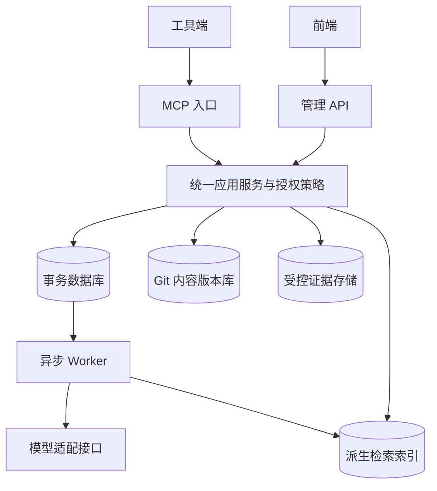
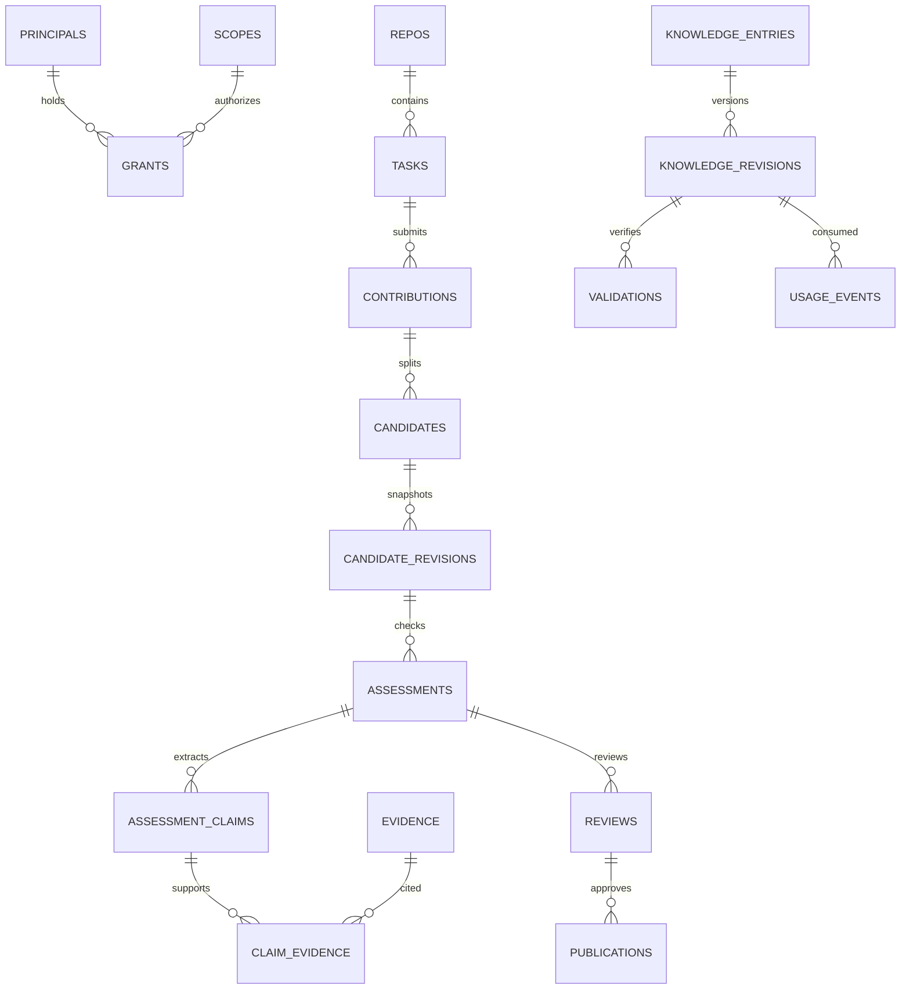
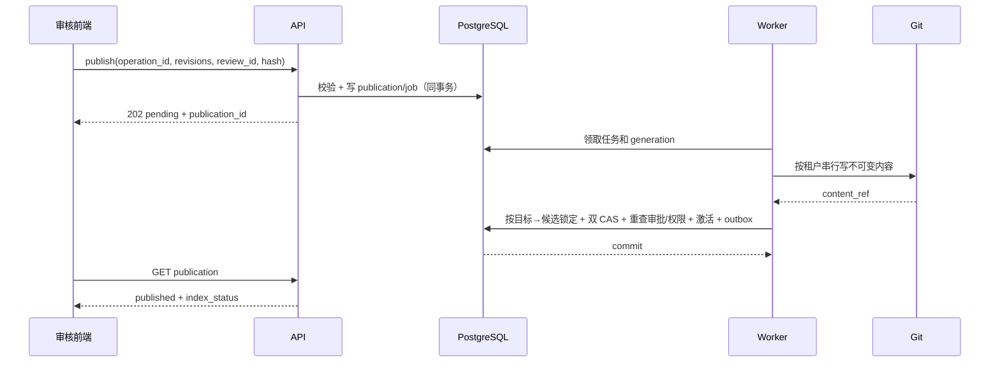

# AI 研发知识基座：后端架构设计

- 版本：2.1（阶段 A 契约修订）；日期：2026-09-12。
- 依据：[AI 研发知识基座 PRD V2.1](<../../AI 研发知识基座 PRD V2 修订版.md>)。
- 状态：实施设计建议。本文规定模块、契约和验收边界，不表示系统已实现或评测已通过。
- 文档协作：[工具端架构](<../../docs/architecture/01-工具端架构设计.md>) · [前端架构](<../../docs/architecture/02-前端架构设计.md>) · [后端架构](<../../docs/architecture/03-后端架构设计.md>) · [开发任务与验收计划](<../../docs/architecture/04-开发任务与验收计划.md>)。
- 规则优先级：PRD V2.1 为产品依据；跨端契约以契约 v2 和 B10—B20 为实现基线，B20 明确修订旧版同名规则；B1—B9 为概要导航。发现冲突须先修正契约与文档，不能自行选择较宽松规则。
- 共同底线：优先保存有证据的知识增量；搜不到不等于存在隐性知识；引用不等于验证；零条产出有效；权限、发布校验和成熟度判定由后端执行。

- 实现附件：[OpenAPI 3.1](<../../docs/architecture/contracts/openapi.json>) · [JSON Schema](<../../docs/architecture/contracts/schemas.json>) · [MCP 工具定义](<../../docs/architecture/contracts/mcp-tools.json>) · [领域 SQL](<../../docs/architecture/data/001_initial_schema.sql>) · [身份 SQL](<../../docs/architecture/data/002_identity_schema.sql>) · [验证记录](<../../docs/architecture/verification/2026-09-11-design-validation.md>)。

## B1. 职责与部署边界

后端承接工具端 MCP/业务 API 和前端管理 API，维护唯一权威的身份、内容权限、知识状态及发布规则。知识提炼、增量判定、检索、审核与验证都属于后端业务模块。

MVP 采用模块化单体服务加异步 Worker。API 和 Worker 可以共享代码库与数据库，使用不同运行身份和进程；不按模块拆成六个微服务。前端不直接访问数据库、Git 或证据存储；工具端不直写权威状态。



部署依赖建议：事务数据库优先采用 PostgreSQL；证据采用受控对象存储或单实例受控文件存储；Git 保存审核后的内容版本；队列初期采用数据库任务表；关键词索引可与数据库同部署。默认技术方案现已在 B10 明确，D00 仅确认组织接入信息与实现锁文件，不再推迟架构选型。

MVP 支持关键词检索与人工可发现性检查。向量库、自动隔离代码检查器、多源连接和自动发布不作为首版前置条件。隔离检查接口必须预留，人工路径应完整可用。

## B2. 业务模块与内部接口

| 模块 | 职责 | 对内操作示例 | 不应承担 |
| --- | --- | --- | --- |
| identity-config | 主体、成员、角色、仓库映射、配置发布 | authorize、resolveContext、getConfig | 从客户端 repo 参数直接授予权限 |
| contribution | 证据接收、脱敏复检、幂等、任务状态 | acceptContribution、getProgress | 将 accepted 等同于 published |
| assessment | 候选提炼、可发现性记录、增量与五路分流 | extract、assess、route | 依赖模型自评分自动发布 |
| knowledge-governance | 审核、版本、发布、撤回、冲突、范围变更 | review、publish、suspend、withdraw | 将相似度作为合并决定 |
| retrieval | 授权检索、适用性判断、预算、上下文组装 | search、getAuthorizedEntry | 从索引缓存直接信任旧权限 |
| validation-metrics | 使用、验证、成熟度重算、评测 | recordUsage、reviewValidation、evaluate | 通过引用次数晋升 |

跨模块通过应用接口调用；数据库中不同模块的权威字段只由所属模块写入。模型适配层仅输出建议数据，不持有发布权限或可执行配置权限。

## B3. 关键端到端流程

### B3.1 提交与增量判定

1. 身份认证，服务端校验仓库授权和包大小；校验幂等键及来源事件。
2. 证据复检；含不允许上报信息时拒绝或隔离，不发送模型。合法包落受控存储，事务写入贡献记录与提炼任务。
3. 返回 contribution_id 和 accepted；Worker 异步提炼原子断言，保存 claim 与来源定位，不编造原因或失败过程。
4. 建立 CaptureAssessment。MVP 默认等待有权检查者填写已查材料、基线答案及依据；缺少检查时 discoverability=inconclusive、disposition=needs_confirmation。
5. 对比候选与基线，仅提取有来源支持的增量。按 B5 五路分流，保留导航、链接、待确认和丢弃记录；一个包可以有多个不同处理结果，也可以没有任何知识候选。
6. 有增量的候选进入审核；规范镜像走显式例外路径。审核通过后进入 B3.2。

隔离检查扩展：输入只能包含中立问题、授权材料快照及预算；不能携带候选答案、原讨论、提炼上下文或其缓存。无资料权限、超预算、模型失败统一记录未完成原因；不得升级为 missing_context。问题本身也要检查答案暗示。模型与检查规则版本、实际 token/时间/工具用量单独计费记录。

### B3.2 审核发布与一致性

审核请求绑定 candidate_revision、assessment_revision、evidence_set_hash 和目标范围。修改任一结论、条件、证据、判定或范围后，旧批准失效；排版变更也要记录审核，成熟度可按 PRD 保留。

发布前服务端再次检查：

- 审核者有内容权限且不是唯一的自审贡献者；审批主体来自认证会话。
- experience 有已审核的非空 knowledge_delta、逐项证据、适用条件、owner、失效条件和完整判定记录。
- authoritative_mirror 具有权威来源、同步责任人、镜像理由及明确批准；禁止改 role 绕过检查。
- 无未解决的阻断冲突；来源和目标范围兼容。共享范围扩大要求源负责人批准并重新审查派生内容。
- enforcement 已评估；未实施保持 proposed。验证证据不足时 maturity=draft。

执行顺序：准备不可变正文版本 → 受控串行写入 Git 并获取 content_ref → 数据库事务 CAS 校验旧 revision、激活新版本、写审计和 outbox → Worker 更新索引。Git 失败不得激活；事务失败形成的孤立 Git 版本不对外服务，由清理任务处理。发布请求按 B14 异步返回 publication_id/status=pending；轮询成功后区分 published 与 index_status=pending/ready/failed。

撤回和暂停先写权威状态再异步清理索引；检索返回前重查权威状态。并发保障按返回前授权检查的时点判断：状态变更提交后开始的检查必须拒绝；已发出的正文无法追回，已知引用者通过站内更正通知获知。

### B3.3 检索与应用

身份与任务上下文 → 授权集合 → 仓库/环境候选 → 关键词检索 → 适用性与状态过滤 → 排序 → 权威权限/状态复检 → 预算裁剪 → 返回。

不得为了返回至少若干条而放宽 ACL。global 只包含当前主体有权访问的团队通用知识。未知依赖版本需要补充；已知不兼容条目不能作为直接建议。review_due/unknown 必须说明不确定性，stale 默认排除；draft 返回未完成验证标记。

排序考虑相关性、版本、证据、权威性及时效；P0/P1/P2 仅为采集审核优先级。团队强制规范由配置通道加载，不能被一般检索预算或“已找到三条”截断。

默认一次最多 5 条、总正文预算 4000 tokens；服务端创建并绑定 task_id，默认每任务 3 次自动知识读取，search/get 均计数。配置获取与事件上报不计此预算，但独立限流。申请更高预算必须受服务策略批准，新造客户端 task_id 不能绕过配额。仅成功完成的逻辑查询计一次，operation_id 的幂等记录避免网络重试重复扣减；request_id 仅用于单次请求追踪；超时任务记录实际执行成本，不伪造零消耗。

上下文按条件、增量、结论依据、例外、验证方法组织，不静默截去限定条件；无法完整容纳关键条件时只给可展开提示。入口不区分未授权条目与不存在条目的存在性。

## B4. 统一数据与状态契约

内部 ID 为服务端生成的稳定不透明 ID；时间统一 UTC；业务正文使用 UTF-8；所有表以 tenant_id 作为强制作用域。工具端和前端读取服务端返回的 capabilities，仅用于界面提示，服务端仍逐请求鉴权。

| 对象/存储 | 关键字段与约束 |
| --- | --- |
| principals / grants / repos | 成员、内容范围、角色、规范化仓库映射；平台管理员不自动获正文权限 |
| contributions | id、actor_id、repo_id、idempotency_key、payload_hash、processing_status；tenant+key 唯一 |
| source_events | 源客户端、session、event_id、hash、task/PR/commit；同来源事件唯一，跨任务重复证据另行识别 |
| evidence | 不可变 source_ref/revision、定位、摘要、ACL、保留期；正文不写长期 Git |
| capture_assessments | PRD §4.5 全部字段、revision、来源关联、判定与审核人；旧记录不可被静默覆盖 |
| candidates | 原子断言、context、role、owner、assessment_id、publication_status、revision |
| knowledge_entries / revisions | 稳定 ID、当前 revision 指针、content_ref、scope、四维状态；正文可追溯 |
| navigation_items | index_only/link_existing、授权来源、符号/路径/版本；不计经验条数 |
| reviews / conflicts | 审核绑定对象版本、证据集合和范围；冲突解决理由及替代关系 |
| usage_events / validations | event_id 唯一；验证绑定知识 revision、task、方法、环境、结果和审核人 |
| jobs / outbox | 任务去重键、租约、尝试数、next_run_at、状态、last_error_code |
| config_versions / audit / notifications | 受控配置、操作审计、已知引用者的更正通知 |

四维状态完全沿用 PRD：

- publication_status：candidate / in_review / published / rejected / withdrawn / archived。
- maturity：draft / verified / proven。
- freshness：current / review_due / stale / unknown。
- serving_status：enabled / suspended。

贡献处理状态为独立技术字段：accepted / processing / waiting_review / waiting_confirmation / completed / failed。completed 只表示包内条目已获得当前阶段终态，不等于全部发布；返回 route_counts 与 published_ids。需要后续补充可重新排队并保留处理历史。原始包可拆成多个候选，每个候选拥有自己的分流和审核状态。

使用事件沿用 retrieved / cited / applied / validation_submitted / validation_accepted。retrieved 由服务端成功返回时记录；验证后两类由验证业务生成，不能让任意 record-usage 请求伪造审核通过。

## B5. 增量判定与五路分流

| discoverability/依据 | disposition | 服务行为 |
| --- | --- | --- |
| code_recoverable 且无独立增量 | index_only | 生成授权导航，关闭该候选处理 |
| authoritative_source 且原来源已充分回答 | link_existing | 生成授权链接；镜像需单独批准 |
| missing_context，检查已完成且增量有依据 | knowledge_candidate | 等待人工审核，不自动发布 |
| inconclusive，或具体结论缺证据/有冲突 | needs_confirmation | 列明缺口，等待补充；保留已有检查事实 |
| 重复或无复用价值，有理由 | discard | 保存结束理由，允许零产出 |

disposition 不由 priority 或五维自评分推导；后端验证可发现性与分流组合是否成立。权威镜像可以在 link_existing 判定基础上申请正文发布，必须保留镜像审批与来源，不伪造 missing_context。

审核展示字段由后端提供：question、checked_context、assessment_method、baseline_answer、discoverability、knowledge_delta、claim_evidence_map、omission_consequence、priority、disposition、review。读者无证据权限时只给安全占位，不泄漏标题/片段；不能看齐必需证据的人员不得批准该条。

人工检查是 MVP 的完整可用路径；只实现提炼 Prompt 而缺少结构化判定和发布约束，不算完成。

## B6. 对外 API 契约草案

所有路径为本项目设计，不代表已部署地址。管理与工具业务 API `/api/v1`；MVP 本地 MCP 桥接调用这些 API，后端 `/mcp` 远程适配后置。两种调用方式使用同一应用服务。HTTP JSON 成功结构为 `{request_id, data}`；错误为 `{request_id, error:{code,message,retryable,details}}`。MCP 将相同领域响应包装为协议结果，不改变权限与语义。

列表接口采用 cursor/limit 分页；输入 schema 拒绝客户端写入 actor、审核人、maturity 等服务端字段。openapi、JSON Schema、MCP 工具定义由共享契约生成并做一致性测试。

### B6.1 工具与业务接口

| MCP 工具 | HTTP 对应 | 输入重点 | 返回重点 |
| --- | --- | --- | --- |
| search-knowledge | POST /knowledge/search | task_id、query、repo_id、environment、scope、limit、token_budget | query_id、items、outcome、budget |
| get-knowledge | POST /knowledge/read | task_id、id、可选 revision | 授权正文、当前状态、引用与预算 |
| ingest-knowledge | POST /contributions | idempotency_key、repo_id、source_event_ids、evidence、可选 candidates | contribution_id、accepted/duplicate、processing_status |
| get-contribution | GET /contributions/{id} | id | 包状态、逐候选 disposition、route_counts、published_ids |
| record-usage | POST /usage-events | event_id、task_id、知识 ID/revision、cited/applied | recorded/duplicate |
| submit-validation | POST /validations | event_id、知识版本、任务、环境、方法、预期/实际结果、证据 | validation_id、pending |
| submit-feedback | POST /feedback | 知识版本、类别、说明 | feedback_id、状态 |
| get-config | GET /config | repo_id、client_version、current_config_version | 配置版本、差量/未变更、兼容状态 |

补充基础 API：GET /me 返回身份与能力；POST /repo-bindings 核验仓库；POST /tasks 创建服务端任务；POST /tasks/{id}/budget-requests 请求额度；GET /notifications 与 POST /notifications/{id}/read 提供更正通知。工具认证经组织身份系统完成，CLI 使用浏览器授权或经验证的设备授权流程，具体方式在 D00 冻结。

search outcome：matched / no_applicable_knowledge / clarification_required / budget_exhausted。服务失败通过错误结构返回，不能返回成功的 no_applicable_knowledge。每个 item 包含 id、revision、title、claim、context、knowledge_delta、rationale、maturity、freshness、source_refs、match_reason、truncated。证据和来源链接经同样授权。

请求示例（标识均为假设）：

```json
{
  "task_id": "task_demo",
  "repo_id": "repo_demo",
  "query": "改变订单消息发送方式前，需要遵守哪些事务顺序约束？",
  "environment": {"commit": "example-commit", "dependencies": {}},
  "scope": "repo",
  "limit": 5,
  "token_budget": 4000
}
```

### B6.2 管理接口

| 方法与路径 | 用途与核心约束 |
| --- | --- |
| GET /knowledge、GET /knowledge/{id}/revisions | 授权浏览及历史列表；历史正文仍检查权限和状态 |
| GET /knowledge/{id} | 完整管理详情及 aggregate/content revision；历史/非活跃正文另需授权，不替代 MCP 预算读取 |
| GET /reviews、GET /candidates/{id} | 审核队列和完整对照视图 |
| PATCH /candidates/{id} | 保存修订，携带 expected_revision；修改使旧审批失效 |
| PUT /candidates/{id}/assessment | 有权人员提交/修订检查记录，留存执行依据和版本 |
| POST /candidates/{id}/review | action=approve/return/reject/route，绑定候选、判定、证据版本 |
| POST /candidates/{id}/publish | 仅后台有权人员调用，重新执行全部发布门槛，操作幂等 |
| POST /knowledge/{id}/revisions | 创建修订候选，不能直接覆盖已发布正文 |
| POST /candidates/{id}/rebase | 显式重基，目标/候选双 CAS，旧判定/批准失效 |
| POST /knowledge/{id}/suspend、/withdraw、/archive | 记录理由、expected_revision；立即更改权威可服务状态 |
| POST /knowledge/{id}/scope-change-requests | 申请共享范围变更，走单独授权审核 |
| GET /scope-change-requests、POST /scope-change-requests/{id}/review | 源负责人审核指定内容版本与目标范围；变更后重新校验来源披露权限 |
| GET /conflicts、POST /conflicts/{id}/resolve | 按条件/版本裁决，不按相似度强行合并 |
| GET /validations、POST /validations/{id}/review | 独立审核验证；success/failure/inconclusive 与批准结果分离 |
| GET /evidence/{id}?revision=N、POST /evidence/{id}/retain | 精确版本读取及最小依据冻结，不暴露存储密钥 |
| GET /navigation | 有范围的导航/权威来源链接，不返回经验建议 |
| GET /members、GET /repo-bindings | 仅返回授权管理范围的成员与映射 |
| POST /membership-changes、POST /repo-mapping-changes | 具备管理权限者更新，写审计并使权限及时生效 |
| GET /config/versions、POST /config/versions、POST /config/{id}/activate | 草稿、发布及回滚；版本范围与校验信息必需 |
| GET /metrics、GET /audit | 范围受控的聚合指标和操作记录 |
| POST /governance/lint-runs、GET /jobs/{id} | 授权启动治理及查看任务，技术失败与业务待确认分离 |
| POST /deletion-requests、GET /deletion-requests/{id} | 受控删除与跨存储处理进度，不把归档当删除 |


更新已有聚合对象携带 expected_revision 和唯一 operation_id；创建操作只有 operation_id 或专用 idempotency_key/event_id；具体字段以 OpenAPI 为准。同操作重试返回原结果。过期版本返回 REVISION_CONFLICT 并要求重新核对，不采用后写覆盖。错误类别：UNAUTHENTICATED、FORBIDDEN、NOT_FOUND_OR_INACCESSIBLE、INVALID_INPUT、REVISION_CONFLICT、RATE_LIMITED、TEMPORARILY_UNAVAILABLE、PUBLICATION_BLOCKED。对外对象枚举查询优先统一不存在/不可访问语义；审核者在有权范围内可获具体阻断字段。

## B7. 生命周期与验证规则

发布、成熟度、时效及服务开关分别维护。draft→verified 需要至少一条独立审核通过的针对性成功验证；proven 需要至少两个独立任务、两名验证者，跨项目适用知识另需两个适用项目。组织规则采用权威确认依据，遵循 PRD。

验证记录由身份、任务、知识版本、方法/证据哈希去重，不能通过反复创建事件增加独立次数。客户端或模型声称“验证通过”仅为提交证据；审核者与验证提交者必须不同。引用、整体构建成功不自动提升成熟度。实质修订重算，不能盲目继承旧版本结果。

失败验证触发复核，严重反证允许授权人员暂停服务；长期不引用只降低热度。到期复核默认 90 天，按知识 owner 配置；critical 低频知识不按热度归档。

## B8. 任务、安全与可观测性

数据库任务队列采用至少一次投递；任务拥有 lease_until、attempts 和去重键，Worker 通过事务领取，超时租约可回收。写知识、证据、索引和验证时逐步幂等，禁止把一次 LLM 响应重试当作多个新知识。技术失败指数退避加随机抖动，最多 5 次后进入失败队列；业务 needs_confirmation 不属于技术重试。

原始证据最长默认 30 天，使用事件 90 天，审计 180 天。到期前将必要审核依据提取至独立受控证据对象；该对象仍受权限、最小化和团队保留策略限制。删除任务覆盖证据、索引、Git 历史中误入内容及备份生命周期，留最小审计证明。对外模型发送前再次检查数据范围；来源 URL 获取需白名单/地址校验，不能任意访问内网或把源文档指令交给执行器。

浏览器采用同源服务会话和写请求防伪校验；工具用有范围的令牌，凭据不进入文档、Git、日志或模型上下文。Worker 仅使用任务范围内权限，不能以服务账号访问全库再过滤。配置可执行能力与普通知识分开，MVP 不分发可执行 Skills。

指标：query_id/request_id/job_id 可串联链路；分别记录检索延迟、索引滞后、队列等待、模型成本、判定成本、分流比例、审核时长、版本冲突及撤回耗时。日志默认无正文。评测按 PRD §11，不用模型自评分证明提效。

## B9. 后端验收与演进

必测：两用户/两仓库越权矩阵；相同幂等键不同载荷；Worker 崩溃重启；Git 成功而数据库失败；数据库成功而索引失败；撤回后旧索引不得泄漏；自审和伪造 maturity 被拒；修改证据后旧批准不可发布；五路分流和规范镜像例外；独立验证去重；预算超限不伪装无结果。

性能目标沿用 PRD：1000 条、10 并发，端到端 P95≤2 秒、错误率≤1%，记录中文查询、分词方式与部署条件。API 默认 3 秒查询超时；后台提炼不纳入此时延承诺。备份建议 RPO 24 小时/RTO 4 小时，演练后才能宣称达标。

先以关键词和人工判定建立基线；只有评测证明缺口，才增加混合检索、自动隔离检查和更多来源。相关任务见开发计划 B01—B12、Q01—Q05。

## B10. 默认技术决策与替代条件

| 决策 | 本版默认 | 选择理由 | 何时替换 |
| --- | --- | --- | --- |
| 运行时 | Node.js 24 LTS、TypeScript strict、pnpm workspace | 三端共享类型与契约；API/Worker 分进程 | 团队已有强制运行时约束时通过 ADR 替换 |
| API | Fastify 5＋JSON Schema 校验，REST 业务接口 | 请求/响应可由同一契约校验 | 没有性能证据不改为微服务或 GraphQL |
| 前端 | React 19＋Vite＋TanStack Query 5，原生表单和共享表单字段组件 | 明确区分服务端缓存和本地编辑状态 | 大型表单复杂度增长再引入专门表单库 |
| 数据 | PostgreSQL 17，SQL 显式迁移，连接池上限初始 10/API 进程 | 事务、条件更新、队列与关键词索引统一 | 观测到数据库瓶颈才拆搜索或队列 |
| 检索 | 分词后的关键词检索＋结构化过滤；不使用 LLM 在线重排 | 优先建立可解释的中文检索基线 | 固定留出集证明关键词不足才加混合检索 |
| 内容/证据 | 每租户受控 Git 内容库；MVP 受控文件目录＋存储适配器 | 内容版本与敏感原始证据分离 | 多机部署时证据换对象存储，不改业务接口 |
| 队列 | PostgreSQL jobs/outbox | 降低首版基础设施数量 | 积压和吞吐证明有需要时引入专用队列 |
| 工具入口 | CLI＋Claude Code stdio MCP 桥接 | 先接通明确宿主，认证复用自有后端 | 远程 MCP 需另行完成协议认证兼容验收 |
| 模型 | ProviderAdapter，部署配置必须指定允许的 endpoint/model_id | 不把厂商或模型名称写死进业务逻辑 | 模型替换需重跑提炼与增量留出集 |

这是一套明确的开发基线，不是兼容性已验证声明。精确补丁版本通过首次 lockfile 和镜像 digest 冻结并进入验收报告；不得自动升级 major。未配置允许的模型时，人工导入/审核照常工作，提炼任务返回 MODEL_NOT_CONFIGURED，不偷偷外发。

依据：Node 24 的支持阶段见 [Node 官方发布表](https://nodejs.org/en/about/previous-releases)；Fastify 请求/响应 schema 能力见 [官方验证文档](https://fastify.dev/docs/v5.8.x/Reference/Validation-and-Serialization/)。MVP 不依赖文章中的性能数字。

## B11. 数据模型、ER 与存储约定

SQL 迁移见附件 001/002；001 创建领域表和租户 RLS，002 创建独立身份边界。它们是实现起点，不应由应用运行时自动创建/修改表。



所有跨表业务外键包含 tenant_id；复合 FK 阻止误关联其他租户。RLS 只加租户保护，不能替代同租户内内容 ACL。运行角色不得拥有表或 BYPASSRLS；迁移角色与运行角色分开。每请求开启事务后，使用参数化 set_config 设置 SET LOCAL 级租户上下文，连接归还池时不保留租户信息。预登录身份表不适用租户 RLS，仅认证服务有权读取；API 在令牌验证后才能映射主体。

ACL 采用 capabilities＋scope：scope 为单个 team/domain/repo，读取需精确范围授权或明确授予的祖先范围授权。repo 成员不自动获得全团队读取；团队公共规范需要另授公共范围读取。平台运维权限不转换成 knowledge:read。授权查询必须返回数据库可执行的范围集合，不能先查全库再仅由前端过滤。

证据的 scope 与正文 scope 分别存在。正文可以包含已批准的脱敏派生结论，但不能把更窄范围的原始片段附给更宽读者；范围扩展审批记录公开了哪些信息。review/publish 需要能查看全部必需证据。

### B11.1 版本与字段映射

| 字段 | 含义 | 修改规则 |
| --- | --- | --- |
| candidates.revision | 候选并发版本 | 修改正文或判定依赖时 CAS 增加；同步写候选快照 |
| assessments.id/revision | 判定历史 | append-only；关联确切 candidate_revision |
| knowledge_entries.revision | 聚合状态并发版本 | 暂停、撤回、owner/范围变化也递增 |
| active_content_revision | 当前生效正文版本 | 只在发布事务激活 |
| knowledge_revisions.revision | 正文版本，API item.revision | 用于引用/验证，不能用状态版本替代 |
| review.evidence_set_hash | 审批依赖指纹 | 按证据 ID/revision/hash、断言映射和 scope 排序后规范化 JSON 求 SHA-256 |

PATCH 候选使用完整 CandidateBody 替换，不是任意 JSON Patch；不存在部分更新后字段被意外遗留的问题。候选正文 schema 负责结构，数据库显式列负责索引及状态。enums/role 在 body 和列必须由应用同事务写入，禁止客户端直接修改权威列。

SQL 中 JSONB 承载版本化 Context、Assessment 文档和治理请求细节，均先经 schemas.json 校验；不是任意键值袋。claim_evidence 用关系表保存证据完整性；rationale/alternatives 引用在发布时校验存在与权限。MVP 应用不得提供绕过应用服务的通用 SQL/表编辑 API。

### B11.2 迁移与删除

迁移顺序 001→002，记录 migration checksum；生产使用 expand→backfill→switch→contract，应用版本发布不自动执行不可逆降列。删除只允许专用流程执行；默认不使用大范围 ON DELETE CASCADE。删除知识时先停止服务，再处理引用的保留/脱敏、索引、Git、原始证据、备份生命周期，不能让 FK 清理意外删除其他知识共用证据。

日常备份：数据库和内容/证据对象共同记录截止时间；恢复时先数据库与 Git/证据，再重建索引，最后开放流量。tenant_id/ID/version 的完整性必须校验。SQL 语法验证与真实 PostgreSQL 迁移演练是不同验收，不能互相替代。

## B12. 身份、会话与 HTTP 通用规则

Web 登录使用组织 OIDC 授权码流程，由后端处理回调和身份映射，前端只持 HttpOnly、Secure、SameSite=Lax 会话 Cookie。写请求校验 CSRF token 与 Origin；会话建议 8 小时到期。OIDC issuer、client_id、回调白名单是部署参数，不由普通用户提供。开发环境使用仅绑定 loopback 的合成身份，生产开关禁止启用。

CLI 默认浏览器票据授权：

1. 客户端生成随机 verifier/state，提交 SHA-256(verifier) 得到 5 分钟票据及 verification_url。
2. 浏览器在已认证会话里显示 CLI 名称、请求范围并批准；服务端绑定主体。前端没有任意指定 tenant/actor 的输入。
3. CLI 每至少 3 秒用 ticket_id/verifier/state 查询；批准后原子消费票据一次，返回 15 分钟 opaque access token 和最多 7 天 refresh token。
4. 服务端仅保存 token hash；刷新令牌轮换，重用旧 refresh 撤销该会话族。登出和成员禁用及时撤销。

这是本项目 CLI 登录流程，不宣称等同于远程 MCP OAuth 实现；stdio 桥接不把 token 传给模型。`/auth/cli/start` 与 exchange 有独立限流，票据 ID 不是授权凭据。组织无法提供 OIDC 时，在明确接入替代前只运行合成环境。

HTTP 通用规则：URL 为 `/api/v1`＋OpenAPI paths；JSON UTF-8；返回 X-Request-ID 与 body.request_id，一次网络尝试一个新 request_id。业务重试固定 operation_id，actor 由凭据决定。创建贡献使用 idempotency_key，使用/验证事件用 event_id，不叠加不必要字段。

更新已有对象 expected_revision 必需；创建无需假造 revision。内容不存在/无权统一 404 NOT_FOUND_OR_INACCESSIBLE；有权用户的版本冲突 409；结构错误 400；发布条件阻断 422；256KB 贡献包超限 413；限流 429 携带 Retry-After；服务故障 503。管理列表默认20、最多100，cursor 为服务端签名的不透明排序位置，绑定主体/范围/过滤条件，禁用跨范围复用。

幂等记录以 tenant_id＋operation_id 唯一，保存 actor、route、规范载荷 hash、结果引用和状态。同键异 actor/route/payload 拒绝；同键 pending 返回当前操作位置；completed 重新授权后返回结果，不能通过幂等缓存读取已经撤权的正文。保留至少 8 天以覆盖客户端 7 天离线队列；结果正文不必长期缓存。

## B13. 提炼与知识增量管线的实现

### B13.1 阶段与持久化点

| 阶段 | 输入 | 输出/持久化 | 失败和重放 |
| --- | --- | --- | --- |
| receive | 脱敏后的证据包 | contribution、source_events、evidence、job | 同键去重；隔离数据不交模型 |
| extract | 允许的证据及版本 | 原子候选、claim/source 定位、提炼运行记录 | 模型格式错误最多修复一次；仍失败入失败队列 |
| baseline | 中立问题、材料清单 | Assessment 的实际检查范围和有依据答案 | MVP 人工填写；无检查保持 inconclusive |
| compare | 候选断言＋基线＋来源 | 最小 knowledge_delta 和 claim_evidence_map | 相同信息归索引/链接；推断保留为待确认 |
| route | 判定＋证据＋缺失代价 | 五路分流、导航/链接或待审候选 | 零候选属于成功 |
| review | 不可变版本、证据集合 | 独立审核记录 | 修改输入后原审核不再可发布 |

提炼输入预算默认每任务 12000 tokens，输出 3000；超过输入预算按来源事件边界分块，每块最多 20 个原子断言，超出创建后续块，禁止直接截掉因果前提。每条必须有源证据定位。对没有明确历史动机的代码只提取行为，不生成“为什么选择它”。缺少版本的条目可待补充，不能猜测版本。

模型适配函数约定为 `extract({evidence, schemaVersion, promptVersion, budget, signal}) -> {candidates, usage, modelRunId}`，结构化输出经 JSON Schema 和来源校验；provider 错误、schema 错误、授权错误、业务无结果分别记录。模型运行记录只保留允许的必要依据，完整原始 prompt 受证据保留限制。

### B13.2 基线材料选择与防答案泄漏

MVP 人工检查是完整路径，隔离自动检查适配接口可在后续接上同样记录：

- 从仓库注册的根目录和指定 commit 获取只读快照；不 checkout 或执行不可信仓库脚本。
- 候选对应文件、相关测试、已登记 ADR/权威文档为首轮材料；最多两次扩展到引用的符号和依赖文档。
- 默认检查预算：60 秒、20 次只读检索/读取、12000 输入 tokens；这是独立于消费预算的配置。任一耗尽都标记 incomplete_reason=budget_exhausted。
- 中立问题通过去掉候选结论、替代方案结论和故障根因后生成。检查者只收到问题和材料清单，不收到原讨论、候选正文或提炼会话缓存；题目若含答案暗示退回改写。
- 每次读取记录 source_ref/version/locator/hash；“搜索无结果”只能说明所查范围内未找到。检查完成标志由真实执行记录或人工确认产生。

人工检查者可以知道业务背景，但必须引用基线材料解释可恢复内容；“无答案”不能代替检查记录。对于模型猜对但无引用的基线，只记录 unsupported_answer，不视为可靠恢复。

### B13.3 判定函数与发布门槛

```text
route(candidate, baseline, evidence):
  if forbidden_or_sensitive: reject_or_quarantine
  if duplicate_or_no_reuse_value: discard(reason)
  if baseline.incomplete: needs_confirmation(inconclusive, reason)
  delta = compare_supported_assertions(candidate, baseline)
  if delta.empty and baseline.authoritative_doc_covers: link_existing
  if delta.empty and baseline.code_or_test_covers: index_only
  if delta.has_unconfirmed_claim or unresolved_conflict: needs_confirmation
  if delta.has_supported_claim:
      knowledge_candidate(missing_context, delta, evidence_mapping)
  else: needs_confirmation(reason="insufficient_evidence")
```

compare 可以用模型提出差异，但服务端至少检查 claim_id 唯一、引文定位真实、源内容 hash 一致、证据可见、支持类型合法。没有证据覆盖的必要断言不得进入可发布集合。人类审核者判断因果、适用条件和是否确有增量，不能靠相似度或字符串包含自动证明。

发布 gate 返回固定 blocker code：BASELINE_INCOMPLETE、DELTA_EMPTY、CLAIM_UNSUPPORTED、EVIDENCE_UNAVAILABLE、SCOPE_DISCLOSURE_REQUIRED、SELF_REVIEW、STALE_REVIEW、CONFLICT_OPEN、MIRROR_APPROVAL_REQUIRED。前端根据 field 定位，CLI 无发布能力。范例：修改任一证据 locator 也会改变 evidence_set_hash，旧 approve 即失效。

评分只影响审核排序。队列按 priority→created_at 排列并按 owner 分组；P0 来源不足优先补充，不能直接放行。没有 knowledge_candidates 的处理记录仍写 route_counts 与对应判定，明确“本次无新增经验”。

## B14. 发布时序、并发与任务恢复

发布改为可观察的异步操作：POST publish 校验一次并创建 publication/job，返回 202；Worker 写 Git 后再次检查最新授权与审批，再激活正文。客户端通过 GET /publications/{id} 或 operations 查询，不等待长 Git 操作占用 HTTP 请求。



任务领取使用 SELECT FOR UPDATE SKIP LOCKED，在短事务中写 running、lease_owner、lease_until=now+60s、generation+1。Worker 每20秒续租；每次 checkpoint/最终提交必须带 generation 并检查 lease_owner，防止过期 Worker 恢复后重复生效。Worker 不持数据库事务等待模型/Git。

租约回收每30秒扫描，超过60秒未续租重新排队。技术重试默认 5 次，等待 min(2^attempt×2秒,60秒) 加随机抖动；业务待确认不重试。SIGTERM 停止领取，最多30秒完成短阶段并保存 checkpoint；未完成阶段由新 Worker 重放。

Git 每租户单写者通过数据库 session advisory lock 持有专用连接，锁丢失立刻终止 Git 子进程；Git 提交中包含 publication_id/content_hash，恢复时先检查是否已有同内容提交。数据库激活仍依赖 generation 和 CAS，即使产生孤立 Git 提交也不对外可见。禁止并发线程共享同一个可写 checkout。

| 故障点 | 恢复动作 | 不变量 |
| --- | --- | --- |
| 证据写入成功，贡献事务失败 | 根据哈希检查孤立对象，延迟清理 | 不返回 accepted |
| 提炼响应丢失 | 同 stage/job 重试，按源事件＋claim 哈希去重 | 不生成重复经验 |
| Git 写成功，激活失败 | 复用 content_ref，重查当前审核 | 不激活过期批准 |
| 激活成功，索引失败 | outbox 重投递，幂等 upsert | published 与 ready 分开 |
| 撤回时索引仍旧 | 返回前查 DB 状态 | 不返回已知撤回正文 |
| 续租失败旧 Worker 仍运行 | generation 拒绝写入 | 不重复副作用 |

PostgreSQL 的 SKIP LOCKED 语义见 [官方 SELECT 文档](https://www.postgresql.org/docs/17/sql-select.html)，RLS 边界见 [官方行安全文档](https://www.postgresql.org/docs/17/ddl-rowsecurity.html)。

## B15. 检索算法、预算与撤权

中文分词默认使用 Node 的 `Intl.Segmenter('zh', {granularity:'word'})`，对英文标识、错误码与 API 路径另外保留精确 token；维护团队术语/同义词表。生成规范化 token 流后写 PostgreSQL simple tsvector，查询同样处理。字段权重初始 title=4、claim=2、context/rationale=1；这是待评测的默认值，不声称最佳。

候选集先以授权 scope、published/enabled、版本条件过滤，再取至多50条；用精确标识命中、词项排名、项目匹配、当前时效及证据状态进行确定性排序，按 ID 作稳定 tie-breaker。不设置未经验证的0.8语义阈值。无匹配返回 no_applicable_knowledge；缺必要版本返回 clarification_required。归一化得分不是正确概率。

token 计数器作为可替换 TokenCounter 接口，部署指定编码版本。服务端计数返回给客户端；测试使用固定 tokenizer。裁剪以完整语义段为单位，先保留条件/例外，再结论与理由；若最小安全段超过预算，仅返回标题、来源与需展开标志，不给脱离条件的操作建议。

预算原子预留：锁 task 行，验证主体/仓库/有效期与 used+reserved<limit，再写 operation/reservation。完成后 reserved--/used++；技术失败释放 reservation，记录实际模型/查询成本；空结果算完成查询。操作超时由回收任务释放，但 generation/operation 状态阻止迟到结果二次扣费。只有同 operation_id 的重试免重复扣减，新请求不是重试。

task 以主体＋repo＋client_session_id 复用未过期记录，默认8小时；同主体额外每小时限流，阻止反复创建 session 绕过总限额。提高任务预算最多20次，必须由策略允许，不因为客户端 requested_limit 更大就直接同意。

最终返回前在新事务重查主体 active/authz_version、scope 和 entry 状态；缓存键包括主体/租户/scope/authz_version/content_revision。缓存命中也必须执行当前权限与状态检查。撤权提交后新开始的返回检查拒绝，不承诺撤回已经到达用户机器的内容。

## B16. 部署拓扑、容量与运维阈值

首个试点默认单台8 vCPU/16GB内存主机运行反向代理、Web 静态资源、API、Worker、PostgreSQL，内容与证据放独立持久卷；备份必须异机。此为起步资源假设，不是容量承诺。API 副本1、Worker并发2，模型任务并发2；Git 按租户串行。增长后先分离数据库/Worker，不先拆业务模块。

容量样例：20名成员×每日10包×256KB×30天≈1.5GB原始包上界（未计附件、备份和索引）；另按知识版本数量估算 Git 增长。取实际平均包大小、留存、模型 token 单价配置计算成本，不把厂商价格写死在架构。

健康：/healthz 检进程；/readyz 检数据库及配置；模型不可用使提炼降级，不能使只读人工知识服务整体失效。告警起点：查询 P95>2秒持续5分钟、错误率>1%持续5分钟、最老任务等待>5分钟、publication pending>2分钟、索引滞后>60秒、磁盘>80%。阈值在试点报告校准。

日志字段：request_id、operation_id、tenant_id、actor_id、job_id、stage、duration_ms、error_code、schema/prompt/model版本；不默认记 query 正文或证据正文。监控队列等待与处理耗时分别统计。

回滚应用保留向后兼容 schema；发布新配置回滚时复制已验证内容为新版本重新批准，不重新激活已撤销的配置 ID。备份恢复及删除后备份过期需 runbook、责任人和演练证据。

## B17. 契约使用与接口完成度

附带 OpenAPI 3.1 覆盖业务与管理操作的请求、响应、参数、错误、认证类型与 capability；JSON Schema 使用 additionalProperties=false，不能偷偷写 actor/maturity。请求必须用 Ajv2020 严格验证，removeAdditional=false、coerceTypes=false、useDefaults=false；不能使用 Fastify 默认校验器静默删除未知字段。MCP 工具定义展开相同结构，schema 中 `expected_revision` 是并发条件，不是授权。

当前文件包含 HTTP 业务接口，不把 OIDC provider 的 authorize/token/callback 标准交互重新定义为业务资源。认证路由接入细节在 B12；组织 issuer 等从部署配置注入。默认后端不开放远程 /mcp；若以后启用，要独立核验传输/授权规范，不能把浏览器票据流程当成 MCP OAuth。

接口补充的语义规则不能单靠 JSON Schema表达：self-review、证据是否真实、权威镜像批准、scope继承、当前版本、验证独立性、RLS角色设置。这些均需领域函数和负例测试，不允许“schema验证通过”直接发布。

开发者顺序：修改 contracts/source/openapi.json 与 source/mcp-tools.json 的工具元数据 → 执行 npm run contracts:generate → npm run contracts:check → 生成客户端类型 → 实现应用服务 → 接 Fastify/前端/桥接。三个顶层 JSON 均为派生产物，禁止直接维护；契约 v2 的详细变化和迁移说明见 contracts/README.md。

## B18. 模块函数签名与单元测试边界

```typescript
interface PrincipalContext { tenantId: string; actorId: string; authzVersion: number }
interface VersionBinding { candidateRevision: number; assessmentRevision: number; evidenceSetHash: string }
interface AuthorizationService {
  allowedScopes(ctx: PrincipalContext, capability: string): Promise<ReadonlySet<string>>;
  assertEvidenceReadable(ctx: PrincipalContext, refs: readonly EvidenceRef[]): Promise<void>;
}
interface AssessmentService {
  saveHumanCheck(ctx: PrincipalContext, input: AssessmentWrite): Promise<AssessmentRecord>;
  route(ctx: PrincipalContext, assessmentId: string, revision: number): Promise<RouteResult>;
}
interface PublicationService {
  request(ctx: PrincipalContext, candidateId: string, input: PublishRequest): Promise<PublishResult>;
  activate(job: LeasedJob, binding: VersionBinding, contentRef: string): Promise<void>;
}
interface ContentStore {
  writeImmutable(tenantId: string, publicationId: string, body: string): Promise<ContentRef>;
  read(tenantId: string, ref: ContentRef): Promise<string>;
}
```

类型引用由契约生成；LeasedJob/ContentRef/RouteResult 为内部类型，包含 generation/leaseOwner、commit/path/hash、disposition/对象ID，不对客户端开放。

单元测试关注 route/gate/版本匹配/token裁剪等纯函数；集成测试使用 PostgreSQL验证事务/RLS/幂等，不能用内存 Map 替代；E2E覆盖真实首个宿主。测试至少故意触发过期审批、跨租户FK、旧索引撤回、迟到Worker、未授权证据、已有规范误入和零候选。

## B19. 实现前提与剩余组织参数

已决定：三端技术方向、stdio接入、事务模型、版本语义、API与schema、SQL、队列算法、增量管线和回滚边界。

仅待组织提供：OIDC issuer/client配置、允许的模型endpoint/model_id及数据地域、私有仓库映射、真实审核人、试点机器与域名。缺少这些信息时可以使用合成身份/证据开发全部流程，不能声称已通过真实团队试点。

## B20. 阶段 A：契约 v2 的闭环与修订规则

本节关闭架构审查 R1—R9 的设计缺口，并覆盖 B6/B11/B12/B14 中旧版未明确的细节。当前没有已部署系统，v2 为开工前破坏性契约升级；001/002 是空数据库基线，不应对已有环境重复执行。已有 v1 原型如需迁移，按 contracts/README.md 明确补齐数据，不得猜测修订目标或批准记录。

### B20.1 管理读取、正文版本与历史语义（R1、R6）

- SearchHit.revision 仅为正文版本，用于引用/验证。管理 KnowledgeSummary、KnowledgeDetail、KnowledgeRevisionSummary 同时返回 aggregate_revision 和 content_revision。
- GET /knowledge/{id} 返回完整 KnowledgeDetail，含 CandidateBody 全部字段、判定 ID/版本、增量、来源及四维状态。未指定 revision 返回当前生效正文；历史读取另需 knowledge:history，当前暂停/撤回/归档正文另需同范围 knowledge:review。历史内容仅 historical_reference，不参与普通建议。
- 正文对应的成熟度、时效、验证时间与复核时间存 knowledge_revisions；knowledge_entries 对应字段只缓存当前生效版本。验证旧正文不能晋升当前正文。is_current 和 usage_mode 由当前激活版本/服务状态计算，不由客户端写入。
- 暂停/撤回/归档的 expected_revision = 当前 aggregate_revision；PATCH 候选/approve/publish 的 expected_revision = candidate.revision。页面刷新必须重新 GET 取得 CAS 条件，不能拿 SearchHit.revision 做管理写入。
- 管理详情不是 MCP 预算绕行接口：按主体限流并设响应大小上限；Agent 只能使用 POST /knowledge/read。ReadResult 为 complete 或 budget_limited，后者只有标题/来源/需展开原因，不返回脱离条件的操作建议。次数预算耗尽也可返回 budget_limited，不能伪装成完整条目。
- GET 历史列表返回 KnowledgeRevisionPage，不复用检索片段。暂停/撤回/归档状态和 aggregate_revision 始终取当前聚合。

### B20.2 修订候选、重基与目标并发（R2）

- 新候选 creation_kind=new、revision_binding=null；修订候选 creation_kind=revision，并保存 target_knowledge_id、base_content_revision、base_aggregate_revision。候选快照持久化同样绑定，不能仅从最初 URL 恢复目标。
- POST /knowledge/{id}/revisions 使用 RevisionCreate，expected_revision 是目标聚合版本，base_content_revision 必须等于目标当前正文。contribution_id 必须是同主体有权使用、同授权仓库的证据提交；不允许跨范围引用。创建在短事务锁目标、检查 CAS 后写候选及第一个快照；客户端不能通过 CandidateBody 改目标。
- PATCH 候选只改正文，不改修订绑定。基线过期时 POST /candidates/{id}/rebase 用 RevisionRebase 显式提交人工合并后的完整正文，同时校验 candidate expected_revision、target expected_target_revision 和最新 base_content_revision；递增候选版本，追加快照并清除当前判定/批准。必须重新做增量判定和独立审核。
- 请求发布修订时必须带 expected_target_revision，且等于候选保存的 base_aggregate_revision；新建候选不得带该字段。publication 持久化目标/正文基线/目标聚合版本，以便 Worker 重启恢复。
- 请求阶段与最终激活阶段都按固定顺序锁 target knowledge_entries → candidate。新建只锁候选。Worker 在 Git 写完后重锁目标与候选，检查最新授权、批准、generation、候选绑定、目标 aggregate_revision 和 active_content_revision；任一变化拒绝激活，返回 TARGET_REVISION_CONFLICT，不静默覆盖。
- 两个基于同一正文的候选：第一个激活使目标聚合版本递增、正文版本前进；第二个必须重基、重新判定/审核。状态变化也导致目标 CAS 失效；不自动忽略暂停、撤回或范围变化。

### B20.3 证据上传、精确版本与保留（R3）

- 每个 EvidenceInput 带客户端稳定 client_evidence_id，包内不能重复。IngestResult 与 Contribution 均返回 evidence_mappings：client_evidence_id → EvidenceRef(id, revision, locator)。数据库 contribution_evidence 持久化映射，即使无模型、零候选或仅用于验证也能恢复。
- 客户端预填候选中的 EvidenceRef 只能引用已有且有权读取的服务端证据；新上传证据先接收取得映射，再由人工或提炼器绑定。MVP 不支持猜测 evidence ID 或借本地 ID 冒充服务端引用。
- GET /evidence/{id}?revision=N 的 revision 必需；对确切版本重新授权和检查 available 状态。无权、不存在、隔离、到期和已删均统一安全 404。重复提交返回原映射前重新核验授权；不可见证据项不返回 ID/定位，允许映射数组为空。
- 原始 raw 证据只用于采集和候选整理。独立批准之前，必要最小依据必须提取为 retained 证据对象，再以确切 ID/revision/hash/locator 重新绑定判定；发布 gate 增加 EVIDENCE_NOT_RETAINED。提取不是模型凭空摘要，必须保留实际支持断言的可审核片段。
- 具体入口 POST /evidence/{id}/retain(RetainRequest)：授权审核人提交 source_evidence_revision 与最小 locator，服务端核验实际来源切片，受控复制内容并返回 Evidence（新 ID、retained、版本/hash/定位/保留期）；同 operation_id 幂等，不接受客户端编造的 content。复制范围不能超出原证据 scope。前端拿返回 EvidenceRef 重填 Assessment 后再次路由/审核；原证据到期/无权限返回安全 404，不能冻结不存在的内容。
- 已批准 retained 对象不因普通 30 天 raw 清理而改 ID/hash/locator；仍受独立保留期、授权和删除流程约束。必要 retained 依据失效/被删时暂停相关知识并复核。不得把原 raw → retained 迁移静默当成同一批准指纹。

### B20.4 CLI 票据审批与 Refresh Token（R4、R5）

- start/exchange/refresh 是 public:auth 认证入口，security=[]，只由认证服务验证专属凭据并限流；通用 content capability 中间件不得要求事先 knowledge:read。
- start 的 state_hash/challenge 均为 SHA-256 十六进制；verifier/state 至少 32 字节随机数仅留 CLI 内存。verification_url 使用同源批准页面，ticket_id/state_hash 放 URL fragment，由页面读取；不在链接/日志携带原始 verifier/state。
- 已登录 Web 使用 GET /auth/cli/tickets/{id}?state_hash=... 获取详情，再 POST /auth/cli/tickets/{id}/decision 明确 approve/deny。二者仅 sessionCookie，写请求校验 CSRF/Origin。ticket ID 和 state_hash 本身不能批准票据。
- eligible_tenants 来自已验证 OIDC 主体的有效成员关系；requested_capabilities 来自服务端固定 CLI 能力白名单，令牌权限 = 白名单与该主体当前内容授权的交集，不在 start 接受自选能力。approve 必须选择一个 eligible tenant，deny 不得提交 tenant_id。服务端按当前主体映射 actor，不接受 actor 字段。
- 在票据行锁内检查 pending、5 分钟有效期和 state_hash，再绑定 tenant/principal 与决定记录。相同 operation_id/决定主体/载荷的重试返回原结果；其他主体不能读出已绑定票据，统一 404；同主体不同决定对已决定票据返回 409。exchange 对 approved 票据一次消费并原子创建工具会话。
- 工具 sessions.id 即 refresh family ID；refresh_tokens 保存所有历史 hash、session_id、状态、期限、consumed_at 和 replaced_by_hash。每个 family 只允许一个 active refresh；会话族绝对期限最多 7 天，轮换不延长。
- 刷新事务锁 session → token，验证未撤销/未过期、token active；先消费旧 token，创建新 hash，再更新 access hash，同事务提交。重用 consumed token 撤销整个 session 及该族可用 token；未知 hash 统一 401，不暴露会话是否存在。过期或撤销 hash 不再次发 token。
- 历史 hash 至少保留至 family 绝对到期；到期后按认证审计保留策略清理，不存明文 token。仅认证角色可读 identity schema，Worker 和内容 API 角色不能直接查 token 表。
- 刷新或成功 exchange 响应丢失：不支持宽限重放/明文结果缓存，客户端进入 reauthentication_required 并重新浏览器登录；不得自动重复旧 refresh 或发第二份票据 token。此安全优先策略可能增加一次登录，作为 MVP 限制明确展示。

### B20.5 批准恢复与规范镜像（R7、R8）

- review 返回具名 ReviewRecord，review_id 不再复用 MutationResult.id。ReviewView.current_approval 返回当前 valid 的批准或 null，latest_review 返回最近记录（可以 stale），current_publication 返回当前候选版本的发布操作或 null；页面刷新/换审核人后可重新获取发布输入和异步进度。
- validity/stale_reasons 由候选版本、判定版本、证据指纹、范围与当前权限计算；不是可写数据库状态。Candidate 尚未检查时 assessment_id/assessment_revision 同时为 null，ReviewView.assessment=null，不能伪造空检查。候选保存/重基后批准自然失效。
- 普通 link_existing 只生成导航。authoritative_mirror + link_existing 保留原分流，填写 mirror 后独立 approve 时显式 mirror_approval=true；ReviewRecord 持久化批准依据，满足权威来源、同步 owner、镜像理由与披露权限才可发布。经验路径不允许用 mirror_approval 跳过增量门槛。
- 当前批准不可访问或已失效时 current_approval=null，返回有权可见的 blockers，不从审计日志或客户端猜测 review_id。发布永远再校验，不因读取返回 valid 而放松。

### B20.6 严格校验、导航与阶段边界（R9）

- 请求校验固定 Ajv2020＋ajv-formats，strict=true、removeAdditional=false、coerceTypes=false、useDefaults=false、allErrors=true。HTTP 路由层只对声明的 query/path 类型做显式解析，再校验；拒绝未知参数，不全局类型强转。
- Fastify 使用显式 validatorCompiler，响应使用同一 Draft 2020-12 校验后 JSON 序列化，MVP 不假定默认 fast-json-stringify 对所有 oneOf/条件 schema 等价支持。未知 actor/maturity 的负例必须在 HTTP/MCP 都拒绝。纯 schema 不代替证据、授权、自审或事务规则。
- GET /navigation 提供 scope_id/query/cursor/limit 授权导航入口，返回 NavigationPage；索引/链接保存 title/locator，返回前重新检查原来源权限/状态，缺权限则不泄漏标题。工具端未来通过独立 navigation 命令消费，不增加第九个 MCP 工具，不将导航伪装成经验建议。
- S1 只验收 search-knowledge/get-knowledge/get-contribution/get-config 四个就绪工具及 Bridge 的进程/认证/安装能力；其余工具使用冻结 schema 暴露明确 CAPABILITY_NOT_READY（不执行、副作用为零），不能用 Mock 声称完成。S2 才要求 8 个工具全部通过真实服务闭环。
- 本轮 contracts:check 验证源/派生一致、OpenAPI 规范、Ajv2020 实际编译、正反 fixtures 和契约级流程。PostgreSQL SQL/RLS/并发、真实 Fastify/浏览器/宿主仍需实现阶段验证，不能把设计脚本当成运行系统验收。
