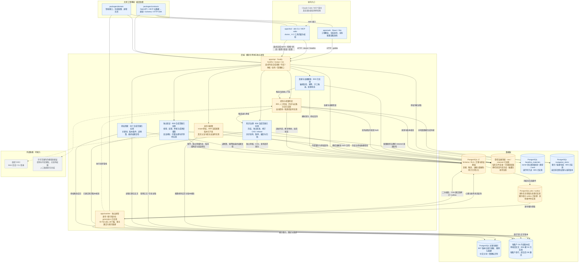
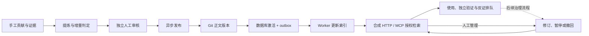

# AccreMind 项目架构总览

依据当前代码、README 和后端设计文档整理，日期：2026-09-14。

项目采用 TypeScript/pnpm Monorepo，运行架构为模块化单体 API + 独立 Worker，Web 和 CLI/MCP 为访问入口。下图同时标注工程现状与目标设计：蓝色为已实现的基础，黄色为部分实现，灰色为待实现；实线为现有调用，虚线为规划调用或依赖。

## 核心业务闭环（B08 合成范围已贯通）

发布先准备 Git 正文版本，再通过数据库事务激活；索引是可重建的派生数据。暂停、撤回或撤权后，检索在返回前重新检查数据库中的权威状态与权限，不能仅依赖旧索引。

Web 检索表单和真实宿主接入仍待实现。新搜索、命中结果的重传及返回前最终检查均要求当前发布的索引 ready；直接读取已发布正文使用独立预算与授权检查，可以在索引重建期间使用。

## 关键边界与现状

- Web 和工具端只通过 API 访问业务，不直接写数据库、Git 或证据存储。
- API 与 Worker 分进程、使用不同数据库角色；业务模块不拆成独立微服务。
- 默认 HTTP 只有无内容权限的 loopback 合成身份；显式开启 B03 固定合成主体后支持接收与证据读取，真实 Cookie/Bearer 凭据仍被拒绝。生产模式尚不能启动。
- MCP 工具校验输入与输出，默认返回 UNAUTHENTICATED；显式合成开关下检索、读取、贡献状态、使用、验证、反馈、配置七个工具经真实 HTTP 调用 API，ingest-knowledge 未就绪。
- B03/B05/B06 贡献、判定、审核发布、B07 检索、B08 验证和 B09 配置已实现；Worker 只处理发布与索引，反证任务已排队但未处理。真实身份、宿主配置安装、完整治理与其他 outbox 投递未完成。
- MVP 使用 PostgreSQL 任务表与关键词索引；向量库、专用消息队列及自动发布不是首版前置条件。

## 依据

- [项目说明](../../README.md)
- [后端架构设计](03-后端架构设计.md)
- [API 路由](../../apps/api/src/app.ts)
- [B06 验证记录](verification/2026-09-14-b06-review-publication.md)
- [B07 验证记录](verification/2026-09-14-b07-retrieval.md)
- [B08 验证记录](verification/2026-09-14-b08-independent-validation.md)
- [B09 验证记录](verification/2026-09-14-b09-configuration.md)
- [授权基础](../../apps/api/src/authorization.ts)
- [Worker 入口](../../apps/worker/src/main.ts)
- [MCP Bridge](../../apps/tool/src/bridge.ts)
- [阶段 C 基础验证](verification/2026-09-14-phase-c-foundation.md)
