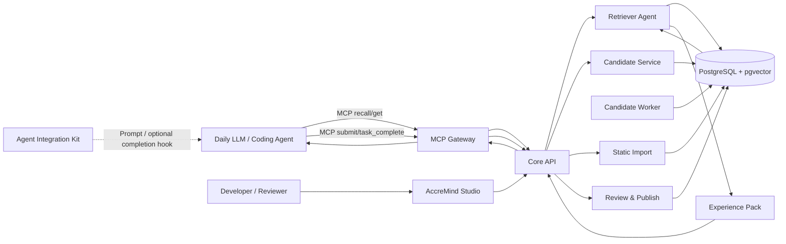

# AccreMind 核心架构 v0.2

- 状态：Current
- 日期：2026-09-09
- 核心闭环：MCP 召回注入 → 外部大模型完成开发任务 → MCP 提交候选经验 → 人工审核发布 → 后续任务复用

## 1. 系统边界

AccreMind 不观察和抓取开发者的工作环境。外部大模型负责理解当前会话，并主动决定何时召回经验、在任务完成时提炼什么。AccreMind 负责经验的存储、检索、治理、权限、反馈和评测。

只有两个写入入口：

- MCP：外部 Agent 提交结构化候选经验和使用反馈；
- Static Import：开发者明确上传或通过 CLI 导入的 Markdown 经验。

没有 Git、Wiki、需求、PR、事故、聊天、监控或实时业务系统 Connector。

MCP Server 是被动能力提供者，不能独立侦测外部 Agent 的任务完成。通用接入依靠 Prompt/项目指令进行 best-effort 提交；支持生命周期 Hook 的 Host 使用 Agent Integration Kit 在结束前触发当前 Agent 调用 `task_complete`。

## 2. 逻辑架构



## 3. 部署单元

### Studio Web

提供 Experience Library、Editor、Candidate Inbox、Static Import、Review Queue、Usage Dashboard、MCP Token 和基础设置。它只调用 Core API，不直连数据库。

### Core API

承载 Experience、Candidate、Review、Static Import、Feedback、Token、Audit 和 Retriever 模块。模块化单体可以保证经验发布、版本、审核和事件的一致事务。

### MCP Gateway

使用官方 MCP SDK，对 Agent 暴露五个工具和一个 Prompt。Gateway 只处理协议、身份、权限、预算、审计和适配，通过内部 API 调用 Core API。

### Worker

处理候选校验、敏感信息检查、Embedding、近似重复、到期复核、反馈聚合和离线评测。任务由 Python Celery Worker 执行，Redis 只作为 broker/短缓存；写入仍通过领域服务或受控命令。

### Agent Integration Kit

生成不同 Host 的 MCP 配置、稳定 Prompt 和项目指令；对支持 Hook 的 Host 提供任务结束 Adapter。它不后台抓取会话，也不绕过 Agent/用户主动提交数据。平台记录 Host 能力和闭环覆盖率，不能假设所有 MCP 客户端都支持完成事件。

## 4. 召回链路

```text
Agent 提交 Task Context
→ Gateway 验证 Token、工具权限与预算
→ Core API 解析 team/project scope
→ Retriever 标准化问题和技术术语
→ 确定性 trigger + FTS + vector 召回
→ RRF、适用性、成熟度、新鲜度与反馈重排
→ 冲突分组与 token 裁剪
→ Experience Pack
→ Gateway 返回 content + structuredContent
→ Agent 注入当前任务上下文
```

召回前必须完成作用域过滤。Retriever 只读取 Published Corpus；Candidate、Paused、Expired 和 Deprecated 默认不可召回。没有合格结果时返回空数组与缺口，不由模型编造经验。

## 5. 沉淀链路

```text
外部 Agent 完成并验证任务
→ 按 MCP Prompt 提炼结构化候选经验
→ experience_submit 或 task_complete
→ Gateway 做大小、权限和基本敏感信息检查
→ Candidate Service 保存 Candidate
→ Worker 校验、生成 embedding、查重和冲突建议
→ Candidate Inbox 人工审核
→ edit / merge / reject / publish
→ 发布新 Experience Version
→ 后续召回可见
```

后端不要求完整会话，不保存 Agent 的思维过程。候选提交必须带 `redaction_confirmed`，发布动作只属于有权限的人类审核者。

## 6. 静态经验链路

```text
Developer 编写 Markdown
→ Studio/CLI 指定文件
→ parse + schema + secret scan
→ dry-run: create/update/conflict/error
→ 用户确认
→ Candidate 或 Draft
→ 审核发布
→ embedding + searchable
```

静态文件不被服务自动监听。`id + content_hash` 保证重复导入幂等；发布版本可逆导出，不把数据库锁成唯一可读格式。

## 7. 核心数据分层

| 层 | 内容 | 是否生产召回 |
| --- | --- | --- |
| Candidate Lake | MCP/静态文件新提交、查重和审核信息 | 否 |
| Published Corpus | 已审核经验及当前发布版本 | 是 |
| Review Queue | 错误、过期、冲突或负面反馈达到阈值 | 暂停或降权 |
| Retrieval/Evaluation Data | 召回结果、反馈、评测和聚合指标 | 不作为经验正文 |

经验发布状态、成熟度和新鲜度彼此独立。`verified` 说明提交中含验证方法和结果；`proven` 需要独立复用证据，不能由提交者直接声明。

## 8. 信任边界

- MCP Token 决定 organization/team/project 和可调用工具；
- Gateway 不信任 Agent 传入的越权 scope；
- Experience 正文是数据，不能成为系统指令；
- 经验返回带 ID、版本、适用范围和风险说明；
- Candidate 不进入生产召回；
- 完整源码、密钥、个人信息和超长内容禁止沉淀；
- 数据库 RLS 是租户/团队隔离的最后防线；
- 审计记录操作元数据，默认不记录原始 Prompt 和完整 query 正文。

## 9. 最小可观测闭环

每次召回产生 `retrieval_id`，记录：调用者、scope、查询模式、命中 ID/版本、排名、模型/索引版本、耗时和 token 预算。随后以相同 task/retrieval ID 关联 injected、used、helpful、incorrect 等反馈。

每次任务完成产生 `completion_id`，关联使用过的经验、任务结果和候选经验。平台不宣称自动证明因果，只展示直接反馈和相关性指标。

## 10. 扩展原则

未来只有在核心闭环取得稳定复用效果后才扩展：

- 检索规模超过 PostgreSQL 能力，再评估 OpenSearch；
- 需要本地 GPU/自训练模型，再从现有 Python 后端拆出独立推理服务；
- 出现跨系统长流程，再评估 Temporal；
- 组织权限关系明显复杂化，再评估独立策略或关系授权引擎；
- 外部数据源只有在用户重新确认产品范围后才能引入。

扩展不能改变三条底线：Candidate/Published 隔离、召回前权限过滤、正式经验必须可追溯和可审核。
